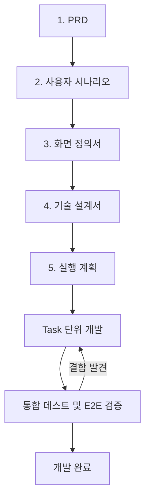

# AI 에이전틱 개발 가이드

이 저장소는 **요구사항을 문서로 정의하고, 확정된 문서를 근거로 AI가 Task 단위로 개발하는 방식**의 프로젝트 기본 템플릿이다.

사람은 프로젝트 방향과 요구사항을 결정하고 문서를 검토·승인한다. AI는 확정된 문서를 바탕으로 구현 계획을 수립하며, 서브에이전트와 스킬을 활용해 개발 및 테스트를 수행한다.

문서 작성 자체가 목적이 되지 않도록 불필요한 산출물은 최소화하고, 실제 개발에 필요한 정보만 관리한다.

## 1. 전체 개발 프로세스



각 문서는 앞 단계의 확정된 내용을 기준으로 작성한다. 개발 과정에서 요구사항이 변경되면 관련 문서를 함께 수정하며, 코드와 문서 사이에 불일치가 발생하지 않도록 관리한다.

## 2. 저장소 구성

| 경로                | 역할                                                |
| ------------------- | --------------------------------------------------- |
| `.claude/CLAUDE.md` | 프로젝트 최상위 개발 지침                           |
| `.claude/agents/`   | 분석, 설계, 개발, 테스트 등을 담당하는 서브에이전트 |
| `.claude/skills/`   | Task 단위 개발을 수행하는 스킬                      |
| `.mcp.json`         | 프로젝트에서 사용할 MCP 서버 설정                   |
| `docs/`             | 요구사항 및 설계 문서                               |
| `prompts/`          | 문서 생성 및 개발용 프롬프트                        |
| `backend/`          | 백엔드 소스 코드                                    |
| `frontend/`         | 프론트엔드 소스 코드                                |
| `test/e2e/`         | 통합 테스트 결과 및 스크린샷                        |

프로젝트 성격에 따라 디렉터리 구조를 변경할 수 있다. 백엔드와 프론트엔드를 별도로 구성하지 않는 프로젝트에서는 해당 구조를 강제하지 않는다.

## 3. 프로젝트 시작 전 준비

1. 기본 템플릿 저장소를 복사하여 새로운 프로젝트를 생성한다.
2. `.claude/CLAUDE.md`에 프로젝트명, 목적, 기술 스택, 디렉터리 구조 및 개발 규칙을 작성한다.
3. `.mcp.json`에서 필요한 MCP 서버만 활성화한다.
4. `.claude/agents/`의 서브에이전트 역할과 모델을 프로젝트 규모에 맞게 조정한다.
5. `docs/`에 기존 문서가 있다면 먼저 분석하고, 없는 문서부터 순서대로 작성한다.

이미 작성된 문서가 있다면 처음부터 다시 작성하지 않는다. 기존 문서를 검토하고 부족한 부분만 보완한다.

## 4. 문서 작성 순서

기본 산출물은 PRD, 사용자 시나리오, 화면 정의서, 기술 설계서, 실행 계획의 5개 문서다.

| 순서 | 산출물                           | 주요 내용                                       | 담당 에이전트                |
| ---- | -------------------------------- | ----------------------------------------------- | ---------------------------- |
| 1    | `docs/1-PRD.md`                  | 목표, 기능 요구사항, 비교 규칙, 비기능 요구사항 | business-analyst             |
| 2    | `docs/2-user-scenario.md`        | 정상·예외 시나리오, 사용자 행동, 시스템 반응    | business-analyst             |
| 3    | `docs/3-screen-specification.md` | 화면 구성, 와이어프레임, UI 동작, 입력 검증     | ui-designer                  |
| 4    | `docs/4-technical-design.md`     | 아키텍처, 기술 스택, DB 구조, API, 처리 방식    | backend-expert, api-designer |
| 5    | `docs/5-plan.md`                 | 개발 Task, 우선순위, 의존성, 완료 조건          | 메인 에이전트                |

문서 파일명은 프로젝트 시작 시 확정하고, 기존 파일이 있다면 불필요하게 이름을 변경하지 않는다. 다른 문서에서 참조하는 경로도 실제 파일명과 일치해야 한다.

### 4.1 PRD

프로젝트에서 무엇을 개발할 것인지 정의한다. 개발 배경과 목표, 주요 사용자, 기능 요구사항, 비기능 요구사항, 핵심 업무 규칙, MVP 범위 및 제외 기능을 포함한다.

기능 요구사항은 `FR-xx`, 비기능 요구사항은 `NFR-xx`로 관리한다. 각 요구사항에는 우선순위와 확정 여부를 명시한다.

### 4.2 사용자 시나리오

PRD를 기준으로 사용자가 프로그램을 사용하는 과정을 정의한다. 정상적인 업무 흐름뿐 아니라 오류 발생, 데이터 누락, 입력값 검증 등의 예외 상황을 포함한다.

각 시나리오는 `SN-xx`로 관리하며 관련 PRD 요구사항을 연결한다. 실제 사용자 행동과 시스템 반응을 구분하여 작성한다.

### 4.3 화면 정의서

사용자 시나리오를 기반으로 실제 화면의 구조와 동작을 정의한다. 별도의 와이어프레임 문서를 만들지 않고 화면 정의서에 통합한다.

화면별로 레이아웃, UI 구성 요소, 버튼 동작, 입력값 검증, 오류 메시지, 화면 상태 및 전환 흐름을 작성한다.

각 화면은 `SC-xx`로 관리하고 관련 사용자 시나리오와 기능 요구사항을 연결한다.

필요한 경우 HTML 또는 React 기반 UI 프로토타입을 별도로 생성하여 검토할 수 있다. 프로토타입은 화면 정의서를 검증하기 위한 보조 산출물로 취급한다.

### 4.4 기술 설계서

실제 구현 방법을 정의한다. 기존의 구조 설계 원칙, 아키텍처 설계서, ERD, API 설계 내용을 하나의 문서로 통합한다.

기술 설계서에는 다음 내용을 포함한다.

- **기술 스택:** 백엔드, 프론트엔드, DBMS, 주요 라이브러리 및 버전
- **시스템 아키텍처:** 애플리케이션 구성, 레이어 구조, 컴포넌트 간 의존 관계
- **데이터 설계:** 기존 DB 활용 방식, 신규 테이블 필요 여부, 데이터 조회 및 처리 구조
- **API 설계:** 주요 API 목록, 요청·응답 구조, 공통 오류 처리
- **핵심 처리 로직:** 업무 규칙을 구현하는 알고리즘 및 데이터 흐름
- **개발 원칙:** 네이밍, 예외 처리, 로깅, 보안, 테스트 규칙
- **실행 및 배포:** 로컬 실행, 환경별 설정, 빌드 및 실행 방법

신규 테이블이 필요한 경우 ERD와 `schema.sql`을 별도 파일로 생성한다. 기존 DB를 조회하기만 하는 프로그램이라면 불필요한 신규 테이블이나 ERD를 만들지 않는다.

API가 많거나 프론트엔드와 백엔드를 병렬 개발해야 하는 경우에는 `swagger.yaml` 또는 OpenAPI 명세를 별도 파일로 분리할 수 있다.

### 4.5 실행 계획

확정된 문서를 바탕으로 실제 개발 작업을 Task 단위로 분할한다.

각 Task에는 작업 ID, 작업 내용, 선행 Task, 참조 문서 및 요구사항 ID, 구현 범위, 테스트 방법, 완료 조건을 작성한다.

Task는 하나의 개발 스킬 실행에서 처리할 수 있는 크기로 나누며, 완료 조건은 가능하면 테스트로 검증할 수 있도록 작성한다.

## 5. 문서 작성 및 검토 규칙

각 문서는 앞 단계 문서를 기준으로 작성하며, 사람이 검토하고 확정한 뒤 다음 단계로 진행한다.

문서 간 중복된 내용을 반복하지 않고 관련 ID로 참조한다. 기존 문서와 충돌하는 내용이 발견되면 임의로 수정하지 않고 충돌 사항과 수정 방향을 제안한다.

### 단계별 검토 기준

| 문서            | 주요 검토 사항                                            |
| --------------- | --------------------------------------------------------- |
| PRD             | 개발 목표, 기능 범위, 우선순위, 업무 규칙이 명확한가      |
| 사용자 시나리오 | 정상·예외 흐름과 경계값이 정의되어 있는가                 |
| 화면 정의서     | 모든 핵심 시나리오가 화면에 반영되어 있는가               |
| 기술 설계서     | 구조가 과도하게 복잡하지 않고 요구사항을 구현할 수 있는가 |
| 실행 계획       | Task 크기가 적절하고 완료 조건을 검증할 수 있는가         |

## 6. 개발 진행 방식

### 6.1 실행 계획 작성

`5-plan.md`에 개발 작업을 Task 단위로 작성한다. 기본 Task 유형은 다음과 같다.

| 유형  | 의미                                 |
| ----- | ------------------------------------ |
| SETUP | 프로젝트 초기 설정 및 개발 환경 구성 |
| DB    | DB 연결 및 데이터 접근 기능          |
| BE    | 백엔드 로직 및 API 개발              |
| FE    | 프론트엔드 화면 개발                 |
| INT   | 통합 테스트 및 E2E 검증              |

Task ID는 `BE-01`, `FE-01`, `INT-01`과 같이 관리한다. 프로젝트에 해당하지 않는 유형은 생략할 수 있다.

### 6.2 착수 전 확인

개발 시작 전에 PRD, 사용자 시나리오, 화면 정의서, 기술 설계서의 미결 사항을 확인한다.

개발에 영향을 미치는 미결 사항은 실행 계획에 `D-xx`로 정리하고 해결한 뒤 개발한다. 구현과 무관한 경미한 사항까지 모두 확정할 필요는 없다.

### 6.3 Task 단위 개발

메인 에이전트는 실행 계획을 읽고 선행 Task가 완료된 작업부터 개발 스킬에 전달한다.

```text
/develop-backend BE-01
/develop-frontend FE-01
```

각 개발 스킬은 관련 문서와 요구사항 ID를 확인한 뒤 구현 범위를 분석하고, 필요한 코드를 작성하며 테스트를 수행한다.

개발 절차는 다음과 같다.

1. Task와 참조 문서를 확인한다.
2. 기존 코드와 영향 범위를 분석한다.
3. 구현 방법과 테스트 항목을 결정한다.
4. 코드를 구현하고 자동화 테스트를 수행한다.
5. 오류 발생 시 원인을 분석하고 수정한다.
6. 완료 조건을 충족하면 Task를 완료 처리한다.

독립적인 Task는 병렬로 진행할 수 있지만, 같은 파일을 수정하거나 선행 관계가 있는 Task는 충돌을 방지하도록 순서를 조정한다.

스킬 실행 중 문제가 발생하면 최대 3회까지 수정 및 재검증을 시도한다. 이후에도 실패하면 원인과 미충족 조건을 보고하고 Task를 미완료 상태로 유지한다.

테스트를 수행하지 못한 항목은 완료된 것으로 표시하지 않는다.

### 6.4 통합 테스트

핵심 기능 개발이 완료되면 전체 애플리케이션을 실행하고 사용자 시나리오 기반의 통합 테스트를 수행한다.

웹 애플리케이션은 Playwright 등을 활용해 주요 화면과 사용자 행동을 자동 검증할 수 있다.

주요 검증 대상은 정상 처리, 입력 검증, 오류 처리, 화면 전환, 데이터 정합성, 주요 성능 기준이다.

테스트 결과는 `test/e2e/report.md`에 기록하고 필요한 경우 스크린샷 및 오류 로그를 보관한다. 테스트 데이터와 로그에 비밀번호, 인증 정보, 민감한 운영 데이터가 포함되지 않도록 한다.

## 7. 문서 공통 규칙

### 7.1 문서 형식

모든 문서는 Markdown 형식으로 작성한다. 제목과 문단 중심으로 구성하며, 불필요한 줄바꿈이나 지나치게 세분화된 목록을 피한다.

모든 문서에는 버전 이력과 변경 이력을 포함한다.

```markdown
# 문서 제목

## 버전 이력

| 버전 | 일자       | 작성자 | 상태 | 요약      |
| ---- | ---------- | ------ | ---- | --------- |
| v0.1 | YYYY-MM-DD | 작성자 | 초안 | 최초 작성 |

## 변경 이력

| 버전 | 일자       | 변경 섹션 | 구분 | 변경 내용 | 작성자 |
| ---- | ---------- | --------- | ---- | --------- | ------ |
| v0.1 | YYYY-MM-DD | 전체      | 신규 | 최초 작성 |
```

기존 문서를 수정할 때는 버전을 올리고 변경 내용을 기록한다. 문서의 기준이 되는 상위 문서와 버전도 함께 명시한다.

### 7.2 ID 관리

| 접두어                           | 의미                     | 정의 문서       |
| -------------------------------- | ------------------------ | --------------- |
| `G`                              | 프로젝트 목표            | PRD             |
| `FR`                             | 기능 요구사항            | PRD             |
| `NFR`                            | 비기능 요구사항          | PRD             |
| `R`                              | 리스크                   | PRD             |
| `SN`                             | 사용자 시나리오          | 사용자 시나리오 |
| `SC`                             | 화면 ID                  | 화면 정의서     |
| `TD`                             | 기술 설계 결정           | 기술 설계서     |
| `SETUP`, `DB`, `BE`, `FE`, `INT` | 개발 Task                | 실행 계획       |
| `D`                              | 개발 착수 전 결정 사항   | 실행 계획       |
| `PA`, `SA`, `WA` 등              | 문서별 가정 및 미결 사항 | 각 문서         |

ID는 문서 내에서 고유해야 하며, 삭제된 ID를 다시 사용하지 않는다. 기존 문서에 이미 사용된 ID가 있다면 해당 ID를 유지한다.

### 7.3 가정 및 미결 사항

문서 작성 중 확인되지 않은 사항은 문서 마지막 장에 기록한다.

| ID    | 구분 | 내용                         |
| ----- | ---- | ---------------------------- |
| SA-01 | 미결 | 확인해야 하는 사항           |
| SA-02 | 가정 | 현재 가정하고 있는 처리 방식 |

상태는 `가정`, `미결`, `확정`, `해결`로 구분한다. 개발 착수에 영향을 미치는 미결 사항은 실행 계획에서 관리한다.

### 7.4 문서 동기화

상위 문서의 요구사항이 변경되면 관련 하위 문서를 검토하고 필요한 부분을 수정한다.

개발 도중 기존 설계와 다른 구현이 필요해진 경우에는 변경 사유와 영향 범위를 검토한 뒤 해당 문서를 갱신한다.

문서를 업데이트할 때는 기존 요구사항 ID와 확정된 업무 규칙을 임의로 삭제하거나 변경하지 않는다.

## 8. AI 에이전트 운영 원칙

### 8.1 역할 분담

| 에이전트         | 담당 역할                                      |
| ---------------- | ---------------------------------------------- |
| business-analyst | 요구사항 분석, PRD, 사용자 시나리오            |
| ui-designer      | 화면 정의서, 와이어프레임, UI/UX 검토          |
| backend-expert   | 백엔드 아키텍처 및 구현                        |
| frontend-expert  | 프론트엔드 설계 및 구현                        |
| api-designer     | API 설계 및 명세                               |
| security-auditor | 보안 관련 검토                                 |
| 메인 에이전트    | Task 분배, 작업 조율, 결과 검증 및 문서 동기화 |

에이전트를 무조건 모두 사용하지 않는다. 작업 성격에 맞는 에이전트만 선택하며, 간단한 작업은 메인 에이전트가 직접 처리할 수 있다.

### 8.2 개발 원칙

AI는 확정된 문서를 근거로 개발하고, 문서에 없는 기능을 임의로 추가하지 않는다. 요구사항 해석이 모호하거나 설계 변경이 필요한 경우에는 사람에게 확인을 요청한다.

기존 코드를 수정할 때는 영향 범위를 분석하고, 불필요한 리팩터링이나 관계없는 파일 수정을 피한다.

각 Task를 완료하기 전에 테스트 결과를 확인하며, 검증에 실패한 상태에서는 완료 처리하지 않는다.

### 8.3 보안 원칙

DB 접속 정보, API Key, 인증서, 비밀번호 등은 소스 코드와 Git 저장소에 포함하지 않는다.

운영 데이터는 사전에 허가된 범위에서만 조회하며, 읽기 전용 작업을 기본으로 한다. 로그와 테스트 결과에도 비밀정보나 민감정보가 남지 않도록 한다.

특히 운영 DB 접근이나 데이터 복호화가 필요한 기능은 보안 관련 요구사항을 우선 적용한다.

## 9. 운영 팁

프롬프트는 가능한 한 간결하게 작성하고, 상세한 프로젝트 맥락은 `docs/` 문서를 참조하도록 한다. 동일한 요구사항을 여러 프롬프트에 반복해서 작성하지 않는다.

문서 작성 후에는 기존 문서와 비교하여 요구사항 누락, ID 불일치, 기능 범위 충돌이 있는지 검토한다. 실제 사용한 프롬프트는 `prompts/`에 보관하여 다음 프로젝트에서도 재사용할 수 있도록 한다.

개발 Task의 체크박스는 완료 조건을 실제로 검증한 뒤 체크한다. 확인할 수 없는 항목은 완료로 처리하지 않고 사유를 기록한다.

**최종 목표는 많은 문서를 만드는 것이 아니라, 최소한의 문서로 요구사항을 정확하게 관리하고 AI가 안정적으로 개발할 수 있는 환경을 구축하는 것이다.**
