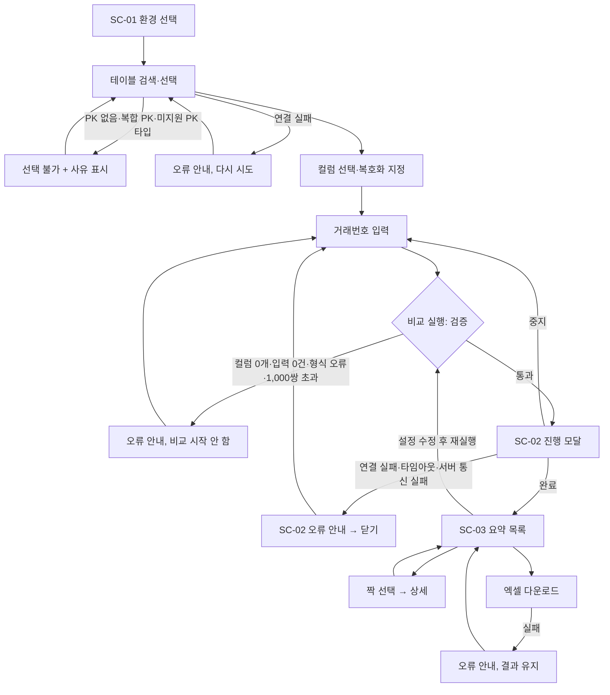

# 화면 정의서: DataMatch

## 버전 이력

| 버전 | 일자       | 작성자 | 상태 | 요약      |
| ---- | ---------- | ------ | ---- | --------- |
| v0.1 | 2026-11-09 | Claude | 초안 | 최초 작성 |
| v0.2 | 2026-11-09 | Claude | 초안 | 문서 간 비교 검토 결과 반영(장 번호 정리, 기준 문서 버전 갱신) |
| v0.3 | 2026-11-09 | Claude | 초안 | 추가 확인 사항 WA-01~09를 제안대로 확정(WA-07은 기술 설계서로 이관) |
| v1.0 | 2026-11-09 | Claude | 확정 | 사용자 검토·승인으로 확정. 기준 PRD v1.0, 시나리오 v1.0 |
| v1.1 | 2026-11-09 | Claude | 확정 | 기술 설계서 승인에 따라 WA-07을 해결로 변경, 기준 PRD v1.1, 시나리오 v1.1 |
| v1.2 | 2026-11-09 | Claude | 확정 | 서버 통신 불가 안내 문구(WA-10)와 지원하지 않는 PK 타입 안내 추가, 기준 PRD v1.2, 시나리오 v1.2 |
| v1.3 | 2026-11-09 | Claude | 확정 | 숫자 PK 입력 오류(WA-12)와 후보 30건 초과 안내(WA-11)를 추가하고 기준 시나리오를 v1.3으로 갱신(문서 간 비교 검토) |
| v1.4 | 2026-11-09 | Claude | 확정 | 최종 검토 결과 반영(진행 예시 수치, 서버 통신 실패 흐름 표기, 기준 시나리오 v1.4) |
| v1.5 | 2026-11-09 | Claude | 확정 | WA-11·WA-12 문구 확정, 이전 비교 진행 중 안내(WA-13) 추가, 기준 PRD v1.3·시나리오 v1.5 |

## 변경 이력

| 버전 | 일자       | 변경 섹션 | 구분 | 변경 내용 | 작성자 |
| ---- | ---------- | --------- | ---- | --------- | ------ |
| v0.1 | 2026-11-09 | 전체      | 신규 | 최초 작성 | Claude |
| v0.2 | 2026-11-09 | 머리말, 1~6장 | 수정 | 다른 문서와 맞춰 장 번호를 1~6장으로 정리하고 내부 참조("4.4", "4.6")를 수정, 기준 문서를 PRD v0.8, 시나리오 v0.4로 갱신 | Claude |
| v0.3 | 2026-11-09 | 머리말, 6장 | 수정 | WA-01~06, 08, 09를 확정으로 변경하고 WA-07은 미결로 유지하되 대규모 스키마의 테이블 자동완성 후보 개수·입력 지연을 WA-07로 이동, 머리말의 '제안' 설명 수정 | Claude |
| v1.0 | 2026-11-09 | 전체, 머리말 | 수정 | 문서 상태를 초안에서 확정으로 변경하고 기준 문서를 PRD v1.0, 시나리오 v1.0으로 갱신(내용 변경 없음) | Claude |
| v1.1 | 2026-11-09 | 머리말, 2·4·6장 | 수정 | WA-07을 해결로 변경하고 기술 설계서 결정(TD-13, TD-14, TD-16, TD-17)을 참조하도록 문구 수정, 누락 색을 호박색으로 확정, 기준 문서를 PRD v1.1, 시나리오 v1.1로 갱신 | Claude |
| v1.2 | 2026-11-09 | 머리말, 2·4·6장 | 추가 | SC-01 테이블 선택 불가 사유에 "지원하지 않는 PK 타입" 추가(PA-19), SC-02 오류 표와 4장 오류 메시지 정책에 서버 통신 불가 문구 추가, WA-10 신설, 기준 문서를 PRD v1.2, 시나리오 v1.2로 갱신 | Claude |
| v1.3 | 2026-11-09 | 머리말, 2장(SC-01 오류 표), 6장 | 추가 | PRD PA-19와 기술 설계서 TD-07에서 정해졌으나 화면 정의에 없던 두 가지 문구(숫자 PK 입력 오류, 후보 초과 안내)를 SC-01 오류 표와 WA-11·WA-12로 추가하고 기준 시나리오를 v1.3으로 갱신 | Claude |
| v1.4 | 2026-11-09 | 머리말, 1·2·3장 | 수정 | SC-02 진행 예시를 청크(100쌍) 단위 갱신에 맞는 수치(200/500, 40%)로 고치고 갱신 단위를 설명, 1장 화면 목록과 3장 전환 흐름에 이미 확정된 서버 통신 실패(WA-10) 경로를 표기, 기준 시나리오를 v1.4로 갱신 | Claude |
| v1.5 | 2026-11-09 | 머리말, 1장, 2장(SC-01 오류 표), 6장 | 수정 | WA-11·WA-12를 가정에서 확정으로 변경, 시나리오 SA-11에 따른 이전 비교 진행 중 문구를 SC-01 오류 표와 WA-13으로 추가, WA-10에 SA-10 참조 추가, SC-01 관련 시나리오에 SN-E01 추가, 기준 문서를 PRD v1.3·시나리오 v1.5로 갱신 | Claude |

> 구분: 신규 / 추가 / 수정 / 삭제. 버전을 올릴 때는 '버전 이력'에 한 줄을 추가하고, 세부 변경 사항은 '변경 이력'에 섹션 단위로 기록한다.

> 본 문서는 `1-PRD.md`(v1.3)와 `2-user-scenario.md`(v1.5)를 기준으로 한다. 요구사항과 규칙은 FR, NFR, SN, PA, SA ID로 참조하고 이 문서에서 다시 정의하지 않는다. **확정**은 PRD·시나리오 또는 사용자가 결정한 사항, 이 문서에서 처음 정한 화면 동작은 6장의 WA-xx로 관리하며 모두 확정 또는 해결되었다. 구현 코드, API, DB 설계는 다루지 않는다.

## 1. 화면 목록

DataMatch는 페이지 이동 없이 한 페이지 안에서 설정, 진행, 결과가 이어지는 단일 페이지 웹 프로그램이다. 데스크톱 웹을 우선으로 하고, 상단 환경 바는 스크롤해도 항상 보이도록 고정한다. 아래 세 화면은 별도 페이지가 아니라 한 페이지를 구성하는 영역이다.

| 화면 ID | 화면명         | 화면 유형                | 주요 기능                                                                          | 관련 사용자 시나리오                  |
| ------- | -------------- | ------------------------ | ---------------------------------------------------------------------------------- | ------------------------------------- |
| SC-01   | 거래 비교 설정 | 페이지 본문(상단 영역)   | 환경 선택, 테이블 검색·선택, 컬럼 선택, 복호화 지정, 거래번호 입력·검증, 비교 실행 | SN-01~SN-03, SN-E01~SN-E03            |
| SC-02   | 비교 진행 상태 | 모달                     | 진행률 표시, 비교 중지, 연결 실패·타임아웃·서버 통신 실패 안내                      | SN-01, SN-E01                         |
| SC-03   | 비교 결과      | 페이지 본문(하단 영역)   | 짝별 요약 목록, 컬럼·필드별 A값·B값 상세, 엑셀 다운로드                            | SN-01~SN-04, SN-E04                   |

전체 배치는 아래와 같다. 환경 바는 SC-01에 속하며 페이지 상단에 고정된다.

```text
┌ 환경 바(고정) ─────────────────────────────────────────────────────────┐
│ A쪽 [테스트 ▾]   B쪽 [운영 ▾] ⚠ 운영 DB                                 │
├ SC-01 거래 비교 설정 ──────────────────────────────────────────────────┤
│ 테이블, 컬럼, 거래번호 입력, [비교 실행]                                │
├ SC-03 비교 결과 (비교 완료 후 표시) ───────────────────────────────────┤
│ 요약 목록 │ 상세                                        [엑셀 다운로드]│
└────────────────────────────────────────────────────────────────────────┘
   SC-02 진행 모달: 비교 실행 시 화면 중앙에 표시
```

## 2. 화면별 상세 정의

### SC-01. 거래 비교 설정

SC-01은 비교할 환경, 테이블, 컬럼, 거래번호를 정하고 비교를 실행하는 화면이다. 프로그램을 실행하면 처음 보이는 화면이며, 사전 조건은 개발·테스트·운영 접속 정보가 properties에 준비되어 있고 담당자 PC에서 각 DB에 접근할 수 있는 것이다(PA-08). 관련 요구사항은 FR-01~FR-06, NFR-01, NFR-07이고 관련 시나리오는 SN-01~SN-03, SN-E02, SN-E03이다.

```text
┌ 환경 바 ───────────────────────────────────────────────────────────────┐
│ A쪽 환경 [선택 ▾]   B쪽 환경 [선택 ▾]         (운영 선택 시 ⚠ 운영 DB)  │
├────────────────────────────────────────────────────────────────────────┤
│ 테이블   [스키마.테이블 검색 ____________▾]   선택: PAYZONE.TB_TRX  PK: TRX_NO │
│                                                                        │
│ 컬럼  [컬럼 검색 ______]  [전체 선택] [전체 해제]                       │
│  ┌──┬──────────┬──────────┬──────────────────┐                        │
│  │☑ │ 컬럼명   │ 타입     │ SafeDB 복호화    │                        │
│  │☑ │ AMOUNT   │ NUMBER   │ -                │                        │
│  │☑ │ APPR_MSG │ CLOB     │ ☑ 정책 [KDKEY ▾] │                        │
│  └──┴──────────┴──────────┴──────────────────┘                        │
│                                                                        │
│ 거래번호  (한 줄에 거래번호A,거래번호B)                                 │
│  ┌──────────────────────────────────────┐   입력 3쌍 / 최대 1,000쌍     │
│  │ T001,P001                            │   오류 0줄                   │
│  │ T002,P002                            │                              │
│  └──────────────────────────────────────┘             [비교 실행]      │
└────────────────────────────────────────────────────────────────────────┘
```

| 요소 ID | 요소명                 | UI 유형                  | 초기값                  | 필수 | 동작 및 설명                                                                                                                                       |
| ------- | ---------------------- | ------------------------ | ----------------------- | ---- | -------------------------------------------------------------------------------------------------------------------------------------------------- |
| SC01-01 | A쪽 환경               | 드롭다운(개발/테스트/운영) | 선택 안 함 (WA-01)    | 필수 | 거래번호A를 조회할 환경이다. 테이블·컬럼 정보도 이 환경에서 조회한다(PA-15). 운영을 선택하면 SC01-03을 강조한다                                    |
| SC01-02 | B쪽 환경               | 드롭다운(개발/테스트/운영) | 선택 안 함 (WA-01)    | 필수 | 거래번호B를 조회할 환경이다. A쪽과 같아도 된다                                                                                                     |
| SC01-03 | 운영 환경 표시         | 배지                     | 숨김                    | -    | A쪽 또는 B쪽이 운영이면 해당 쪽 옆에 "운영 DB" 경고 배지를 눈에 띄는 색으로 표시한다(NFR-07)                                                       |
| SC01-04 | 테이블 검색            | 자동완성 입력            | 비어 있음               | 필수 | A쪽 환경이 선택되어야 활성화된다. 입력하면 일치하는 `스키마.테이블` 후보를 보여주고, PK가 없거나 복합 PK이거나 지원하지 않는 PK 타입인 테이블은 선택 불가와 사유를 함께 표시한다(PA-10, PA-19) |
| SC01-05 | 선택 테이블·PK 표시    | 읽기 전용 텍스트         | 비어 있음               | -    | 선택한 테이블과 자동 인식한 PK 컬럼명을 보여준다                                                                                                   |
| SC01-06 | 컬럼 검색              | 텍스트 입력              | 비어 있음               | 선택 | 입력한 글자가 컬럼명에 포함된 컬럼만 목록에 표시한다. 선택 상태는 검색을 지워도 유지한다                                                           |
| SC01-07 | 전체 선택/전체 해제    | 버튼 2개                 | 활성(테이블 선택 후)    | 선택 | 현재 목록에 보이는 컬럼에만 적용한다(WA-04). 해제된 컬럼의 복호화 지정은 함께 해제한다                                                             |
| SC01-08 | 컬럼 목록              | 표(체크박스, 컬럼명, 타입, 복호화 지정) | 모두 미선택 | 필수(1개 이상) | 체크박스로 비교 컬럼을 고른다. PK 컬럼은 "PK" 표시와 함께 목록에 포함한다(WA-02)                                                         |
| SC01-09 | SafeDB 복호화 지정     | 체크박스 + 정책 드롭다운 | 미지정, 정책 KDKEY      | 선택 | CLOB 컬럼이면서 비교 컬럼으로 선택된 행에서만 활성화된다. 체크하면 정책 드롭다운(KDKEY/PANEN)이 활성화된다(FR-04)                                  |
| SC01-10 | 거래번호 입력          | 여러 줄 텍스트 영역      | 비어 있음               | 필수 | 한 줄에 `거래번호A,거래번호B`를 쉼표 또는 탭으로 구분해 입력하거나 붙여넣는다. 위에서부터 A1-B1, A2-B2 순서로 짝을 맺는다(FR-05)                    |
| SC01-11 | 입력 현황              | 텍스트                   | "입력 0쌍 / 최대 1,000쌍" | -  | 입력 중 실시간으로 유효한 쌍 수와 오류 줄 수를 표시한다. 1,000쌍을 넘으면 경고색으로 바꾼다                                                         |
| SC01-12 | 입력 오류 안내         | 텍스트 목록              | 숨김                    | -    | 형식 오류 줄을 줄 번호와 사유로 표시한다                                                                                                           |
| SC01-13 | 비교 실행              | 기본 버튼                | 비활성                  | -    | 활성 조건은 4장의 버튼 정책을 따른다. 클릭하면 입력을 검증하고 통과하면 SC-02를 띄운다                                                             |

**사용자 인터랙션**

| 사용자 행동                          | 시스템 반응                                                                                                                                              |
| ------------------------------------ | -------------------------------------------------------------------------------------------------------------------------------------------------------- |
| A쪽 환경을 선택한다                  | 해당 환경에 연결해 테이블을 조회할 수 있는 상태로 만든다. 테이블이 이미 선택되어 있으면 선택을 유지하고 컬럼 정보를 다시 조회한다(WA-05). 연결 실패 시 오류를 안내한다 |
| B쪽 환경을 선택한다                  | 선택한 환경을 표시한다. 테이블·컬럼 정보에는 영향이 없다                                                                                                 |
| 테이블 이름 일부를 입력한다          | 일치하는 `스키마.테이블` 후보를 자동완성으로 보여준다                                                                                                    |
| 테이블을 선택한다                    | 컬럼명·타입 목록과 PK를 표시하고, 이전에 선택했던 컬럼 선택과 복호화 지정은 초기화한다                                                                  |
| 컬럼을 체크하거나 검색·전체 선택한다 | 선택 상태를 반영한다. CLOB 컬럼이 선택되면 복호화 지정을 활성화한다                                                                                      |
| 복호화를 체크하고 정책을 고른다      | 해당 컬럼을 SafeDB 복호화 대상으로 표시한다. 정책은 KDKEY가 기본이다                                                                                     |
| 거래번호를 입력하거나 붙여넣는다     | 입력 중 쌍 수와 오류 줄을 즉시 갱신해 SC01-11, SC01-12에 표시한다                                                                                        |
| [비교 실행]을 누른다                 | 입력을 다시 검증한다. 통과하면 SC-02 모달을 띄우고 비교를 시작한다. 실패하면 첫 번째 오류 위치로 이동해 메시지를 표시하고 비교를 시작하지 않는다         |

**입력값 검증 및 오류 처리**

| 상황                                  | 처리 방식                                                  | 사용자 안내 메시지                                                                                   | 근거          |
| ------------------------------------- | ---------------------------------------------------------- | ---------------------------------------------------------------------------------------------------- | ------------- |
| 환경 연결 실패(테이블 조회 단계)      | 오류 표시, 다시 시도 가능                                  | "{환경} DB에 연결하지 못했습니다. 접속 설정을 확인한 뒤 다시 시도해 주세요."                         | SA-01         |
| 조회 가능한 테이블이 없음             | 테이블 검색 아래에 빈 상태 안내                            | "조회할 수 있는 테이블이 없습니다. 접속 계정의 조회 권한을 확인해 주세요."                           | SA-02         |
| 검색어와 일치하는 테이블이 없음       | 후보 영역에 안내                                           | "검색어와 일치하는 테이블이 없습니다."                                                               | WA-08         |
| 검색 결과가 30건을 넘음 | 후보 30건만 표시하고 안내 | "검색 결과가 많아 일부만 표시합니다. 검색어를 더 입력해 주세요." | TD-07, WA-11 |
| PK 없음 / 복합 PK / 지원하지 않는 PK 타입              | 선택 불가로 표시하고 사유 표시                             | "PK가 없어 비교할 수 없습니다." / "복합 PK 테이블은 지원하지 않습니다." / "PK 컬럼 타입을 지원하지 않아 비교할 수 없습니다."                              | PA-10, PA-19   |
| 환경 미선택                           | 비교 실행 비활성, 보조 문구 표시                           | "A쪽과 B쪽 환경을 모두 선택해 주세요."                                                               | FR-01         |
| 비교 컬럼 미선택                      | 비교를 시작하지 않고 안내                                  | "비교할 컬럼을 하나 이상 선택해 주세요."                                                             | SA-03         |
| 거래번호 입력 없음                    | 비교를 시작하지 않고 안내                                  | "거래번호를 입력해 주세요."                                                                          | SA-04         |
| 구분자 없음                           | 오류 줄 표시, 비교 시작 불가                               | "{n}번째 줄: 쉼표나 탭으로 거래번호A와 거래번호B를 구분해 주세요."                                   | PA-17         |
| 거래번호A 또는 B가 비어 있음          | 오류 줄 표시, 비교 시작 불가                               | "{n}번째 줄: 거래번호{A 또는 B}가 비어 있습니다."                                                    | PA-17         |
| 한 줄에 구분자가 2개 이상             | 오류 줄 표시, 비교 시작 불가                               | "{n}번째 줄: 한 줄에는 거래번호 두 개만 입력할 수 있습니다."                                         | WA-03         |
| 숫자 PK 테이블에 숫자가 아닌 거래번호 | 오류 줄 표시, 비교 시작 불가 | "{n}번째 줄: 거래번호{A 또는 B}는 숫자여야 합니다." | PA-19, WA-12 |
| 입력 오류가 하나라도 있음             | 비교 실행 시 전체 비교 중단, 상단 요약 안내                | "입력 형식 오류가 있어 비교를 시작할 수 없습니다. 표시된 줄을 수정해 주세요."                        | PA-17         |
| 1,000쌍 초과                          | 전체 거절                                                  | "입력한 거래 쌍이 1,000건을 초과했습니다(현재 {n}쌍). 1,000쌍 이하로 나누어 입력해 주세요."         | PA-17, NFR-01 |
| 이전 비교가 서버에서 진행 중 | 비교를 시작하지 않고 안내(진행 모달 열지 않음) | "이전 비교가 아직 진행 중입니다. 잠시 후 다시 시도해 주세요." | SA-11, WA-13 |

**화면 상태**

| 상태          | 조건                          | 화면 표시                                                                                  |
| ------------- | ----------------------------- | ------------------------------------------------------------------------------------------ |
| 초기          | 프로그램 첫 실행              | 모든 입력 비어 있음, 테이블·컬럼·거래번호 영역은 선행 입력 전까지 비활성, 비교 실행 비활성 |
| 로딩 중       | 테이블·컬럼 조회 중           | 해당 영역에 로딩 표시, 다른 영역 조작은 가능                                               |
| 정상 입력     | 필수 입력 충족                | 비교 실행 활성                                                                             |
| 입력 오류     | 형식 오류 줄 존재             | 오류 줄 안내 표시, 오류 줄 수 강조                                                         |
| 조회 오류     | 연결 실패, 테이블 없음        | 해당 영역에 오류 또는 빈 상태 안내                                                         |
| 비교 실행 중  | SC-02 표시 중                 | 설정 영역 전체 조작 불가(모달이 가림)                                                      |
| 비교 실패     | 연결 실패·타임아웃·중지       | SC-02 닫힘 또는 오류 상태 → 입력값 유지한 채 SC-01로 복귀                                  |

### SC-02. 비교 진행 상태

SC-02는 비교가 실행되는 동안 진행 상황을 보여주고 중지하거나 실패 원인을 안내하는 모달이다. 접근 경로는 SC-01의 [비교 실행] 클릭이고, 사전 조건은 입력 검증을 통과한 것이다. 관련 요구사항은 FR-06, NFR-01, NFR-02이고 관련 시나리오는 SN-01, SN-E01이다. 모달은 비교 중 설정 변경을 자연스럽게 막기 위한 선택이며, 실제 진행률 산정과 중지 처리 방식은 기술 설계서에서 정했다(TD-13, TD-14). 처리 건수는 청크(기본 100쌍)가 끝날 때마다 갱신되므로 100쌍 이하의 입력은 완료 시점에 한 번에 100%가 된다(TD-08).

```text
┌─────────────── 비교 진행 중 ───────────────┐
│  ██████████░░░░░░░░░░░░░  40%              │
│  처리 200 / 전체 500쌍                      │
│                              [비교 중지]   │
└────────────────────────────────────────────┘
```

| 요소 ID | 요소명         | UI 유형        | 초기값             | 필수 | 동작 및 설명                                                                                                          |
| ------- | -------------- | -------------- | ------------------ | ---- | --------------------------------------------------------------------------------------------------------------------- |
| SC02-01 | 제목           | 텍스트         | "비교 진행 중"     | -    | 상태에 따라 "비교 중지 중", "비교 실패"로 바뀐다                                                                      |
| SC02-02 | 진행 바·퍼센트 | 진행 바        | 0%                 | -    | 처리 완료 쌍 수를 전체 쌍 수로 나눈 비율을 표시한다                                                                   |
| SC02-03 | 처리 건수      | 텍스트         | "처리 0 / 전체 N쌍" | -   | 처리 완료 쌍 수와 입력한 전체 쌍 수를 표시한다                                                                        |
| SC02-04 | 비교 중지      | 버튼           | 활성               | -    | 클릭하면 비교를 취소하고 결과를 만들지 않는다(PA-18). 취소가 끝날 때까지 "비교 중지 중..."을 표시하고 버튼은 비활성화한다 |
| SC02-05 | 오류 메시지    | 텍스트         | 숨김               | -    | 연결 실패·타임아웃이 발생하면 진행 표시를 오류 내용으로 바꾼다                                                        |
| SC02-06 | 닫기           | 버튼           | 숨김               | -    | 오류 상태에서만 표시한다. 누르면 모달을 닫고 SC-01로 돌아간다                                                         |

**사용자 인터랙션**

| 사용자 행동           | 시스템 반응                                                                                                                  |
| --------------------- | ---------------------------------------------------------------------------------------------------------------------------- |
| (모달이 열림)         | 비교를 시작하고 처리 건수를 갱신한다. 모달 바깥을 눌러도 닫히지 않는다                                                       |
| [비교 중지]를 누른다  | 비교를 취소하고 모달을 닫는다. SC-01에 "비교를 중지했습니다. 결과는 저장되지 않았습니다."를 알리고 입력값은 유지한다(SA-07) |
| [닫기]를 누른다(오류) | 모달을 닫고 SC-01로 복귀한다. 입력값은 유지한다                                                                              |

**입력값 검증 및 오류 처리**

| 상황               | 처리 방식                                              | 사용자 안내 메시지                                                                                         | 근거          |
| ------------------ | ------------------------------------------------------ | ---------------------------------------------------------------------------------------------------------- | ------------- |
| DB 연결 실패       | 전체 비교 실패, 부분 결과 없음                         | "{A쪽 또는 B쪽}({환경}) DB에 연결하지 못했습니다. 접속 설정을 확인한 뒤 다시 시도해 주세요."              | PA-17, SN-E01-1 |
| 조회 타임아웃      | 전체 비교 실패, 부분 결과 없음                         | "DB 조회 시간이 제한(30초)을 넘어 비교를 중단했습니다. 거래번호 건수를 줄이거나 잠시 후 다시 시도해 주세요." | PA-17, NFR-02 |
| 비교 중지          | 취소, 결과 없음                                        | "비교를 중지했습니다. 결과는 저장되지 않았습니다."                                                         | PA-18         |
| 서버 통신 실패(서버 종료, 폴링 실패) | 진행 모달을 오류 상태로 바꾸고 [닫기]를 제공한다. 입력값은 유지한다 | "서버와 연결할 수 없습니다. 프로그램이 실행 중인지 확인해 주세요." | WA-10 |

**화면 상태**

| 상태        | 화면 표시                                                                    |
| ----------- | ---------------------------------------------------------------------------- |
| 비교 실행 중 | 진행 바와 처리 건수를 갱신하고 [비교 중지]를 활성화한다                      |
| 중지 중     | 제목을 "비교 중지 중"으로 바꾸고 [비교 중지]를 비활성화한다                  |
| 비교 실패   | 오류 메시지와 [닫기]를 표시한다                                              |
| 비교 완료   | 모달을 자동으로 닫고 SC-03에 결과를 표시한다                                 |

### SC-03. 비교 결과

SC-03은 비교가 끝난 뒤 짝별 판정을 요약해 보여주고, 짝을 선택하면 컬럼·필드별 A값과 B값을 나란히 확인하며, 결과를 엑셀로 내려받는 화면이다. 비교가 완료되면 SC-01 아래에 표시되고, 새 비교를 실행하면 이전 결과를 새 결과로 대체한다(SA-08). 관련 요구사항은 FR-07, FR-08, FR-09이고 관련 시나리오는 SN-01~SN-04, SN-E04이다.

```text
┌ 결과 ── A=테스트 / B=운영 · PAYZONE.TB_TRX · 컬럼 3개 ──── [엑셀 다운로드]┐
│ 총 3쌍 · 일치 1 · 불일치 1 · 누락 1                                      │
├ 요약 목록 ─────────────────────┬ 상세: T002 - P002 ──────────────────────┤
│  1  T001 - P001   일치          │ 컬럼·필드        A값(테스트)  B값(운영)  │
│▶ 2  T002 - P002   불일치(1)  ←  │ AMOUNT           1000         1000       │
│  3  T003 - P003   누락(B 없음)  │ APPR_MSG.order_no  X1        X9    ← 빨강 │
│                                 │ APPR_MSG.amount    1000      1000       │
└─────────────────────────────────┴─────────────────────────────────────────┘
```

| 요소 ID | 요소명              | UI 유형               | 초기값                  | 필수 | 동작 및 설명                                                                                                                                      |
| ------- | ------------------- | --------------------- | ----------------------- | ---- | ------------------------------------------------------------------------------------------------------------------------------------------------- |
| SC03-01 | 비교 조건 표시      | 텍스트                | 비교 당시 조건          | -    | A쪽·B쪽 환경, 테이블, 선택 컬럼 수를 표시한다. 설정을 바꿔도 이 값은 결과 기준으로 유지한다(SA-09)                                                |
| SC03-02 | 판정 건수 요약      | 텍스트                | 비교 결과               | -    | 총 쌍 수와 일치·불일치·누락 건수를 표시한다(WA-06)                                                                                                |
| SC03-03 | 엑셀 다운로드       | 버튼                  | 결과가 있으면 활성      | -    | 클릭하면 요약과 상세를 엑셀 파일로 내려받는다. 다운로드 중에는 비활성화하고 로딩을 표시한다(FR-09)                                                 |
| SC03-04 | 요약 목록           | 목록(선택 가능)       | 첫 번째 짝 선택         | -    | 행마다 순번, `거래번호A - 거래번호B`, 판정 배지를 표시한다. 불일치는 불일치 컬럼·필드 수를, 누락은 없는 쪽을 괄호로 표시한다. 행을 누르면 상세로 전환한다 |
| SC03-05 | 상세 패널           | 표(컬럼·필드, A값, B값) | 선택한 짝의 상세        | -    | 선택한 짝의 비교 컬럼별 A값·B값을 나란히 보여준다. 복호화 컬럼은 JSON 필드별 행으로 펼쳐 `컬럼명.필드명`으로 표시한다. 일치 항목도 모두 표시한다   |
| SC03-06 | 상태 표시           | 배지/강조색           | -                       | -    | 불일치 항목과 복호화 오류는 빨간색, 일치는 기본색, 누락은 빨강과 구분되는 별도 색으로 표시하고 항상 텍스트 라벨을 함께 둔다(4장)                    |
| SC03-07 | 긴 값 펼치기        | 토글                  | 접힘                    | -    | 값이 길면 말줄임으로 접어 두고, 누르면 전체 값을 보여준다(4장)                                                                                    |

**사용자 인터랙션**

| 사용자 행동             | 시스템 반응                                                                                                              |
| ----------------------- | ------------------------------------------------------------------------------------------------------------------------ |
| (비교 완료)             | SC-02를 닫고 SC-03을 표시한다. 요약 목록의 첫 짝을 선택한 상태로 상세를 보여준다                                        |
| 요약 목록의 짝을 누른다 | 해당 짝의 상세로 전환한다. 불일치·오류 항목이 빨간색으로 보인다                                                          |
| 누락 짝을 누른다        | 상세에 누락 안내를 표시하고 컬럼 비교 표는 보여주지 않는다                                                              |
| 긴 값을 누른다          | 해당 값을 펼치거나 접는다                                                                                                |
| [엑셀 다운로드]를 누른다 | 요약과 상세를 담은 엑셀을 내려받게 한다. 화면과 같은 빨간색 강조를 적용하고 A쪽·B쪽 환경을 함께 기록한다(FR-09)          |
| 설정을 바꾸고 다시 비교한다 | 비교 실행 전까지 현재 결과를 유지하고, 새 비교가 시작되면 새 결과로 대체한다(SA-08, SA-09)                            |

**입력값 검증 및 오류 처리**

| 상황                          | 처리 방식                                                              | 사용자 안내 메시지                                                                       | 근거            |
| ----------------------------- | ---------------------------------------------------------------------- | ---------------------------------------------------------------------------------------- | --------------- |
| A 또는 B 거래가 없음          | 요약은 누락, 상세에 없는 쪽 표시. 나머지 짝은 계속 표시                | "B쪽(운영) DB에 해당 거래번호가 없습니다." (A쪽이 없으면 "A쪽(테스트) …")                | SN-E04-1        |
| A·B 거래가 모두 없음          | 누락, "A·B 모두 없음"으로 표시                                         | "A쪽과 B쪽 모두 해당 거래번호가 없습니다."                                               | SA-05           |
| 복호화 실패                   | 해당 컬럼만 빨간색 "복호화 오류", 나머지 컬럼은 정상 비교. 짝은 불일치 | "복호화 오류: 복호화에 실패했습니다."                                                    | SN-E04-3, PA-05 |
| 복호화 결과 JSON 해석 실패    | 위와 같음                                                              | "복호화 오류: 복호화 결과를 JSON으로 읽을 수 없습니다."                                  | SN-E04-4        |
| 엑셀 다운로드 실패            | 오류 안내, 화면 결과 유지, 다시 시도 가능                              | "엑셀 파일을 만들지 못했습니다. 잠시 후 다시 시도해 주세요. 비교 결과는 화면에 그대로 남아 있습니다." | SA-06           |

**화면 상태**

| 상태        | 조건                    | 화면 표시                                                                |
| ----------- | ----------------------- | ------------------------------------------------------------------------ |
| 미표시      | 비교 전, 실패, 중지     | SC-03 영역을 보여주지 않는다(이미 결과가 있으면 이전 결과 유지, SA-08)   |
| 비교 완료   | 결과 있음               | 요약 목록과 상세, [엑셀 다운로드] 활성                                   |
| 다운로드 중 | 엑셀 생성 중            | [엑셀 다운로드] 비활성, 로딩 표시                                        |
| 다운로드 실패 | 엑셀 실패             | 오류 안내 표시, 결과 화면 유지                                           |

## 3. 화면 전환 흐름

사용자는 환경을 고르고 테이블, 컬럼, 거래번호를 입력한 뒤 비교를 실행해 결과를 확인한다. 모든 단계가 한 페이지 안에서 이루어지며, 오류가 나면 SC-01로 돌아와 입력값을 유지한 채 수정한다.



비교 완료는 SC-02에서 SC-03으로의 유일한 정상 이동이며, SC-02가 자동으로 닫히면서 결과가 표시된다. 입력 오류, 중지, 연결 실패, 타임아웃은 모두 SC-01로 복귀하고 입력값을 유지한다(SA-07, SA-09). 엑셀 다운로드 실패는 SC-03에 머무른다.

## 4. 공통 UI/UX 정책

**버튼 활성화.** [비교 실행]은 A쪽·B쪽 환경이 모두 선택되고 테이블이 선택되어 있고 비교가 진행 중이 아닐 때 활성화한다. 컬럼 미선택, 거래번호 미입력, 입력 오류, 건수 초과는 활성 상태에서 클릭 시 검증해 안내한다(SA-03, SA-04, PA-17). [엑셀 다운로드]는 결과가 있고 다운로드 중이 아닐 때만 활성화한다. 컬럼의 [전체 선택/전체 해제]는 테이블을 선택한 뒤 활성화한다.

**로딩 표시.** 테이블·컬럼 조회처럼 짧은 대기는 해당 영역에 로딩 표시를 보여주고 다른 영역은 조작할 수 있게 둔다. 비교 실행은 SC-02 모달의 진행 바로 표시한다. 엑셀 생성은 버튼에 로딩을 표시한다.

**오류 메시지.** 입력 오류는 해당 입력 가까운 곳에 줄 번호와 사유를 보여주고, 연결·조회 오류는 발생한 영역 또는 SC-02 안에서 안내한다. 메시지에는 원인과 사용자가 할 수 있는 조치를 함께 쓴다. 서버와 통신할 수 없을 때(프로그램 종료, 응답 없음)는 현재 영역에 "서버와 연결할 수 없습니다. 프로그램이 실행 중인지 확인해 주세요."를 표시하고 입력값은 유지한다(WA-10). 비밀번호, 접속 URL, 복호화된 평문 같은 민감정보는 메시지에 넣지 않는다(NFR-05).

**운영 환경 경고.** A쪽 또는 B쪽이 운영이면 환경 바의 해당 환경 옆에 "운영 DB" 경고 배지를 눈에 띄는 색으로 표시한다. 환경 바는 스크롤해도 항상 보이며, 비교 결과 머리글에도 환경명을 함께 표시한다(NFR-07, FR-08). 경고 외에 추가 확인 팝업은 띄우지 않는다.

**일치·불일치·누락 표현.** 불일치 항목과 복호화 오류는 빨간색으로 강조한다(FR-08). 일치는 기본색으로 표시한다. 누락은 빨강과 구분되는 별도의 색(호박색)을 쓴다(기술 설계서 TD-17). 색만으로 구분하지 않도록 "일치", "불일치", "누락", "복호화 오류" 텍스트 라벨을 항상 함께 표시하고, 엑셀에도 같은 라벨과 빨간색을 적용한다.

**입력값 유지.** 같은 페이지에서는 환경, 테이블, 컬럼 선택, 복호화 지정, 거래번호 입력을 유지한다. 입력 오류, 비교 실패, 중지 후에도 유지하며, 브라우저를 새로고침하거나 다시 열면 초기화한다(SA-07, SA-09). 설정을 바꿔도 이전 결과는 다음 비교 실행 전까지 유지하고 SC03-01에 비교 당시 조건을 표시한다. 단, 새 테이블을 선택하면 컬럼 선택과 복호화 지정은 초기화한다.

**긴 데이터와 JSON 표시.** 값 칸은 정해진 높이까지만 보이고 넘치면 말줄임으로 접은 뒤, 눌러서 전체 값을 펼친다. 줄바꿈은 보존하고 값은 선택해 복사할 수 있게 한다. 복호화한 JSON은 하나의 긴 문자열이 아니라 필드마다 한 행으로 펼쳐 `컬럼명.필드명`으로 표시한다. 한쪽에만 키가 있으면 없는 쪽은 NULL로 보고(PA-04) 값 칸에 "(NULL)"을 회색으로 표시한다(WA-09).

**엑셀 다운로드.** 결과가 있을 때만 [엑셀 다운로드]를 활성화하고, 누르면 브라우저 다운로드로 파일을 저장한다. 요약과 상세를 포함하고 화면과 같은 빨간색 강조를 적용하며 A쪽·B쪽 환경을 함께 기록한다(FR-09). 불일치만 보기 필터는 MVP에서 제외되므로 화면의 필터 상태와 무관하게 전체 결과를 담는다. 파일명과 시트 구성은 기술 설계서(TD-16)를 따른다.

## 5. 요구사항 추적표

| 요구사항 | 내용                      | 화면                      | 사용자 시나리오                  | 반영 위치                                       |
| -------- | ------------------------- | ------------------------- | -------------------------------- | ----------------------------------------------- |
| FR-01    | 환경별 DB 연결            | SC-01                     | SN-01, SN-02, SN-E01             | SC01-01~03                                      |
| FR-02    | 테이블 검색·선택          | SC-01                     | SN-01, SN-02, SN-E01, SN-E02     | SC01-04, SC01-05                                |
| FR-03    | 컬럼 조회·선택            | SC-01                     | SN-01, SN-02, SN-E02             | SC01-06~08 (컬럼 검색, 전체 선택/해제 포함)     |
| FR-04    | 복호화 컬럼 지정          | SC-01                     | SN-03                            | SC01-09                                         |
| FR-05    | 거래번호 짝 입력          | SC-01                     | SN-01, SN-02, SN-E03             | SC01-10~12                                      |
| FR-06    | 비교 실행·진행 표시       | SC-01, SC-02              | SN-01, SN-02, SN-E01, SN-E04     | SC01-13, SC02-01~06                             |
| FR-07    | 복호화 및 JSON 필드 비교  | SC-03                     | SN-03, SN-E04                    | SC03-05 (필드별 행), 복호화 오류 표시           |
| FR-08    | 결과 요약·상세 화면       | SC-03                     | SN-01~SN-03, SN-04               | SC03-01, 03-02, 03-04~07                        |
| FR-09    | 엑셀 다운로드             | SC-03                     | SN-04, SN-E04                    | SC03-03                                         |
| NFR-01·02 | 건수 상한, 타임아웃      | SC-01, SC-02              | SN-E01, SN-E03                   | SC01-11, SC02-05                                |
| NFR-07   | 운영 환경 경고            | SC-01, SC-03              | SN-01, SN-02                     | SC01-03, SC03-01                                |

MVP 요구사항 FR-01~FR-09는 모두 화면에 반영되었고 누락된 항목은 없다. 시나리오는 SN-01~SN-04, SN-E01~SN-E04가 모두 어느 화면에서 일어나는지 연결된다. FR-10(불일치만 보기), FR-11(설정 저장), 엑셀 업로드, 중첩 JSON 펼치기, 복합 PK는 포함하지 않았다.

## 6. 추가 확인 사항

시나리오의 SA-01~SA-11은 모두 확정되었고 화면에는 다음 위치에 반영했다. SA-01, SA-02는 SC-01의 연결 실패·빈 상태 안내, SA-03, SA-04는 SC-01의 검증 메시지, SA-05, SA-06은 SC-03의 누락·엑셀 실패 안내, SA-07~SA-09는 입력값 유지와 결과 대체 정책(4장), SA-10과 SA-11은 서버 통신 불가와 이전 비교 진행 중 안내(WA-10, WA-13)이다. 아래는 PRD와 시나리오에 정의가 없어 이 문서에서 정한 화면 동작이며, 모두 확정 또는 해결되었다. WA-07은 기술 설계서(TD-07, TD-13, TD-14, TD-16, TD-17)에서 해결했다.

| ID    | 구분 | 내용                                                                                                                                                  |
| ----- | ---- | ----------------------------------------------------------------------------------------------------------------------------------------------------- |
| WA-01 | 확정 | A쪽·B쪽 환경 드롭다운의 초기값은 "선택 안 함"이다. 운영 DB를 실수로 조회하지 않도록 기본값을 두지 않는다                                              |
| WA-02 | 확정 | PK 컬럼도 컬럼 목록에서 비교 컬럼으로 선택할 수 있다(PRD는 "PK는 키로 사용"까지만 정의). 환경 간 비교에서는 거래번호가 달라 대부분 불일치로 나온다        |
| WA-03 | 확정 | 거래번호 입력은 값의 앞뒤 공백을 제거하고, 빈 줄은 무시하며, 한 줄에 구분자가 2개 이상이면 형식 오류로 본다                                           |
| WA-04 | 확정 | 컬럼 [전체 선택/전체 해제]는 검색으로 걸러져 보이는 컬럼에만 적용하고, 해제된 컬럼의 복호화 지정도 함께 해제한다                                       |
| WA-05 | 확정 | A쪽 환경을 바꾸면 선택한 테이블을 유지하고 컬럼 정보만 다시 조회한다(두 환경의 구조가 같다, PA-15). 새 테이블을 고르면 컬럼 선택은 초기화한다              |
| WA-06 | 확정 | 결과 머리글에 총 쌍 수와 일치·불일치·누락 건수를 보여준다. 건수 요약은 PRD에 없는 보조 표시다                                                          |
| WA-07 | 해결 | 누락 상태의 색, 엑셀 파일명·시트 구성, 진행률 산정 방식, 중지 처리, 테이블 자동완성 후보 개수와 입력 지연은 기술 설계서에서 결정했다(TD-07, TD-13, TD-14, TD-16, TD-17) |
| WA-08 | 확정 | 검색어와 일치하는 테이블이 없을 때 "검색어와 일치하는 테이블이 없습니다."를 표시한다                                                                  |
| WA-09 | 확정 | NULL 값은 "(NULL)"을 회색으로 표시한다                                                                                                                |
| WA-10 | 확정 | 서버와 통신할 수 없을 때(SA-10. 프로그램 종료, 폴링·API 호출 실패)의 공통 안내 문구는 "서버와 연결할 수 없습니다. 프로그램이 실행 중인지 확인해 주세요."이며, 발생한 영역(SC-01 입력 영역 또는 SC-02 모달)에 표시하고 입력값은 유지한다 |
| WA-11 | 확정 | 테이블 검색 후보가 30건을 넘을 때(기술 설계서 TD-07, API의 `truncated`)의 안내 문구는 "검색 결과가 많아 일부만 표시합니다. 검색어를 더 입력해 주세요."이다 |
| WA-12 | 확정 | NUMBER PK 테이블에 숫자가 아닌 거래번호를 입력했을 때(PRD PA-19)의 오류 문구는 "{n}번째 줄: 거래번호{A 또는 B}는 숫자여야 합니다."이다. PK 타입은 컬럼 조회 결과로 알 수 있으므로 입력 중 실시간 검증에도 같은 문구를 쓴다 |
| WA-13 | 확정 | 비교 실행 시 서버에 이전 비교가 아직 진행 중이면(시나리오 SA-11, API `JOB_RUNNING`) SC-01의 [비교 실행] 근처에 "이전 비교가 아직 진행 중입니다. 잠시 후 다시 시도해 주세요."를 표시하고 진행 모달은 열지 않는다 |
