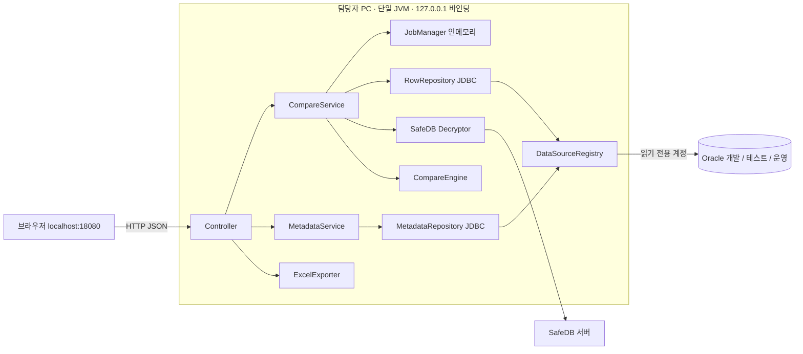
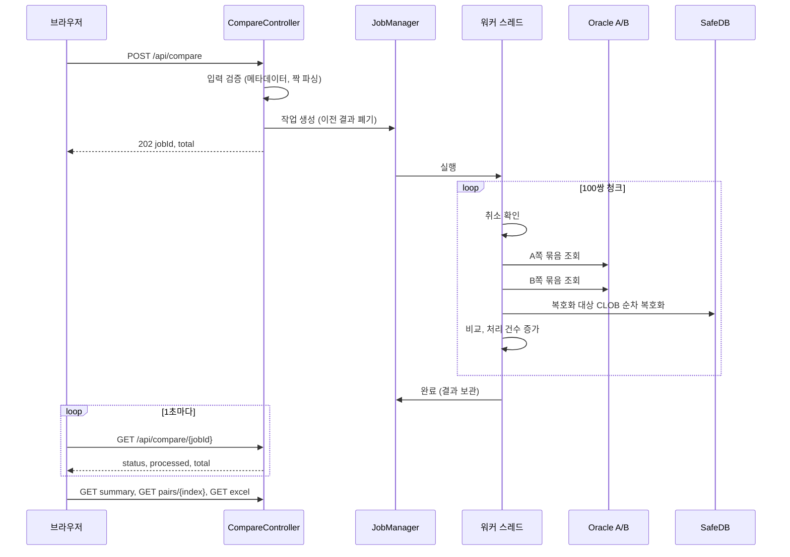

# 기술 설계서: DataMatch

## 버전 이력

| 버전 | 일자       | 작성자 | 상태 | 요약      |
| ---- | ---------- | ------ | ---- | --------- |
| v0.1 | 2026-11-09 | Claude | 초안 | 최초 작성 |
| v0.2 | 2026-11-09 | Claude | 초안 | Node.js 24.16.0 설치 완료 반영 |
| v0.3 | 2026-11-09 | Claude | 초안 | TA-04, TA-12 확정 반영(PRD PA-19, 화면 정의서 WA-10), 기준 문서 버전 갱신 |
| v1.0 | 2026-11-09 | Claude | 확정 | 사용자 검토·승인으로 확정. 개발 중 검증할 TA 항목(TA-01~03, 05~11, 13)은 실행 계획의 Task로 관리 |
| v1.1 | 2026-11-09 | Claude | 확정 | 기준 문서 버전 갱신(시나리오 v1.3, 화면 정의서 v1.3). 설계 내용 변경 없음 |
| v1.2 | 2026-11-09 | Claude | 확정 | 최종 검토 결과 반영(후보 초과 판정 쿼리 정정, API 오류 코드 보완, 경로·문구 정리) |
| v1.3 | 2026-11-09 | Claude | 확정 | 패키지명 확정(D-05)과 `JOB_RUNNING` 화면 안내 참조 반영, 기준 문서 버전 갱신 |
| v1.4 | 2026-11-09 | Claude | 확정 | 로컬 Oracle을 통합·E2E 테스트에 적극 사용하도록 10장 테스트 전략 갱신 |
| v1.5 | 2026-11-09 | Claude | 확정 | 사전 확인 결과 반영(SafeDB 설정 탐색, 로그인 대기 시간, 작업 단위 로그인), 외부망 개발 PC 명시 |
| v1.6 | 2026-11-10 | Claude | 확정 | SETUP-01·02에서 고정한 라이브러리 버전을 2장에 반영 |
| v1.7 | 2026-11-10 | Claude | 확정 | SETUP-04 결과를 TA-01에 기록 |
| v1.8 | 2026-11-10 | Claude | 확정 | BE-01 결과 반영(error 패키지, 오류 코드별 HTTP 상태) |
| v1.9 | 2026-11-10 | Claude | 확정 | INT-03 실측 결과를 TA-09에 기록 |
| v1.10 | 2026-11-10 | Claude | 확정 | SafeDB jar를 Git에서 제외하도록 TD-04 변경(공개 저장소) |

## 변경 이력

| 버전 | 일자       | 변경 섹션 | 구분 | 변경 내용 | 작성자 |
| ---- | ---------- | --------- | ---- | --------- | ------ |
| v0.1 | 2026-11-09 | 전체      | 신규 | 최초 작성 | Claude |
| v0.2 | 2026-11-09 | 2장, 12장(TA-11) | 수정 | Node.js 24.16.0을 개발 PC에 설치한 사실을 반영하고, TA-11에서 Node 인식 확인 항목을 제거(SafeDB 스레드 안전성만 유지) | Claude |
| v0.3 | 2026-11-09 | 머리말, 5·6장, 12장(TA-04, TA-12) | 수정 | PK 타입 제한과 서버 통신 불가 문구가 상위 문서(PRD v1.2, 화면 정의서 v1.2)에서 확정된 데 맞춰 참조와 상태를 갱신하고 기준 문서 버전을 v1.2로 변경 | Claude |
| v1.0 | 2026-11-09 | 전체 | 수정 | 문서 상태를 초안에서 확정으로 변경(내용 변경 없음) | Claude |
| v1.1 | 2026-11-09 | 머리말 | 수정 | 시나리오·화면 정의서가 숫자 PK 입력 오류와 후보 초과 안내(TD-07, PA-19)를 반영해 v1.3이 된 데 맞춰 기준 문서 버전만 갱신 | Claude |
| v1.2 | 2026-11-09 | 머리말, 1장(1.1 TD-04, 1.2), 6.2, 8장, 9.3 | 수정 | `ROWNUM <= 30`으로는 30건 초과 여부를 알 수 없어 `ROWNUM <= 31`로 조회하고 31번째 행 존재 시 `truncated`로 정정, `/api/tables` 오류에 `INVALID_INPUT`(검색어 2자 미만) 추가, 중지 요청의 JSON 콘텐츠 타입 규칙 명시, TD-04의 jar 경로를 `backend/libs/safedb-lib/`로 통일, 1.2의 지난 버전 표기 삭제, 기준 문서 버전 갱신 | Claude |
| v1.3 | 2026-11-09 | 머리말, 4.1, 7.1 | 수정 | 실행 계획 D-05 확정에 따라 패키지명을 제안에서 확정으로 변경, 7.1에 `JOB_RUNNING`의 화면 안내(화면 정의서 WA-13) 참조 추가, 기준 문서를 PRD v1.3·시나리오 v1.5·화면 정의서 v1.5로 갱신 | Claude |
| v1.4 | 2026-11-09 | 10장 | 수정 | 사용자 요청에 따라 백엔드 통합 테스트를 개발 PC의 로컬 Oracle 전용 테스트 스키마로 필수 실행하고, E2E를 "가짜 DB" 대신 로컬 Oracle 테스트 스키마와 가짜 복호화로 수행하도록 변경, 다른 스키마를 변경하지 않는 원칙 추가 | Claude |
| v1.5 | 2026-11-09 | 1.1(TD-10), 2장, 3.2, 5장(FR-07), 7.3, 12장(TA-01·02·14) | 수정 | 2026-11-09 사전 확인 결과로 `SafeDBAccess.properties`의 classpath 탐색을 확인해 3.2와 TA-01을 갱신, SafeDB 서버 연결 불가 시 로그인이 약 110초 걸리는 것을 확인해 로그인을 작업 단위 1회로 제한하는 설계를 TD-10·5장에 추가하고 7.3에 중지 지연을 명시, 개발 PC가 외부망이라 실제 연동은 사내망 PC에서 검증함을 2장·TA-02에 기록, TA-14 추가 | Claude |
| v1.6 | 2026-11-10 | 2장 | 수정 | SETUP-01·02 수행 결과로 POI 5.2.5, Lombok 1.18.30, React 18.3.1, Vite 8.3.7, TypeScript 5.9.3, Vitest 5.1.0, Testing Library 16.3.3, jsdom 31.0.0을 기재(설계 결정 변경 없음) | Claude |
| v1.7 | 2026-11-10 | 12장(TA-01) | 수정 | SETUP-04에서 압축을 푼 배포 구조로 SafeDB 설정 탐색 규칙을 재현한 결과를 TA-01에 추가(남은 `SafeDBMap_config.xml` 위치 확인은 INT-04 M-10) | Claude |
| v1.8 | 2026-11-10 | 4.1, 8장 | 추가 | 하위 계층이 web을 참조하지 않도록 오류 코드·예외를 `error` 패키지에 두기로 하고 4.1에 반영, 실행 계획 PL-04에 따라 BE-01에서 정한 오류 코드별 HTTP 상태 표와 보안 필터용 코드(`FORBIDDEN_REQUEST` 403, `UNSUPPORTED_MEDIA_TYPE` 415)를 8장에 추가 | Claude |
| v1.9 | 2026-11-10 | 12장(TA-09) | 수정 | INT-03의 배포 zip 실측 결과(처리 시간, 최대 힙)를 TA-09 근거로 기록하고 초기값 유지를 명시 | Claude |
| v1.10 | 2026-11-10 | 1.1(TD-04), 4.1, 4.2 | 수정 | 원격 저장소가 공개 저장소이므로 상용 라이브러리인 SafeDB jar 9개를 Git에서 제외하고, `backend/libs/safedb-lib/README.txt`로 복사 방법을 안내하며 jar가 9개가 아니면 빌드를 중단하도록 변경 | Claude |

> 구분: 신규 / 추가 / 수정 / 삭제. 버전을 올릴 때는 '버전 이력'에 한 줄을 추가하고, 세부 변경 사항은 '변경 이력'에 섹션 단위로 기록한다.

> 본 문서는 `1-PRD.md`(v1.3), `2-user-scenario.md`(v1.5), `3-screen-specification.md`(v1.5)를 기준으로 한다. 확정된 요구사항(FR, NFR, PA)과 시나리오(SN), 화면(SC)은 ID로 참조하고 다시 정의하지 않는다. 이 문서에서 새로 정한 사항은 설계 결정 `TD-xx`로, 검증이 필요하거나 확정되지 않은 사항은 마지막 장의 `TA-xx`로 관리한다.

## 1. 설계 개요

이 문서는 확정된 요구사항을 어떤 구조로 구현할지 정한다. DataMatch는 담당자 PC에서 로컬로 실행하는 소규모 웹 애플리케이션이며, 브라우저에서 개발·테스트·운영 Oracle DB의 거래 데이터를 읽어 두 거래의 선택 컬럼을 비교한다. 신규 DB와 영구 저장소는 두지 않고, 작업 상태와 결과는 서버 메모리에서만 관리한다. 로그인, 비교 이력, 비교 설정 저장 등 MVP에 없는 기능은 설계하지 않는다. 구현 코드와 상세 클래스 설계는 이 문서의 범위가 아니며, Task 단위 개발 계획(`5-plan.md`)에서 구체화한다.

### 1.1 설계 결정 요약

| ID    | 결정                                                                                                  | 상세 |
| ----- | ----------------------------------------------------------------------------------------------------- | ---- |
| TD-01 | 런타임은 JDK 11, Spring Boot 2.7.18, Gradle 8.9(wrapper)로 한다(pgweb-boot와 동일 조합)               | 2장  |
| TD-02 | 모놀리식 단일 Spring Boot 애플리케이션이며 React 빌드 결과를 정적 리소스로 함께 서비스한다. 신규 DB·캐시·큐는 두지 않는다 | 3장  |
| TD-03 | 배포는 `datamatch.jar`, `lib/`, `config/`, `start.bat`을 담은 zip이다. 벤더 jar 호환성 때문에 단일 fat jar는 쓰지 않는다 | 3장  |
| TD-04 | SafeDB jar 9개는 pgweb-boot의 `libs/safedb-lib/`와 같이 `backend/libs/safedb-lib/`에 두고 빌드에 포함한다. jar는 상용 라이브러리이고 원격 저장소가 공개이므로 Git에서 제외하며, 빌드하는 PC에서 별도로 복사한다(`backend/libs/safedb-lib/README.txt`, 9개가 아니면 빌드 중단). SafeDB 설정 파일도 Git에서 제외한다 | 4장  |
| TD-05 | DB 접근은 JDBC `JdbcTemplate` + 환경별 HikariCP이며, 읽기 전용 계정과 SELECT 전용 SQL 생성기로 이중 방어한다 | 6장  |
| TD-06 | 환경 접속 정보는 `config/datamatch.properties`에 평문으로 두고(pgweb-boot와 동일) Git에서 제외한다. 예시 파일만 Git에 포함한다 | 6장  |
| TD-07 | 테이블·컬럼 메타데이터는 `ALL_*` 딕셔너리 뷰를 서버에서 검색한다. 자동완성은 입력 지연 300ms, 2자 이상, 후보 최대 30건이다 (WA-07) | 6장  |
| TD-08 | 비교는 100쌍 단위 청크 파이프라인으로 처리한다. 청크마다 A·B를 각각 묶음 조회하고 복호화·비교한 뒤 처리 건수를 올린다 | 6~7장 |
| TD-09 | 값 비교는 타입별로 정해진 문자열 변환 결과 기준이다(6.4)                                              | 6장  |
| TD-10 | 복호화는 `SimpleSafeDB` 어댑터이며 순차 처리한다. KDKEY는 EUC-KR, PANEN은 UTF-8로 디코딩한다. 로그인은 비교 작업마다 1회만 시도하고 실패하면 그 작업의 나머지 복호화는 즉시 복호화 오류로 처리한다 | 5장  |
| TD-11 | JSON은 Jackson으로 최상위 필드를 펼쳐 비교한다. 숫자는 BigDecimal로 읽어 표기 형식을 보존한다          | 5장  |
| TD-12 | 작업은 인메모리 `JobManager`가 관리하며 동시 실행은 1개, 보관하는 결과는 마지막 작업 1개다            | 7장  |
| TD-13 | 진행률은 Polling(1초)으로 전달한다 (WA-07)                                                             | 7장  |
| TD-14 | 중지는 취소 플래그와 JDBC `Statement.cancel()`로 처리하고 결과를 폐기한다 (WA-07, PA-18)              | 7장  |
| TD-15 | 완료 응답은 요약 목록이고, 짝 상세는 선택할 때 지연 조회한다                                          | 8장  |
| TD-16 | 엑셀은 Apache POI XSSF(메모리)로 만들며, 파일명은 `datamatch_{A환경}-{B환경}_{테이블}_{yyyyMMdd-HHmmss}.xlsx`, 시트는 "요약", "상세" 2개다 (WA-07) | 5장  |
| TD-17 | 누락 상태는 호박색(노란 계열)과 "누락" 라벨로 표시한다 (WA-07)                                        | 5장  |
| TD-18 | 프론트엔드는 React 18 + Vite + TypeScript이며 상태는 `useReducer`와 `useState`로 관리한다. 전역 상태 라이브러리와 UI 프레임워크는 쓰지 않는다 | 2, 4장 |
| TD-19 | 로컬 보안으로 서버를 `127.0.0.1`에 바인딩하고, Host·Origin 검증과 JSON 전용 요청 정책을 둔다           | 9장  |
| TD-20 | 로그에는 복호화 평문, 거래번호, 컬럼 값을 남기지 않는다. 로그 파일은 7일 보관한다                      | 9장  |
| TD-21 | 기본 포트는 18080, 힙은 512MB로 시작하며 설정으로 바꿀 수 있다                                        | 3장  |

### 1.2 문서 간 충돌 확인과 이전 제안의 정정

PRD, 시나리오, 화면 정의서 사이에 충돌은 없었다. 이 문서의 결정으로 화면 정의서의 WA-07(색상, 엑셀 구성, 진행률 산정, 중지 처리, 자동완성)이 해결되고 PRD의 PA-18(중지 시 결과 폐기)이 설계에 반영된다. 두 문서에도 이를 반영했다.

사용자와 합의한 과정에서 두 가지가 바뀌었다. 첫째, 초기 제안은 "단일 실행 jar"였으나, pgweb-boot에서 SafeDB 벤더 jar가 fat jar 안에서 실행된 적이 없고(운영은 JEUS가 제공, 로컬은 일반 classpath 실행) 벤더 암호화 라이브러리는 자체 jar 경로나 설정 파일을 읽는 경우가 있어서 분리형 zip으로 정했다(TD-03). 둘째, SafeDB jar를 4개라고 안내했으나 실제로는 9개이며 `SimpleSafeDB`는 `SafeDBClient_v2.3.20.jar`에 있다(TD-04).

## 2. 기술 스택

| 영역         | 기술                                   | 버전                              | 선정 이유                                                                                         |
| ------------ | -------------------------------------- | --------------------------------- | ------------------------------------------------------------------------------------------------- |
| 런타임       | Temurin JDK                            | 11 (개발 PC에 11.0.x 설치됨)      | pgweb-boot와 같은 조합으로 SafeDB 호환성이 확인된 환경. JDK 17 전환은 검증 후 별도 결정(TA-02)    |
| 프레임워크   | Spring Boot (web, jdbc)                | 2.7.18                            | pgweb-boot와 동일. 내장 Tomcat, Hikari, Jackson 포함                                              |
| 빌드         | Gradle wrapper                         | 8.9                               | pgweb-boot와 동일                                                                                 |
| DB 드라이버  | Oracle JDBC `ojdbc8`                   | Boot BOM 관리 버전                | pgweb-boot와 동일. 대상 Oracle 버전 호환은 TA-03에서 확인                                        |
| DB 접근      | `JdbcTemplate` + HikariCP              | Boot 관리 버전                    | 테이블·컬럼이 동적이라 JPA·MyBatis는 부적합. 서버가 SELECT를 직접 생성                           |
| JSON         | Jackson                                | Boot 관리 버전                    | 추가 의존성 없음                                                                                  |
| 엑셀         | Apache POI (`poi-ooxml`, XSSF)         | 5.2.5                             | 메모리 방식이라 평문이 임시 파일에 남지 않는다(TD-16)                                             |
| 보일러플레이트 | Lombok (compileOnly)                 | 1.18.30 (pgweb-boot와 동일)       | JDK 11에는 record가 없어 DTO 코드를 줄이기 위함. 사내 프로젝트에서 이미 사용                      |
| SafeDB       | `libs/safedb-lib/` jar 9개             | 현재 pgweb-boot 보유 버전         | 4.2절 참조                                                                                        |
| 프론트엔드   | React, Vite, TypeScript                | React 18.3.1, Vite 8.3.7(@vitejs/plugin-react 6.3.0), TypeScript 5.9.3 | 화면 상태(자동완성, 체크박스 표, 모달, 요약·상세 분할)를 단순한 상태 관리로 처리. TypeScript는 갓 나온 7.x 대신 5.x 최신을 고정 |
| 프론트 테스트 | Vitest, Testing Library, jsdom        | Vitest 5.1.0, Testing Library React 16.3.3, jsdom 31.0.0 | Vite와 설정을 공유                                                                                |
| 백엔드 테스트 | JUnit 5, Mockito, AssertJ (`spring-boot-starter-test`) | Boot 관리 버전      | 표준 구성                                                                                         |
| 서식         | Prettier                               | 저장소 `.prettierrc` 적용         | singleQuote, semi, printWidth 100, trailingComma all                                              |

개발 PC에는 Node.js 24.16.0(npm 11.13.0)이 없어서 공식 배포 zip(SHA256 검증 완료)을 사용자 폴더 `%LOCALAPPDATA%\Programs\nodejs`에 설치하고 사용자 PATH에 등록했다. 이미 열려 있던 터미널과 IDE는 새 터미널 또는 재시작 후부터 인식한다. Node는 프론트 빌드와 E2E 도구(Playwright MCP) 실행에만 필요하며, 담당자 PC에서는 JDK 11만 있으면 된다. 개발 PC는 외부망이라 사내 DB와 SafeDB 서버에 연결할 수 없으므로, 개발 PC의 자동 테스트는 로컬 Oracle과 가짜 복호화로 하고 실제 연동 검증은 사내망의 담당자 PC에서 한다.

React를 쓰는 대신 서버 렌더링과 바닐라 JS를 쓰는 방안도 비교했으나, 자동완성, 컬럼 표의 복호화 지정(체크 상태에 따라 정책 선택이 활성화), 모달 진행, 요약·상세 분할처럼 화면 상태 간 의존이 많아 React가 유지보수에 유리하다고 판단했다. UI 컴포넌트 라이브러리와 전역 상태 라이브러리는 화면이 한 페이지뿐이므로 쓰지 않는다. 스타일은 프로토타입(`docs/prototype/index.html`)의 CSS를 기반으로 일반 CSS 파일 하나로 관리한다.

## 3. 시스템 아키텍처

### 3.1 구성도



프론트엔드는 정적 파일로 같은 서버가 제공하므로 CORS 설정이 없다. 개발 중에는 Vite 개발 서버가 `/api`를 백엔드로 프록시한다. 영구 저장소가 없으며, 서버를 종료하면 작업과 결과가 모두 사라진다.

### 3.2 배포 구성 (TD-03)

zip 하나로 공유하고, 압축을 풀어 `start.bat`을 실행한다.

```text
datamatch-{버전}/
  start.bat                   실행 스크립트
  datamatch.jar               애플리케이션(프론트 정적 파일 포함)
  lib/                        의존 jar + SafeDB jar 9개 (일반 jar 파일 그대로)
  config/
    datamatch.properties.example   환경별 접속 정보 예시 (복사해서 datamatch.properties로 사용)
    datamatch.properties           환경별 접속 정보 (담당자가 작성, Git·zip 제외)
    SafeDBAccess.properties        SafeDB 접속 설정 (별도 전달, Git·zip 제외)
    SafeDBMap_config.xml           SafeDB 인증 설정 (별도 전달, Git·zip 제외)
    inilog4j.properties            SafeDB 로그 설정
  logs/                       실행 로그
```

`start.bat`은 현재 폴더 구조를 기준으로 다음을 수행한다. 작업 폴더를 `config`로 옮겨 SafeDB가 `./SafeDBMap_config.xml`처럼 상대경로로 읽을 수 있게 하고, 클래스패스를 `..\datamatch.jar;..\lib\*;.`(마지막 `.`은 `config` 폴더로 `SafeDBAccess.properties`를 classpath 루트에서 찾기 위함)으로 지정하며, `-Dfile.encoding=UTF-8 -Xmx512m`과 로그 경로, 설정 파일 위치(`--spring.config.additional-location=file:./datamatch.properties`)를 지정해 `kr.kicc.datamatch.DataMatchApplication`을 실행한다. 시작 전에 `java` 실행 여부와 `config\datamatch.properties` 존재 여부를 확인하고 없으면 한국어 안내를 출력하며, 시작 후 접속 주소(`http://localhost:18080`)를 콘솔에 표시한다. 브라우저는 자동으로 열지 않는다. 포트와 힙 크기는 `datamatch.properties`와 `start.bat`의 변수로 바꿀 수 있다(TD-21).

2026-11-09 사전 확인에서 `SafeDBAccess.properties`는 classpath에서 찾는다는 것을 확인했다(작업 폴더에만 두면 "Could not find resource"로 실패). `SafeDBMap_config.xml`·`inilog4j.properties`의 위치는 SafeDB 서버 연결 이후 단계라 외부망 개발 PC에서는 확인하지 못했고, 사내망 PC에서 확인한다(TA-01). 그때까지는 위와 같이 작업 폴더와 classpath를 모두 `config`로 둔다.

### 3.3 비교 실행 흐름



## 4. 프로젝트 구조

### 4.1 저장소

`backend/`와 `frontend/`는 CLAUDE.md의 디렉터리 구조를 따른다. 아직 생성되지 않았으며 실행 계획의 SETUP Task에서 만든다.

```text
backend/
  build.gradle  settings.gradle  gradlew  gradle/wrapper/
  libs/safedb-lib/                  SafeDB jar 9개 (Git 제외, README.txt의 안내대로 복사)
  config/datamatch.properties.example
  scripts/start.bat
  src/main/java/kr/kicc/datamatch/
    DataMatchApplication.java
    config/      환경 설정(@ConfigurationProperties), DataSourceRegistry, LocalOnlyFilter
    web/         Controller, dto, GlobalExceptionHandler, ApiError
    error/       ErrorCode, DataMatchException (모든 계층이 함께 쓰는 오류 코드·예외)
    metadata/    MetadataService, MetadataRepository (테이블 검색, 컬럼·PK 조회)
    compare/     CompareService, ChunkProcessor, RowRepository, SqlBuilder, ValueConverter,
                 CompareEngine, JsonFlattener, PairsParser, 결과 모델
    safedb/      Decryptor(인터페이스), SafeDbDecryptor, DecryptPolicy
    job/         JobManager, CompareJob, JobStatus
    excel/       ExcelExporter
  src/main/resources/  application.properties, logback-spring.xml, static/(프론트 빌드 산출물, Git 제외)
  src/test/java/...  src/test/resources/
frontend/
  package.json  vite.config.ts  tsconfig.json  index.html
  src/main.tsx  App.tsx  types.ts  styles.css
  src/api/        API 클라이언트
  src/state/      reducer, 액션
  src/components/ EnvBar, TableSearch, ColumnTable, PairsInput, ProgressModal, ResultView
  src/utils/      pairsParser.ts
```

패키지명은 pgweb-boot의 `kr.kicc`를 따른 `kr.kicc.datamatch`로 한다(실행 계획 D-05). 레이어 의존 방향은 `web → service → repository / safedb / excel`이며 역방향 참조는 하지 않는다. 오류 코드와 업무 예외는 모든 계층이 쓰므로 `web`이 아닌 `error` 패키지에 둔다(BE-01). 컨트롤러에는 업무 로직을 두지 않고, SafeDB는 `Decryptor` 인터페이스 뒤에 두어 테스트에서 가짜 구현으로 바꿀 수 있게 한다.

### 4.2 Git 관리 대상

현재 `.gitignore`는 Node 템플릿이어서 Java·SafeDB 항목이 없다. SETUP Task에서 다음을 추가한다. `backend/build/`, `.gradle/`, `backend/src/main/resources/static/`(프론트 빌드 산출물), `backend/config/datamatch.properties`, `backend/config/SafeDBAccess.properties`, `backend/config/SafeDBMap_config.xml`, `backend/logs/`. `gradle-wrapper.jar`는 Git에 포함한다. SafeDB jar(`backend/libs/safedb-lib/*.jar`)는 상용 라이브러리라 공개 저장소에 올리지 않도록 Git에서 제외하고, 같은 폴더의 `README.txt`로 복사할 파일을 안내한다(TD-04). 저장소의 `dist`, `logs`, `node_modules/`, `.env*` 제외 규칙은 그대로 둔다.

### 4.3 빌드

백엔드 Gradle에서 `buildFrontend` 작업이 `frontend/`에서 `npm ci`와 `npm run build`를 실행하고 결과를 `backend/src/main/resources/static/`으로 복사한다. 백엔드만 빌드할 때는 `-PskipFrontend`로 이 작업을 건너뛴다. `distZip` 작업이 3.2절의 구조로 zip을 만들며 시크릿 파일은 포함하지 않는다.

## 5. 핵심 기능 상세 설계

PRD의 FR별 처리 구조를 정리한다. 요구사항 자체는 PRD를 따른다.

**FR-01 환경별 DB 연결.** `config/datamatch.properties`에 `dev`, `test`, `prod` 세 환경의 JDBC URL, 계정, 비밀번호를 정의한다. 설정이 없는 환경은 환경 목록 API에서 빼므로 드롭다운에 나타나지 않는다. `GET /api/environments`는 환경 ID, 표시 이름(개발/테스트/운영), 운영 여부만 반환하며 접속 정보는 절대 반환하지 않는다. 운영 환경 여부는 프론트가 SC01-03 경고 배지 표시에 사용한다.

**FR-02 테이블 검색·선택.** 6.2절의 메타데이터 검색을 사용한다. 응답의 각 후보에 `selectable`과 선택 불가 사유(`NO_PK`, `COMPOSITE_PK`, `UNSUPPORTED_PK_TYPE`)를 포함하고, 화면 정의서의 사유 문구는 프론트가 매핑한다.

**FR-03 컬럼 조회·선택.** 테이블을 선택하면 컬럼 목록(이름, 타입 표시용 문자열, PK 여부, CLOB 여부)과 PK 컬럼명을 반환한다. 컬럼 검색과 전체 선택/해제는 프론트에서 이미 받은 목록을 대상으로 처리하며 서버 호출이 없다. PK 컬럼도 비교 컬럼으로 선택할 수 있다(WA-02).

**FR-04 복호화 컬럼 지정.** 비교 요청의 컬럼 항목에 `decrypt: {policy: KDKEY | PANEN}`을 붙인다. 서버는 요청 시 메타데이터를 다시 조회해 해당 컬럼이 CLOB이고 비교 컬럼에 포함되어 있는지 검증하고, 아니면 `INVALID_INPUT`으로 거절한다.

**FR-05 거래번호 짝 입력.** 입력 규칙(앞뒤 공백 제거, 빈 줄 무시, 쉼표 또는 탭 구분, 한 줄 구분자 정확히 1개, 값 비어 있지 않음, 최대 1,000쌍)은 `PairsParser`가 서버에서 최종 검증하며, 프론트의 `pairsParser.ts`는 실시간 건수·오류 표시용으로 같은 규칙을 구현한다. 두 구현이 어긋나지 않도록 같은 테스트 케이스 표를 양쪽 단위 테스트에 사용한다. PK 타입이 숫자(NUMBER)이면 서버가 숫자 형식 검증을 추가로 수행해 오류 줄을 반환한다(PA-19). 서버는 오류를 코드와 줄 번호로 반환하고(`NO_DELIMITER`, `EMPTY_A`, `EMPTY_B`, `TOO_MANY_DELIMITERS`, `INVALID_NUMBER`, `PAIR_LIMIT_EXCEEDED`), 한국어 메시지는 화면 정의서의 문구를 사용하는 프론트가 한 곳에서 만든다.

**FR-06 비교 실행·진행 표시.** 비교 시작은 작업을 만들고 즉시 `jobId`와 전체 쌍 수를 반환한다. 이후 7장의 작업 구조로 실행하며, 진행률과 중지는 7장에서 설명한다. DB 연결 실패, 조회 타임아웃, 그 밖의 DB 오류는 전체 비교 실패로 처리하고 부분 결과를 만들지 않는다(PA-17).

**FR-07 복호화 및 JSON 필드 비교.** 복호화는 `SafeDbDecryptor`가 담당한다. pgweb-boot의 `SafeDBEncUtil`과 같이 `SimpleSafeDB.getInstance()`를 사용하고 `login()` 후 `decrypt(사용자ID, 정책테이블, 정책컬럼, bytes)`를 호출한다. 사용자ID `SAFEDB`, 정책 테이블 `SAFEDB.POLICY`, 정책 컬럼 `KDKEY`/`PANEN`은 상수로 두고 암호화 메서드는 가져오지 않는다(TD-10). 디코딩은 KDKEY는 `EUC-KR`, PANEN은 `UTF-8`로 하며(pgweb-boot는 KDKEY에 EUC-KR, PANEN에 기본 문자셋을 썼고 `-Dfile.encoding=UTF-8`로 실행했다), 한글 결과가 원본과 같은지는 개발 단계에서 검증한다(TA-07). SafeDB 클라이언트의 스레드 안전성이 확인되지 않았으므로 복호화는 워커 스레드 하나에서 순차 호출한다(TA-11). SafeDB 서버에 연결되지 않으면 `login()`은 설정된 데몬마다 연결을 시도하다가 약 110초 뒤 실패한다(2026-11-09 외부망 개발 PC에서 확인). 그래서 로그인은 비교 작업마다 첫 복호화 때 한 번만 시도하고, 실패하면 그 작업의 나머지 복호화 대상은 다시 시도하지 않고 즉시 복호화 오류(`DECRYPT_FAILED`)로 처리한 뒤 비교를 계속한다. 다음 비교 작업에서 다시 로그인한다.

복호화 결과의 비교 규칙은 다음과 같다(TD-11).

| 경우                                   | 처리                                                                                                                                  |
| -------------------------------------- | ------------------------------------------------------------------------------------------------------------------------------------- |
| 컬럼 값이 NULL                         | 복호화하지 않고 NULL로 취급한다. 양쪽 모두 NULL이면 컬럼 이름 한 행으로 "일치"                                                      |
| 복호화·JSON 해석 성공                  | 최상위 키를 A의 순서대로 나열하고 B에만 있는 키를 뒤에 붙인다. 행 이름은 `컬럼명.필드명`                                              |
| 필드 값 매핑                           | 문자열은 그대로, 숫자는 BigDecimal 원문(`1.10`은 `1.10`), 불리언은 `true`/`false`, JSON null은 NULL, 객체·배열은 compact JSON 문자열(PA-09) |
| 한쪽에만 있는 키                       | 없는 쪽을 NULL로 보고 비교한다(PA-04)                                                                                                 |
| 복호화 실패, JSON 문법 오류, 최상위가 객체가 아님 | 해당 컬럼을 한 행으로 만들고 상태 "복호화 오류"와 원인 코드(`DECRYPT_FAILED`, `JSON_INVALID`, `JSON_NOT_OBJECT`), 오류가 난 쪽(A/B)을 기록한다. 다른 컬럼과 짝은 계속 비교한다 |

짝의 판정은 PRD 6.1을 그대로 구현한다. 어느 한쪽 행이 없으면 "누락"이고 컬럼 비교를 하지 않는다. 양쪽 행이 있으면 불일치 또는 복호화 오류 행이 하나라도 있을 때 "불일치"이고, 그렇지 않으면 "일치"다. 요약의 불일치 수는 불일치와 복호화 오류 행의 합이다.

**FR-08 결과 요약·상세.** 완료된 작업은 비교 조건(환경 A·B, 소유자.테이블, 비교 컬럼과 복호화 지정, 비교 일시)을 결과에 함께 보관한다. 화면은 이 값으로 SC03-01을 표시하므로 사용자가 이후 입력을 바꿔도 기존 결과의 조건은 바뀌지 않는다(SA-09). 요약 응답에는 짝 순서(입력 순서), 거래번호 A·B, 판정, 불일치 수, 누락 쪽(A/B/BOTH)을 담고, 상세는 선택 시 조회한다(TD-15). 상세 행의 `name`은 일반 컬럼은 컬럼명, 복호화 컬럼은 `컬럼명.필드명`이다. 값은 잘라서 보내지 않고 긴 값의 접기·펼치기는 프론트가 처리한다. 판정 색은 일치는 기본색, 불일치·복호화 오류는 빨간색, 누락은 호박색(TD-17)이며 "일치/불일치/누락/복호화 오류" 라벨을 함께 표시한다.

**FR-09 엑셀 다운로드.** 서버에 보관된 결과로 엑셀을 만들기 때문에 DB를 다시 조회하지 않는다(TD-16). 프론트는 `fetch`로 파일을 받아 저장하므로, 실패 시 화면 결과를 유지한 채 오류를 안내하고 다시 시도할 수 있다(SA-06). 파일 구성은 다음과 같다.

| 항목     | 내용                                                                                                                                              |
| -------- | ------------------------------------------------------------------------------------------------------------------------------------------------- |
| 파일명   | `datamatch_{A환경}-{B환경}_{테이블}_{yyyyMMdd-HHmmss}.xlsx` (예: `datamatch_test-prod_TB_PAY_TRX_20261109-151530.xlsx`). 거래번호는 넣지 않는다 |
| "요약" 시트 | 상단에 비교 조건(A·B 환경, 테이블, 비교 컬럼, 비교 일시, 총 쌍/일치/불일치/누락 건수). 아래에 순번, 거래번호A, 거래번호B, 판정, 불일치 수, 비고(누락 쪽, 복호화 오류 여부) |
| "상세" 시트 | 순번, 거래번호A, 거래번호B, 컬럼·필드, A값(환경명), B값(환경명), 상태. 화면과 같이 일치 항목도 모두 포함. 누락 짝은 상태가 "누락(B 없음)"인 한 행으로 기록 |
| 강조     | 불일치와 복호화 오류 행은 빨간 글자·연한 빨간 배경, 누락은 호박색, 일치는 기본. 상태 열에 텍스트 라벨을 항상 기록                                  |
| 제한     | 셀 문자 한도(32,767자)를 넘는 값은 잘라 "…(이하 생략)"을 붙인다. 값은 문자열 셀로만 기록하므로 `=`로 시작해도 수식으로 해석되지 않는다            |

## 6. DB 접근 및 데이터 처리

### 6.1 환경별 연결

`DataSourceRegistry`가 설정된 환경마다 HikariCP DataSource를 처음 사용할 때 생성한다(최대 풀 크기 2, 연결 획득 제한 10초). A쪽과 B쪽이 같은 환경이면 풀 하나를 함께 쓴다. 연결은 자동 커밋을 끄고 읽기 전용(`setReadOnly(true)`)으로 쓰며 사용 후 롤백한다. 읽기 전용 보장은 DB 계정 권한이 본질이며(PRD NFR-03), 애플리케이션은 이에 더해 모든 SQL을 `SqlBuilder`의 템플릿으로만 만들고 `SELECT`로 시작하는지 단위 테스트로 보장한다. 환경을 바꿔도 풀을 닫지 않고, 서버 종료 시 모두 닫는다. 쿼리마다 `setQueryTimeout(30)`을 적용한다(NFR-02).

### 6.2 메타데이터 검색 (TD-07)

메타데이터는 항상 A쪽 환경에서 `ALL_TABLES`, `ALL_CONSTRAINTS`, `ALL_CONS_COLUMNS`, `ALL_TAB_COLUMNS`로 조회한다. 접속 계정이 조회 권한을 가진 모든 스키마가 대상이므로(PA-02) `ALL_*` 뷰를 쓴다. 테이블 후보 조회는 `UPPER(OWNER || '.' || TABLE_NAME) LIKE ? ESCAPE '\'`로 검색한 뒤 `ROWNUM <= 31`로 조회한다(`FETCH FIRST`는 12c 이상이어서 Oracle 버전과 무관하게 `ROWNUM`을 쓴다). 31번째 행이 있으면 `truncated: true`로 표시하고 앞의 30건만 반환한다. 사용자 입력의 `%`, `_`, `\`는 이스케이프한다. PK 판정은 이 30건에만 수행해 `ALL_CONSTRAINTS`(타입 `P`)와 `ALL_CONS_COLUMNS`의 컬럼 수가 1인지 확인한다. PK 컬럼 타입이 문자형 또는 NUMBER가 아니면 선택 불가(`UNSUPPORTED_PK_TYPE`)로 둔다(PA-19). 프론트는 `truncated`이면 검색어를 더 입력하도록 안내한다(화면 정의서 WA-11). 전체 메타데이터를 메모리에 캐시하지 않는다.

프론트는 입력 후 300ms 동안 추가 입력이 없을 때, 그리고 2자 이상일 때만 검색 API를 호출하고 이전 요청은 취소한다. 메타데이터에 존재하지 않는 소유자·테이블·컬럼 이름은 비교 요청에서 거절하며, SQL에 들어가는 식별자는 항상 메타데이터에서 읽은 값을 큰따옴표로 감싸 사용한다(NFR-04).

### 6.3 묶음 조회

한 청크(최대 100쌍)마다 거래번호A 목록(중복 제거)과 거래번호B 목록을 각각 해당 환경에서 한 번씩 조회한다.

```sql
SELECT "<PK>", <변환된 컬럼 식...> FROM "<OWNER>"."<TABLE>" WHERE "<PK>" IN (?, ?, ..., ?)
```

선택한 컬럼만 조회하고 PK 컬럼은 선택 컬럼에 없어도 매칭용으로 함께 조회한다. 한 청크의 IN 목록은 최대 100개여서 Oracle의 1,000개 제한(ORA-01795)과 무관하다. PK가 문자형이면 문자열로, NUMBER이면 `BigDecimal`로 바인딩한다. 결과는 `Map<거래번호, 행>`으로 만들어 짝의 입력 순서대로 A·B를 매칭하므로 같은 거래번호가 여러 짝에 나와도 한 번만 조회하고 결과 순서는 입력 순서를 유지한다. 한쪽 키가 조회되지 않으면 "누락"이다. 페치 크기는 100으로 한다.

### 6.4 값 변환 (TD-09)

PRD 6.1의 "DB에서 읽은 값을 문자열로 변환한 값 기준"을 타입별로 결정적(NLS 설정과 무관)이게 구현한다. 같은 변환을 양쪽에 적용하므로 비교는 단순한 문자열 일치다.

| Oracle 타입                         | 변환                                                                                  |
| ----------------------------------- | ------------------------------------------------------------------------------------- |
| CHAR, VARCHAR2, NCHAR, NVARCHAR2    | `getString` (공백·대소문자 그대로, CHAR의 패딩 포함)                                  |
| NUMBER, FLOAT                       | `getBigDecimal().toPlainString()`                                                     |
| BINARY_FLOAT, BINARY_DOUBLE         | `getString`                                                                           |
| DATE                                | `TO_CHAR(col, 'YYYY-MM-DD HH24:MI:SS')`                                               |
| TIMESTAMP                           | `TO_CHAR(col, 'YYYY-MM-DD HH24:MI:SS.FF9')`                                           |
| TIMESTAMP WITH TIME ZONE            | `TO_CHAR(col, 'YYYY-MM-DD HH24:MI:SS.FF9 TZH:TZM')`                                   |
| TIMESTAMP WITH LOCAL TIME ZONE      | `TO_CHAR(col, 'YYYY-MM-DD HH24:MI:SS.FF9')` (세션 시간대. 양쪽 연결의 시간대가 같아야 함) |
| CLOB, NCLOB, LONG                   | `getString`                                                                           |
| BLOB, RAW, LONG RAW                 | 바이트를 대문자 16진수 문자열로 변환(대용량 주의)                                    |
| 그 밖의 타입(INTERVAL 등)           | `getString`을 시도한다. 읽을 수 없으면 그 짝의 비교가 아니라 전체 조회 실패로 본다(TA-08) |
| NULL                                | Java `null` (양쪽 NULL이면 일치, 한쪽만 NULL이면 불일치. Oracle은 빈 문자열이 NULL)  |

### 6.5 DB 오류의 분류

| 오류                                   | 처리                                                                                                      |
| -------------------------------------- | --------------------------------------------------------------------------------------------------------- |
| 연결 실패, 연결 획득 시간 초과         | 작업 `FAILED`, 오류 코드 `DB_CONNECTION_FAILED`와 실패한 쪽(A/B)·환경을 응답에 포함 (PA-17)              |
| 쿼리 타임아웃(30초)                    | 작업 `FAILED`, `QUERY_TIMEOUT` (PA-17)                                                                    |
| 그 밖의 DB 오류(권한 부족, 테이블 없음 등) | 작업 `FAILED`, `DB_QUERY_FAILED`. PRD에 정의가 없어 같은 방식의 전체 실패로 가정한다(TA-05)          |
| 사용자 취소로 인한 `ORA-01013`         | 오류가 아니라 `CANCELLED`로 처리                                                                         |

## 7. 비교 작업 및 상태 관리

### 7.1 작업 구조 (TD-12)

`JobManager`는 단일 스레드 실행기와 작업 맵을 가진다. 로컬 단일 사용자 전제이므로 동시 실행은 1개로 제한하며, 실행 중에 새 비교를 시작하면 `409 JOB_RUNNING`으로 거절한다(화면 안내는 화면 정의서 WA-13). 새 작업을 만들면 이전 작업과 결과를 즉시 폐기하므로 서버가 보관하는 결과는 마지막 작업 1개뿐이다(SA-08). 작업 상태는 `RUNNING`, `CANCELLING`, `COMPLETED`, `FAILED`, `CANCELLED`이며, 완료된 결과는 다음 작업을 시작하거나 서버를 종료할 때까지 메모리에 둔다. 결과 크기는 쌍 수와 컬럼 값 크기에 비례하는데(복호화 JSON을 포함해 1,000쌍에 수십 MB 수준으로 추정), 힙 512MB로 시작하고 실측해서 조정한다(TA-09).

### 7.2 진행률 (TD-08, TD-13)

진행률은 "처리 완료 쌍 수 / 전체 쌍 수"이며 청크가 끝날 때마다 실제로 증가한다. 시간 경과에 따라 올라가는 가짜 진행률은 쓰지 않는다. 한 청크는 A·B 묶음 조회, 복호화, 비교가 모두 끝난 뒤 처리 건수에 합산하므로, 100쌍 이하의 입력은 완료 전까지 0이었다가 한 번에 완료로 바뀐다. 청크 크기는 설정(`datamatch.compare.chunk-size`, 기본 100)으로 바꿀 수 있다. 프론트는 1초마다 `GET /api/compare/{jobId}`를 호출하며, 응답에는 상태, 처리 건수, 전체 건수, 실패 시 오류 코드와 실패한 쪽만 담는다. SSE도 검토했으나 로컬 소규모 프로그램에서는 1초 Polling으로 충분하고 구현과 테스트가 단순해 Polling을 택했다.

### 7.3 중지 (TD-14)

`POST /api/compare/{jobId}/cancel`은 작업의 취소 플래그를 세우고 상태를 `CANCELLING`으로 바꾼 뒤, 워커가 실행 중인 `Statement`가 있으면 `Statement.cancel()`을 호출해 Oracle 조회를 중단시킨다. 워커는 청크 시작 전과 복호화 행마다 플래그를 확인하고, 플래그가 서 있으면 지금까지의 부분 결과를 버리고 `CANCELLED`로 종료한다(PA-18). 스레드 인터럽트는 SafeDB 소켓 통신 중에 상태가 어긋날 위험이 있어 사용하지 않는다. SafeDB 복호화 호출 하나는 중간에 끊을 수 없으므로 중지는 현재 호출이 끝난 뒤 반영된다. 서버에 연결되지 않을 때의 로그인 대기(약 110초) 중에도 중지는 대기가 끝난 뒤 반영된다. 프론트는 `CANCELLED` 상태를 폴링으로 확인하면 모달을 닫고 입력값을 유지한 채 SC-01로 돌아가 안내를 표시한다(SA-07).

### 7.4 작업 결과 관리

완료된 작업은 비교 조건, 요약 목록, 짝별 상세 행을 메모리에 가진다. 요약은 `GET .../summary`로 한 번에, 상세는 `GET .../pairs/{index}`로 선택 시에 조회한다. 엑셀은 같은 메모리 결과로 만든다. 브라우저를 새로고침하면 프론트 상태가 초기화되며(SA-09) 서버 결과는 다음 작업 시작까지 남지만 화면에서 다시 접근하지 않는다. 서버를 종료하면 모든 결과가 사라진다.

## 8. API 설계

모든 API는 `/api` 아래에 있고 JSON을 주고받는다(엑셀 제외). 상세한 OpenAPI 명세는 만들지 않는다. 엔드포인트가 8개이고 프론트·백엔드를 한 사람이 같은 저장소에서 개발하므로 이 문서의 표로 충분하며, 병렬 개발이 필요해지면 이 표와 일치하는 `swagger.yaml`을 별도로 생성한다.

| Method | URL                                  | 목적                       | 요청                                                                 | 응답                                                              | 오류                                          |
| ------ | ------------------------------------ | -------------------------- | -------------------------------------------------------------------- | ----------------------------------------------------------------- | --------------------------------------------- |
| GET    | `/api/environments`                  | 선택 가능한 환경 목록      | -                                                                    | `[{id, name, production}]`                                        | -                                             |
| GET    | `/api/tables`                        | 테이블 검색(자동완성)      | `env`, `q`(2자 이상)                                                 | `{items:[{owner, name, selectable, reason, pkColumn}], truncated}` | `INVALID_INPUT`, `ENV_NOT_CONFIGURED`, `DB_CONNECTION_FAILED`, `DB_QUERY_FAILED` |
| GET    | `/api/tables/columns`                | 컬럼·PK 조회               | `env`, `owner`, `table`                                              | `{pkColumn, columns:[{name, type, pk, clob}]}`                    | 위와 동일, `TABLE_NOT_SUPPORTED`              |
| POST   | `/api/compare`                       | 비교 시작                  | 아래 예시                                                            | 202 `{jobId, total}`                                              | `INVALID_INPUT`, `ENV_NOT_CONFIGURED`, `TABLE_NOT_SUPPORTED`, `JOB_RUNNING` |
| GET    | `/api/compare/{jobId}`               | 진행 상태 조회             | -                                                                    | `{status, processed, total, errorCode, failedSide, failedEnv}`    | `JOB_NOT_FOUND`                               |
| POST   | `/api/compare/{jobId}/cancel`        | 비교 중지                  | -                                                                    | 202 `{status}`                                                    | `JOB_NOT_FOUND`                               |
| GET    | `/api/compare/{jobId}/summary`       | 결과 요약(조건, 건수, 목록) | -                                                                   | 아래 예시                                                         | `JOB_NOT_FOUND`, `JOB_NOT_COMPLETED`          |
| GET    | `/api/compare/{jobId}/pairs/{index}` | 짝 상세                    | -                                                                    | `{index, a, b, status, missing, rows:[{name, a, b, status, message}]}` | `JOB_NOT_FOUND`, `JOB_NOT_COMPLETED`, `PAIR_NOT_FOUND` |
| GET    | `/api/compare/{jobId}/excel`         | 엑셀 다운로드              | -                                                                    | `.xlsx` (Content-Disposition)                                     | `JOB_NOT_FOUND`, `JOB_NOT_COMPLETED`, `EXCEL_FAILED` |

비교 시작 요청과 요약 응답 예시는 다음과 같다. 요청에는 입력창의 원문 텍스트를 그대로 보내고 서버가 파싱한다.

```json
{
  "envA": "test", "envB": "prod",
  "owner": "PAYZONE", "table": "TB_PAY_TRX",
  "columns": [
    { "name": "ORDER_NO" },
    { "name": "APPR_MSG", "decrypt": { "policy": "KDKEY" } }
  ],
  "pairsText": "T20261109001,P20261109001\nT20261109002\tP20261109002"
}
```

```json
{
  "condition": { "envA": "test", "envB": "prod", "owner": "PAYZONE", "table": "TB_PAY_TRX",
                 "columns": [ {"name":"ORDER_NO"}, {"name":"APPR_MSG","decrypt":"KDKEY"} ],
                 "comparedAt": "2026-11-09T15:15:30" },
  "counts": { "total": 2, "match": 1, "mismatch": 1, "missing": 0 },
  "items": [ { "index": 1, "a": "T20261109001", "b": "P20261109001", "status": "MATCH", "mismatchCount": 0, "missing": null } ]
}
```

모든 오류 응답은 `{code, message, details}` 형식이다. `INVALID_INPUT`의 `details`에는 오류 줄 목록(`line`, `reason`)이 들어가고, `PAIR_LIMIT_EXCEEDED`는 현재 건수를 포함한다. `message`는 로그와 개발 확인용 영문이며 화면 문구는 프론트가 화면 정의서에 따라 코드로 매핑한다. 응답에는 스택 트레이스, SQL, 접속 정보, 평문 값을 포함하지 않는다. 요청 바디는 `Content-Type: application/json`만 허용한다.
오류 코드별 HTTP 상태는 다음과 같다(BE-01에서 확정, 실행 계획 PL-04). `FORBIDDEN_REQUEST`, `UNSUPPORTED_MEDIA_TYPE`은 로컬 보안 필터(9.3절)가 쓴다.

| HTTP 상태 | 오류 코드 |
| --------- | --------- |
| 400 | `INVALID_INPUT`, `ENV_NOT_CONFIGURED`, `TABLE_NOT_SUPPORTED` |
| 403 | `FORBIDDEN_REQUEST` |
| 404 | `JOB_NOT_FOUND`, `PAIR_NOT_FOUND` |
| 409 | `JOB_RUNNING`, `JOB_NOT_COMPLETED` |
| 415 | `UNSUPPORTED_MEDIA_TYPE` |
| 500 | `EXCEL_FAILED`, `INTERNAL_ERROR` |
| 502 | `DB_QUERY_FAILED` |
| 503 | `DB_CONNECTION_FAILED` |
| 504 | `QUERY_TIMEOUT` |

## 9. 보안 및 예외 처리

### 9.1 DB 읽기 전용과 접속 정보

운영 DB를 포함한 모든 환경은 읽기 전용 계정으로 연결한다(NFR-03). 애플리케이션은 SELECT만 생성하며, 연결은 읽기 전용으로 열고 사용 후 롤백한다. 사용자 입력값(거래번호)은 바인드 변수로만 전달하고, 식별자는 메타데이터에서 읽은 값을 큰따옴표로 감싸 사용한다(NFR-04). 접속 정보(`datamatch.properties`)는 pgweb-boot처럼 평문 파일이며 Git과 배포 zip에서 제외한다(TD-06). 비밀번호는 로그와 오류 응답, 화면에 나타나지 않는다. 담당자 PC의 파일 접근 권한(본인만 읽기)으로 보호하는 것을 운영 안내에 포함한다.

### 9.2 SafeDB

SafeDB 인증 설정과 접속 설정(`SafeDBMap_config.xml`, `SafeDBAccess.properties`)은 Git에서 제외하고 담당자에게 별도로 받아 `config/`에 배치한다(NFR-05). 복호화된 평문은 메모리에서만 다루고 로그와 임시 파일에 쓰지 않는다. 엑셀도 메모리에서 만든다(TD-16). 개발·테스트·운영 데이터를 실제로 복호화할 수 있는지는 개발 단계에서 검증한다(TA-02): 환경마다 샘플 거래 한 건을 선택해 복호화 결과가 JSON으로 읽히는지와 한글이 깨지지 않는지를 수동 체크리스트로 확인하고 결과를 `test/e2e/` 보고서에 기록한다. 이 검증은 별도 기능으로 만들지 않는다.

### 9.3 로컬 웹 서버 보안 (TD-19)

서버는 `server.address=127.0.0.1`로만 연다. 로그인이 없으므로 같은 PC의 다른 웹 페이지가 `localhost`로 요청을 보내는 것을 막기 위해 `LocalOnlyFilter`가 `Host` 헤더가 `localhost`, `127.0.0.1`, `[::1]`인 요청만 허용하고, `Origin` 헤더가 있으면 같은 호스트의 값만 허용하며, 변경성 요청(POST)은 JSON 콘텐츠 타입만 받는다. 본문이 없는 중지 요청도 프론트는 `Content-Type: application/json`으로 보낸다. Spring Boot Actuator와 H2 콘솔 같은 부가 엔드포인트는 사용하지 않는다. 사용자 인증과 권한은 MVP에 없으므로 도입하지 않는다.

### 9.4 로깅 (TD-20)

로그는 `logs/`에 일별로 남기고 7일 보관한다. 기록하는 항목은 작업 시작·종료, 환경 ID, 소유자.테이블, 쌍 수, 청크 처리 시간, 오류 코드와 예외 종류다. 복호화 평문, 컬럼 값, 거래번호 값, 비밀번호, JDBC URL의 계정 정보는 기록하지 않는다. SQL은 바인드 값 없이 템플릿만 DEBUG 수준에서 남긴다. 예외 스택은 로그 파일에만 남기며 응답에는 포함하지 않는다.

### 9.5 오류 정책

전체 작업 실패와 개별 오류를 구분한다. PRD의 판정 규칙은 바꾸지 않는다.

| 구분                | 상황                                              | 처리                                                   | 화면(SC)           |
| ------------------- | ------------------------------------------------- | ------------------------------------------------------ | ------------------ |
| 입력 오류(요청 거절) | 형식 오류, 1,000쌍 초과, 컬럼·복호화 지정 불일치  | 400 `INVALID_INPUT`, 비교 시작 안 함                   | SC-01              |
| 메타데이터 오류     | 환경 미설정, 연결 실패, 테이블 조회 실패, PK 미지원 | `ENV_NOT_CONFIGURED`, `DB_CONNECTION_FAILED`, `DB_QUERY_FAILED`, `TABLE_NOT_SUPPORTED` | SC-01 |
| 전체 작업 실패      | 비교 중 연결 실패, 타임아웃, 그 밖의 DB 오류      | 작업 `FAILED`, 부분 결과 없음 (PA-17)                  | SC-02              |
| 사용자 중지         | 중지 버튼                                         | 작업 `CANCELLED`, 결과 폐기 (PA-18)                    | SC-02 → SC-01      |
| 개별 짝 결과        | A·B 거래 없음                                     | 해당 짝 "누락", 나머지 계속                            | SC-03              |
| 개별 컬럼 오류      | 복호화 실패, JSON 해석 실패                       | 해당 컬럼 "복호화 오류", 짝은 "불일치", 나머지 계속    | SC-03              |
| 엑셀 실패           | 파일 생성 오류                                    | 500 `EXCEL_FAILED`, 화면 결과 유지                     | SC-03              |
| 서버 내부 오류      | 예상하지 못한 예외                                | 500 `INTERNAL_ERROR`, 작업 중이면 `FAILED`             | -                  |

## 10. 테스트 전략

테스트 도구는 백엔드 JUnit 5, Mockito, AssertJ, 프론트 Vitest, Testing Library이며 E2E는 Playwright MCP(Node 필요)로 수행한다. 모든 핵심 기능은 정상 흐름과 예외 흐름을 함께 검증하고, 테스트 항목은 PRD의 FR과 시나리오의 SN을 기준으로 만든다.

| 구분         | 대상                                                                                                                   | 방식                                                                                   |
| ------------ | ---------------------------------------------------------------------------------------------------------------------- | -------------------------------------------------------------------------------------- |
| 백엔드 단위  | `PairsParser`, `CompareEngine`(판정 규칙, NULL·누락·복호화 오류), `JsonFlattener`, `ValueConverter`, `SqlBuilder`(SELECT만 생성, 식별자 검증, IN 바인딩), `LocalOnlyFilter`, 엑셀 구성 | DB 없이 실행. SafeDB는 `Decryptor` 가짜 구현으로 대체                                   |
| 백엔드 통합  | `MetadataRepository`, `RowRepository`, 청크 처리, 취소·타임아웃, `JobManager` 동시 실행 제한                            | 개발 PC의 로컬 Oracle(Oracle Free)에 만든 DataMatch 전용 테스트 사용자·스키마로 실행하는 `oracleTest` 작업. 개발 PC에서는 필수로 실행하고, 로컬 Oracle이 없는 PC에서는 건너뛰어 미검증으로 기록. 접속 정보는 환경 변수로 주입 |
| 프론트 단위  | `pairsParser`(백엔드와 같은 케이스 표), reducer, `ColumnTable`(전체 선택 범위, 복호화 활성화 조건), `TableSearch` 지연·취소 | Vitest, Testing Library                                                                |
| E2E          | SN-01~SN-04와 SN-E01~SN-E04. 백엔드를 로컬 Oracle 테스트 스키마와 가짜 복호화 구성으로 띄우고 주요 화면과 예외 화면을 캡처(타임아웃·중지는 느린 조회 테이블, 연결 실패는 잘못된 포트 설정으로 재현)                 | Playwright MCP. 결과는 `test/e2e/report.md`와 스크린샷                                   |
| 수동 검증    | 개발·테스트·운영 Oracle 조회, 환경별 SafeDB 복호화(한글 포함), 성능(NFR-01: 50쌍 10초, 500쌍 60초), 운영 읽기 전용 확인 | 체크리스트로 수행하고 결과를 기록(TA-02, TA-03, TA-10)                                 |

백엔드는 SafeDB와 개발·테스트·운영 DB를 자동 테스트에서 호출하지 않는다. 로컬 Oracle은 pgweb-boot 로컬 테스트와 함께 쓰는 DB이므로 DataMatch 전용 테스트 사용자의 객체만 만들고 다른 스키마는 변경하지 않는다. 테스트 데이터와 로그에는 실제 거래번호, 평문, 접속 정보를 넣지 않는다.

## 11. 요구사항 추적표

| 요구사항       | 내용                           | 설계 결정             | 시나리오                | 화면          | 상세 |
| -------------- | ------------------------------ | --------------------- | ----------------------- | ------------- | ---- |
| FR-01          | 환경별 DB 연결                 | TD-05, TD-06, TD-19   | SN-01, SN-02, SN-E01    | SC-01         | 5, 6.1 |
| FR-02          | 테이블 검색·선택               | TD-07                 | SN-01, SN-E01, SN-E02   | SC-01         | 5, 6.2 |
| FR-03          | 컬럼 조회·선택                 | TD-07, TD-18          | SN-01, SN-E02           | SC-01         | 5, 6.2 |
| FR-04          | 복호화 컬럼 지정               | TD-10                 | SN-03                   | SC-01         | 5 |
| FR-05          | 거래번호 짝 입력               | TD-08                 | SN-01, SN-02, SN-E03    | SC-01         | 5 |
| FR-06          | 비교 실행·진행 표시            | TD-08, TD-12~14       | SN-01, SN-E01, SN-E04   | SC-01, SC-02  | 5, 6, 7 |
| FR-07          | 복호화 및 JSON 필드 비교       | TD-09~TD-11           | SN-03, SN-E04           | SC-03         | 5, 6.4 |
| FR-08          | 결과 요약·상세 화면            | TD-15, TD-17          | SN-01~SN-04             | SC-03         | 5, 8 |
| FR-09          | 엑셀 다운로드                  | TD-16                 | SN-04, SN-E04           | SC-03         | 5 |
| NFR-01, NFR-02 | 건수 상한, 성능, 타임아웃      | TD-08, TD-12, TD-21   | SN-E01, SN-E03          | SC-01, SC-02  | 6.3, 7 |
| NFR-03, NFR-04 | 읽기 전용, 식별자 검증         | TD-05, TD-07          | -                       | -             | 6.1, 6.2, 9.1 |
| NFR-05, NFR-06 | 접속·SafeDB 설정 보호, 평문 표시 허용 | TD-04, TD-06, TD-20 | -                       | SC-03         | 9.1, 9.2, 9.4 |
| NFR-07         | 운영 환경 경고                 | TD-18                 | SN-01, SN-02            | SC-01, SC-03  | 5 |
| NFR-08, NFR-09 | 로컬 실행, 메타데이터 기반 처리 | TD-02, TD-03, TD-07  | -                       | -             | 3, 6.2 |
| WA-07          | 색상, 엑셀, 진행률, 중지, 자동완성 | TD-07, TD-13, TD-14, TD-16, TD-17 | SN-01, SN-04 | SC-02, SC-03  | 5, 6.2, 7 |

MVP 요구사항 FR-01~FR-09는 모두 설계에 반영되었다. FR-10, FR-11, 엑셀 업로드, 복합 PK, 중첩 JSON 펼치기는 설계하지 않았다.

## 12. 가정·미결 사항

| ID    | 구분 | 내용                                                                                                                                                                                      |
| ----- | ---- | ----------------------------------------------------------------------------------------------------------------------------------------------------------------------------------------- |
| TA-01 | 미결 | SafeDB 설정 파일 탐색 방식. `SafeDBAccess.properties`는 classpath에서 찾는 것을 확인했다(2026-11-09, 작업 폴더에만 두면 실패). `SafeDBMap_config.xml`·`inilog4j.properties`(작업 폴더 상대경로 `./`로 보임)는 서버 연결 이후 단계라 외부망 개발 PC에서 확인하지 못했고, 사내망 PC에서 확인해 `start.bat`을 최종 조정한다. SETUP-04(2026-11-10)에서 압축을 푼 배포 구조로 재현했다: 작업 폴더와 classpath(`.`)를 `config`로 두는 `start.bat` 규칙에서는 설정을 찾아 서버 연결 단계까지 진행했고, `config`를 classpath에서 빼면 같은 오류로 실패했다 |
| TA-02 | 미결 | 2026-11-09 외부망 개발 PC에서 JDK 11로 SafeDB jar 9개의 로딩과 암호 모듈 초기화는 정상이었고 서버 연결은 불가(연결 시간 초과)했다. 사내망 PC에서 JDK 11에서 SafeDB jar 9개의 동작과 개발·테스트·운영 환경별 복호화(한글 포함)를 실제로 검증한다. 필요한 최소 jar 집합도 이때 확인하며(`xercesImpl`, `xml-apis` 필요 여부 등), JDK 17/Boot 3 전환은 이 검증 이후에만 검토한다 (PA-14, R-05) |
| TA-03 | 미결 | 대상 Oracle 버전을 확인하고 `ojdbc8`과의 호환을 검증한다. pgweb-boot 저장소에 구버전 `ojdbc14.jar`가 있어 구버전 DB 가능성이 있으며, 그 경우 `ROWNUM` 기반 쿼리 등은 그대로 사용 가능하나 드라이버를 재검토한다 |
| TA-04 | 해결 | 단일 PK 컬럼 타입 제한(문자형과 NUMBER만 지원)은 PRD PA-19로 확정했다. NUMBER PK에 숫자가 아닌 입력이 있으면 입력 오류 줄로 처리한다 |
| TA-05 | 가정 | 연결 실패·타임아웃 외의 DB 오류(권한 부족, 테이블 없음 등)도 같은 방식의 전체 비교 실패(`DB_QUERY_FAILED`)로 처리한다 |
| TA-06 | 가정 | 복호화 결과가 JSON 객체가 아니면(배열, 숫자, 빈 문자열 등) 복호화 오류(`JSON_NOT_OBJECT`, `JSON_INVALID`)로 처리한다 |
| TA-07 | 가정 | 복호화 문자셋은 pgweb-boot와 같이 KDKEY는 EUC-KR, PANEN은 UTF-8(`-Dfile.encoding=UTF-8`)이다. 한글이 포함된 실제 데이터로 원본과 일치하는지 검증한다 |
| TA-08 | 가정 | 특수 타입(INTERVAL, XMLTYPE, 객체 타입 등)은 `getString`으로 읽고, 읽을 수 없으면 전체 조회 실패로 처리한다. 실제로 선택되는 일이 드물어 구현 단계에서 필요할 때 보완한다 |
| TA-09 | 가정 | 청크 100쌍, 힙 512MB, 포트 18080, 로그 7일 보관은 초기값이며 실측(대용량 CLOB 포함) 후 조정한다. 결과를 마지막 접근 후 일정 시간이 지나면 폐기하는 정책은 화면 동작 정의가 필요해 넣지 않았다. 2026-11-10 INT-03에서 배포 zip(`-Xmx512m`)과 로컬 Oracle 합성 데이터로 CLOB 2개를 포함한 7개 컬럼을 비교했다. 50쌍은 3.3초(첫 연결 포함), 500쌍은 1.9초, 1,000쌍은 2.1초였고, 엑셀 생성 1.4~1.8초를 포함한 최대 힙 사용량은 270MB였으며 OOM은 없었다. 이 결과로는 초기값을 바꿀 근거가 없어 유지한다. 실제 환경(SafeDB 복호화 포함)의 최종 판단은 INT-04 M-05에서 한다 |
| TA-10 | 미결 | NFR-01(50쌍 10초, 500쌍 60초)을 실제 환경에서 측정한다. SafeDB 복호화가 순차 호출이므로 병목이 되면 병렬화를 SafeDB 스레드 안전성 확인 후 검토한다(TA-11) |
| TA-11 | 미결 | `SimpleSafeDB`의 스레드 안전성이 확인되지 않아 복호화를 순차로 호출한다 |
| TA-12 | 해결 | 서버와 통신할 수 없을 때의 안내 문구는 화면 정의서 WA-10으로 확정했다. 프론트는 폴링·API 호출이 실패하면 이 문구를 표시하고 입력값을 유지한다 |
| TA-13 | 미결 | 시스템 스키마(SYS 등)의 테이블도 검색 결과에 포함된다(PA-02의 "접속 계정이 조회할 수 있는 전체"). 사용 중 불편하면 제외 규칙을 PRD 변경으로 제안한다 |
| TA-14 | 미결 | SafeDB 서버에 연결되지 않으면 `login()`이 약 110초 동안 대기한다. `SafeDBAccess.properties`의 연결 시간 초과 관련 설정으로 대기를 줄일 수 있는지 SafeDB 담당자와 확인한다. 설정 파일은 SafeDB 담당 소관이라 DataMatch가 임의로 바꾸지 않는다 |
