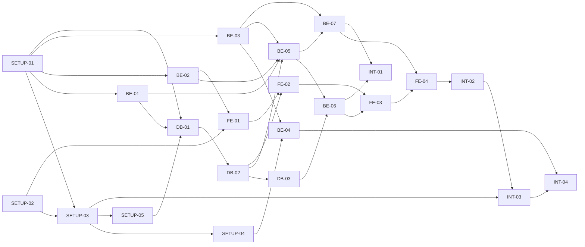

# 개발 실행 계획서: DataMatch

## 버전 이력

| 버전 | 일자       | 작성자 | 상태 | 요약      |
| ---- | ---------- | ------ | ---- | --------- |
| v0.1 | 2026-11-09 | Claude | 초안 | 최초 작성 |
| v0.2 | 2026-11-09 | Claude | 초안 | 문서 간 비교 검토 결과 반영(기준 문서 버전, 숫자 PK 입력 오류·후보 초과 안내 완료 조건) |
| v0.3 | 2026-11-09 | Claude | 초안 | 최종 검토 결과 반영(SETUP-04 선행 관계, 후보 초과 판정, 기준 문서 버전) |
| v0.4 | 2026-11-09 | Claude | 초안 | D-01~D-05 확정, PL-02·PL-03 해결, 시나리오 SN-E01-6·7과 WA-13 반영 |
| v1.0 | 2026-11-09 | Claude | 확정 | 최종 검토 후 확정. 로컬 Oracle 적극 테스트(SETUP-05) 반영 |

## 변경 이력

| 버전 | 일자       | 변경 섹션 | 구분 | 변경 내용 | 작성자 |
| ---- | ---------- | --------- | ---- | --------- | ------ |
| v0.1 | 2026-11-09 | 전체      | 신규 | 최초 작성 | Claude |
| v0.2 | 2026-11-09 | 머리말, 8장(FE-01, FE-02) | 수정 | 기준 문서 버전을 시나리오 v1.3, 화면 정의서 v1.3, 기술 설계서 v1.1로 갱신하고, 화면 정의서 WA-11(후보 30건 초과 안내), WA-12(숫자 PK 입력 오류)에 대응하는 완료 조건을 FE-01, FE-02에 추가 | Claude |
| v0.3 | 2026-11-09 | 머리말, 1.3, 3·4장, 5장(SETUP-04), 6장(DB-02), 8장(FE-01) | 수정 | SETUP-04가 SETUP-03의 `start.bat`을 수정하므로 선행에 SETUP-03을 추가하고 실행 단계(2·3단계)와 의존성 그림을 조정, DB-02의 후보 조회를 기술 설계서 v1.2의 `ROWNUM <= 31` 방식으로 정정, FE-01에 POST 요청의 JSON 콘텐츠 타입 조건 추가, 1차 종단 검증의 DB 표현을 D-02와 일치, 기준 문서 버전 갱신 | Claude |
| v0.4 | 2026-11-09 | 머리말, 1.3, 8장(FE-01, FE-03), 9장(INT-02), 10장, 13장 | 수정 | 사용자 승인으로 D-01~D-05를 확정하고 10장 설명을 갱신, PL-02(새로고침 후 이전 비교 진행 중)를 SN-E01-7·WA-13으로 해결, PL-03을 D-01로 해결, FE-01·FE-03 완료 조건에 WA-13 반영, INT-02의 예외 범위를 SN-E01-1~7로 확대, 기준 문서 버전 갱신 | Claude |
| v1.0 | 2026-11-09 | 1.2, 1.3, 3·4장, 5장(SETUP-05 신설), 6장(DB-01~03), 7장(BE-06), 9장(INT-01~03), 10~13장 | 추가 | 사용자 요청으로 이 PC의 로컬 Oracle(26ai Free)을 적극 테스트에 쓰도록 SETUP-05를 신설하고, DB·BE·INT의 조건부 Oracle 항목을 필수 `[Oracle]` 항목으로 바꾸어 타입 변환·후보 초과·타임아웃·중지·권한 오류 검증을 추가, E2E를 스텁 대신 로컬 Oracle과 가짜 복호화로 전환(PL-05 해결), 실행 단계를 10단계로 조정, D-02·PL-06 갱신, PL-12 추가, 문서 상태를 확정으로 변경 | Claude |

> 구분: 신규 / 추가 / 수정 / 삭제. 버전을 올릴 때는 '버전 이력'에 한 줄을 추가하고, 세부 변경 사항은 '변경 이력'에 섹션 단위로 기록한다.

> 본 문서는 `1-PRD.md`(v1.3), `2-user-scenario.md`(v1.5), `3-screen-specification.md`(v1.5), `4-technical-design.md`(v1.4)를 기준으로 한다. 요구사항과 설계는 FR, NFR, SN, SC, TD, TA, PA, SA, WA ID로 참조하고 다시 정의하지 않는다. 이 문서에서 새로 정하는 사항은 개발 착수 전 결정 `D-xx`와 계획 가정·미결 `PL-xx`로 관리한다. 모든 완료 조건은 미체크 상태이며, 실제 개발과 테스트로 확인하기 전에는 체크하지 않는다.

## 1. 문서 개요 및 개발 목표

이 문서는 확정된 설계 문서를 AI 에이전트가 Task 단위로 구현하고 검증할 수 있도록 개발 작업을 나눈 실행 계획이다. 목표는 PRD의 MVP(FR-01~FR-09)를 기술 설계서의 구조대로 구현하고, 담당자 PC에서 `start.bat`으로 실행하는 배포 zip까지 완성하는 것이다. 기술 스택과 구조는 다시 설계하지 않고 TD-01~TD-21을 그대로 따른다. 설계 문서에서 확정하지 않은 항목(TA)은 임의로 해결된 것으로 바꾸지 않으며, 해당 Task에서 검증한 뒤 근거를 기술 설계서에 반영한다.

### 1.1 Task 실행 방법

Task는 `.claude/skills/`의 개발 스킬로 실행한다. 두 스킬은 `disable-model-invocation: true`이므로 AI가 자동 호출할 수 없고 **사용자가 직접 입력**해야 한다.

```text
/develop-backend BE-01
/develop-frontend FE-01
```

스킬은 `docs/5-plan.md`에서 해당 Task ID의 항목을 읽으므로 각 Task의 제목은 `### BE-01. ...` 형식을 유지한다. 스킬은 BE와 FE만 있으므로 DB와 SETUP-01, SETUP-05는 `/develop-backend`, SETUP-02는 `/develop-frontend`로 실행하고, 두 영역에 걸치거나 사용자의 수동 확인이 필요한 SETUP-03, SETUP-04와 INT는 메인 에이전트가 수행한다(PL-01). 스킬의 절차는 계획 수립, 테스트 작성과 구현(병렬), 테스트 수행, 완료 조건 체크이며 실패 시 재시도는 3회까지이고 이후 미충족 요건을 보고한다.

### 1.2 완료 관리 규칙

- 모든 완료 조건이 테스트나 기록으로 확인된 Task만 체크박스를 체크한다. 일부라도 충족하지 못했거나 테스트를 실행하지 못했다면 미완료로 유지한다.
- 테스트 환경이 없어 실행하지 못한 항목은 성공으로 간주하지 않고 `미검증`으로 기록한다. 실행 결과는 각 Task의 `검증 기록`에 일자, 수행자, 결과(통과/실패/미검증)로 적는다. 실제 거래번호, 복호화 평문, 접속 정보는 기록하지 않는다.
- `[수동]`은 사용자나 실제 환경이 필요한 항목, `[Oracle]`은 로컬 Oracle 테스트 스키마(SETUP-05)가 필요한 항목이다. `[Oracle]` 항목은 이 PC에서 필수로 실행하며, 로컬 Oracle이 없는 PC에서는 `미검증`으로 기록한다.
- 구현 중 요구사항이나 설계 변경이 필요하면 해당 문서(PRD, 시나리오, 화면 정의서, 기술 설계서)를 먼저 확인하고, 변경 내용과 영향 범위를 기록해 버전을 올린 뒤 반영한다.
- 커밋은 사용자가 요청할 때만 한다(CLAUDE.md).

### 1.3 저장소와 환경 확인 결과

| 항목 | 확인 내용 |
|---|---|
| 문서 | `docs/1-PRD.md`(v1.2), `2-user-scenario.md`(v1.5), `3-screen-specification.md`(v1.5), `4-technical-design.md`(v1.4)가 있고 경로 불일치는 없다 |
| 스킬·에이전트 | `develop-backend`, `develop-frontend` 스킬과 backend-expert, frontend-expert, api-designer, security-auditor 등 서브에이전트가 있다 |
| MCP | `.mcp.json`의 playwright, context7, chrome-devtools는 `npx` 기반이다. Node 24.16.0 설치 후 VS Code를 재시작해야 연결된다 |
| 코드 | `backend/`, `frontend/`는 아직 없다(SETUP-01, SETUP-02에서 생성) |
| 개발 PC | JDK 11/17 설치, `JAVA_HOME`·Gradle 없음, Maven Central·npm·Gradle 배포 사이트 접속 가능, 로컬 Oracle AI Database 26ai Free(23.x, SID `FREE`, `localhost:1521`)가 설치되어 있다. pgweb-boot 로컬 테스트와 같은 DB이며 DataMatch는 전용 테스트 사용자만 쓴다(D-02, SETUP-05) |

## 2. 개발 범위 및 제외 범위

개발 범위는 PRD의 MVP인 FR-01~FR-09와 NFR-01~NFR-09, 이를 구현하는 기술 설계서의 TD-01~TD-21, 화면 SC-01~SC-03, 배포 zip과 `start.bat`이다. 제외 범위는 PRD 8~9장을 따른다(FR-10, FR-11, EX-01~EX-04, 복합 PK, 로그인·권한·이력, 엑셀 업로드, 중첩 JSON 펼치기). 실행 계획에도 이들을 위한 Task는 두지 않는다.

## 3. 전체 Task 목록

| Task ID | Task명 | 주요 작업 | 선행 Task | 관련 요구사항 | 담당 스킬 |
|---|---|---|---|---|---|
| SETUP-01 | 백엔드 프로젝트 초기화 | Gradle 8.9, Boot 2.7.18, JDK 11, 의존성, 패키지 골격, SafeDB jar 9개, `.gitignore`, JaCoCo | - | TD-01~04, TD-21, NFR-05 | `/develop-backend` |
| SETUP-02 | 프론트엔드 프로젝트 초기화 | Vite, React 18, TypeScript, Vitest, Prettier, dev 프록시, 스타일 이식 | - | TD-18 | `/develop-frontend` |
| SETUP-03 | 빌드·배포 구성 | 프론트 빌드 포함, `distZip`, `start.bat`, 민감 파일 제외 검증 | SETUP-01, SETUP-02 | TD-03, NFR-05, NFR-08 | 메인 에이전트 |
| SETUP-04 | SafeDB 설정 탐색 검증 | 분리형 배치에서 `login()` 확인, 설정 탐색 방식 확정 | SETUP-01, SETUP-03 | TA-01, TD-03·04 | 메인 에이전트 + 사용자 |
| SETUP-05 | 로컬 Oracle 테스트 환경 구성 | 전용 테스트 사용자·스키마·합성 데이터, `oracleTest` 작업 | SETUP-03 | D-02, TD-05·07·09, NFR-03 | `/develop-backend` + 사용자 |
| DB-01 | 환경 설정·DataSource | 환경별 설정, 지연 생성 풀, 읽기 전용 연결, 타임아웃 | SETUP-01, BE-01, SETUP-05 | FR-01, TD-05·06, NFR-03 | `/develop-backend` |
| DB-02 | 메타데이터 검색·조회 | 테이블 검색, PK 판별, 컬럼 조회, 환경·테이블 API | DB-01 | FR-02·03, NFR-04, TD-07 | `/develop-backend` |
| DB-03 | 거래 묶음 조회 | SQL 생성기, 타입별 값 변환, 묶음 조회, 취소 가능 Statement | DB-02 | FR-06, NFR-02, TD-05·08·09 | `/develop-backend` |
| BE-01 | 공통 API 기반·로컬 보안 | 오류 응답, 예외 처리, Host·Origin·JSON 필터, 로깅 | SETUP-01 | TD-19·20, NFR-05 | `/develop-backend` |
| BE-02 | 거래번호 입력 파서 | 파싱 규칙, 오류 코드, 1,000쌍, 숫자 PK, 공유 테스트 케이스 | SETUP-01 | FR-05 | `/develop-backend` |
| BE-03 | 비교 엔진·JSON 평탄화 | 판정 규칙, 결과 모델, `Decryptor` 인터페이스 | SETUP-01 | FR-07, TD-10·11, PA-04·05·09 | `/develop-backend` |
| BE-04 | SafeDB 복호화 어댑터 | KDKEY/PANEN, 문자셋, 순차 호출 | BE-03, SETUP-04 | FR-04·07, TD-10, TA-07·11 | `/develop-backend` |
| BE-05 | 비교 작업 관리·결과 API | `JobManager`, 시작·상태·중지·요약·상세 API | BE-01, BE-02, BE-03, DB-02 | FR-06·08, TD-12·13·15 | `/develop-backend` |
| BE-06 | 비교 서비스 | 100쌍 청크 파이프라인, 진행률, 취소, 오류 분류 | DB-03, BE-05 | FR-06·07, TD-08·14, PA-17·18 | `/develop-backend` |
| BE-07 | 엑셀 생성·다운로드 | XSSF, 요약·상세 시트, 색상, 파일명, 오류 처리 | BE-03, BE-05 | FR-09, TD-16·17 | `/develop-backend` |
| FE-01 | 프론트 기반 | API 클라이언트, 타입, reducer, 입력 파서, 메시지 맵 | SETUP-02, BE-02 | FR-05, TD-18, SA-09 | `/develop-frontend` |
| FE-02 | SC-01 설정 화면 | 환경 바, 테이블 검색, 컬럼 표, 복호화 지정, 거래번호 입력 | FE-01, DB-02 | FR-01~05, NFR-07 | `/develop-frontend` |
| FE-03 | SC-02 진행 모달 | 비교 시작, 1초 Polling, 진행률, 중지, 실패 안내 | FE-02, BE-06 | FR-06, WA-10 | `/develop-frontend` |
| FE-04 | SC-03 결과 화면 | 요약 목록, 상세, 긴 값 펼치기, 엑셀 다운로드 | FE-03, BE-07 | FR-07~09 | `/develop-frontend` |
| INT-01 | 백엔드 통합 테스트 | 로컬 Oracle + 가짜 복호화, 환경 간 비교, 타입 변환, 타임아웃·중지, 읽기 전용 | BE-06, BE-07, SETUP-05 | NFR-01~03 | 메인 에이전트 |
| INT-02 | E2E 테스트 | 로컬 Oracle·가짜 복호화 구성, Playwright로 SN-01~04, SN-E01~E04 | FE-04, SETUP-05 | 전체 SN, SC | 메인 에이전트 |
| INT-03 | 배포 zip·성능·민감정보 검증 | zip 실행, 로그 검사, 합성 데이터 성능·메모리 | SETUP-03, INT-02 | NFR-01·05·08, TA-09 | 메인 에이전트 |
| INT-04 | 실환경 수동 검증 | 환경별 SafeDB, 읽기 전용 계정, 성능 실측, 실제 PC 설치 | BE-04, INT-03 | TA-02·03·07·10·11·13 | 사용자 + 메인 에이전트 |

## 4. Task 의존성 및 실행 순서



권장 실행 순서와 병렬 구간은 다음과 같다. 같은 줄의 Task는 서로 다른 패키지·디렉터리를 수정하므로 동시에 진행할 수 있다.

| 단계 | 실행할 Task | 비고 |
|---|---|---|
| 1 | SETUP-01, SETUP-02 | 백엔드와 프론트가 서로 다른 디렉터리라 병렬 |
| 2 | SETUP-03, BE-01 | SETUP-03은 SETUP-01이 만든 `build.gradle`을 이어서 수정하므로 SETUP-01 완료 후 진행 |
| 3 | SETUP-04, SETUP-05, BE-02, BE-03 | SETUP-04는 D-03·D-04 승인 후 SETUP-03의 `start.bat`을 조정. SETUP-05는 `build.gradle`에 `oracleTest`를 추가하고 사용자의 관리자 스크립트 실행이 필요 |
| 4 | DB-01, BE-04, FE-01 | DB-01은 SETUP-05의 테스트 스키마로 연결을 검증. BE-04는 SETUP-04 결과 필요. FE-01은 BE-02의 공유 테스트 케이스 필요 |
| 5 | DB-02 | |
| 6 | DB-03, BE-05, FE-02 | **FE-02 완료 시 환경·테이블·컬럼 조회가 로컬 Oracle 테스트 스키마와 연결된다(1차 종단 검증)** |
| 7 | BE-06, BE-07 | BE-06은 로컬 Oracle로 실제 파이프라인을 검증 |
| 8 | FE-03 | **완료 시 로컬 Oracle과 가짜 복호화로 비교 한 사이클이 화면까지 연결된다(2차 종단 검증)** |
| 9 | FE-04, INT-01 | `App.tsx`·결과 영역을 FE-02~04가 이어서 수정하므로 FE는 순차 |
| 10 | INT-02 → INT-03 → INT-04 | INT-02 전에 VS Code 재시작으로 Playwright MCP 연결 확인 |

`build.gradle`(SETUP-01, SETUP-03, SETUP-05), `ErrorCode`(BE-01), `application.properties`(여러 Task가 항목 추가), 프론트의 `App.tsx`와 `reducer`(FE-01~04)는 충돌하기 쉬운 지점이다. 위 순서에서 이 파일을 수정하는 Task는 병렬로 두지 않았다.

## 5. SETUP Task 상세

### SETUP-01. 백엔드 프로젝트 초기화

**목적:** 기술 설계서의 런타임과 패키지 구조에 맞는 백엔드 프로젝트와 빌드 환경을 만든다.

**참조 문서:** 기술 설계서 TD-01~TD-04, TD-21, 2장·4장, PRD NFR-05·NFR-08, CLAUDE.md.

**선행 Task:** 없음 (패키지명은 D-05, 커버리지 설정은 D-01을 따른다)

**구현 범위:** `backend/`에 Gradle 프로젝트를 만든다. Gradle 8.9 wrapper 파일은 pgweb-boot의 wrapper를 복사하고, JDK 11 지정은 저장소 밖의 사용자 `~/.gradle/gradle.properties`(`org.gradle.java.home`)로 안내한다. Spring Boot 2.7.18 플러그인과 `spring-boot-starter-web`, `spring-boot-starter-jdbc`, `ojdbc8`, `poi-ooxml` 5.x, Lombok(compileOnly), 테스트 의존성(JUnit 5, Mockito, AssertJ)을 구성하고, `kr.kicc.datamatch` 패키지 골격(기술 설계서 4.1)과 `DataMatchApplication`, `application.properties`(`server.address=127.0.0.1`, `server.port=18080`), `config/datamatch.properties.example`(dev, test, prod 항목 구조, 값은 자리표시자)을 만든다. pgweb-boot의 `libs/safedb-lib/` jar 9개를 `backend/libs/safedb-lib/`로 복사해 컴파일·런타임 classpath에 포함한다. `.gitignore`에 기술 설계서 4.2의 제외 항목을 추가하고 JaCoCo 리포트를 설정한다.

**완료 조건:**
- [ ] `backend`에서 `gradlew test`가 JDK 11로 통과하고 스프링 컨텍스트 로드 테스트가 포함된다.
- [ ] 설정 테스트가 `server.address=127.0.0.1`, `server.port=18080`을 확인한다.
- [ ] `backend/libs/safedb-lib/`에 jar 9개가 있고 pgweb-boot 원본과 SHA256이 모두 같다.
- [ ] `com.initech.safedb.SimpleSafeDB`가 컴파일 classpath에서 해석되는 컴파일 테스트가 통과한다.
- [ ] `git check-ignore`로 `backend/config/datamatch.properties`, `backend/config/SafeDBAccess.properties`, `backend/config/SafeDBMap_config.xml`, `backend/build/`, `backend/logs/`, `backend/src/main/resources/static/`이 무시되고, `backend/libs/**/*.jar`, `gradle-wrapper.jar`, `datamatch.properties.example`은 무시되지 않는다.
- [ ] 패키지 구조가 기술 설계서 4.1과 일치한다(`config`, `web`, `metadata`, `compare`, `safedb`, `job`, `excel`).
- [ ] `gradlew jacocoTestReport`로 커버리지 리포트가 생성된다.

**검증 방법:** Gradle 실행 결과, `git check-ignore -v`, `sha256sum` 비교.

**검증 기록:** 미실행

**담당 스킬:** `/develop-backend SETUP-01`

### SETUP-02. 프론트엔드 프로젝트 초기화

**목적:** React 18, Vite, TypeScript 기반 프론트엔드 개발·테스트 환경을 만든다.

**참조 문서:** 기술 설계서 TD-18, 2장·4장, 저장소 `.prettierrc`, `docs/prototype/index.html`.

**선행 Task:** 없음 (Node 24.16.0 인식, VS Code 재시작 후)

**구현 범위:** `frontend/`에 Vite + React 18 + TypeScript(strict) 프로젝트, Vitest와 Testing Library(jsdom), Prettier(`.prettierrc` 적용)를 구성한다. `vite.config.ts`에 `/api`를 `http://127.0.0.1:18080`으로 보내는 dev 프록시를 설정하고, 프로토타입의 CSS를 `src/styles.css`로 옮긴다. 빈 `App`이 렌더되는 smoke 테스트를 만든다. 런타임 의존성은 `react`와 `react-dom`뿐이며 전역 상태 라이브러리와 UI 프레임워크는 설치하지 않는다. 정확한 버전은 `package-lock.json`으로 고정하고 기술 설계서 2장의 버전 기재를 이때 갱신한다.

**완료 조건:**
- [ ] `npm ci`, `npm run build`, `npm test`가 Node 24.16.0에서 통과하고 `dist/`가 생성된다.
- [ ] `package.json`의 `dependencies`에 `react`, `react-dom` 외 항목이 없다(테스트 또는 스크립트로 확인).
- [ ] `npm run format:check`가 `.prettierrc` 규칙으로 통과한다.
- [ ] dev 서버가 `/api` 요청을 `127.0.0.1:18080`으로 프록시하도록 설정되어 있다.
- [ ] `App` smoke 테스트가 통과한다.
- [ ] `src/styles.css`에 프로토타입의 색상 변수(일치·불일치·누락·운영 경고)가 포함된다.

**검증 방법:** npm 스크립트 실행 결과, `package.json` 검사.

**검증 기록:** 미실행

**담당 스킬:** `/develop-frontend SETUP-02`

### SETUP-03. 빌드·배포 구성

**목적:** 프론트엔드 빌드를 포함한 배포 zip을 한 번의 Gradle 작업으로 만들고, 민감 파일이 들어가지 않음을 확인한다.

**참조 문서:** 기술 설계서 TD-03, 3.2절, 4.3절, PRD NFR-05, NFR-08.

**선행 Task:** SETUP-01, SETUP-02

**구현 범위:** `buildFrontend` 작업(`frontend`에서 `npm ci`, `npm run build` 후 `backend/src/main/resources/static/`으로 복사, `-PskipFrontend`로 생략 가능)과 `distZip` 작업을 만든다. zip 구조는 `start.bat`, `datamatch.jar`, `lib/`(의존 jar와 SafeDB jar 9개), `config/`(`datamatch.properties.example`), 안내 문서(JDK 11 필요, `datamatch.properties` 작성 방법, SafeDB 설정 파일을 별도로 받아 `config/`에 두는 방법)로 한다. `start.bat`은 기술 설계서 3.2의 규칙(작업 폴더 `config`, 클래스패스, `-Dfile.encoding=UTF-8 -Xmx512m`, 로그 경로, 설정 파일 위치, `java`와 `datamatch.properties` 존재 확인, 접속 주소 출력)을 따른다. SafeDB 설정 탐색 방식은 SETUP-04의 결과로 조정한다. 실제 `datamatch.properties`, `SafeDBAccess.properties`, `SafeDBMap_config.xml`이 zip에 들어가지 않는지 확인하는 검증을 작업에 포함한다. `inilog4j.properties`의 포함 여부는 SETUP-04 결과를 따른다.

**완료 조건:**
- [ ] `gradlew distZip`이 성공하고 zip 내용이 기술 설계서 3.2의 구조와 일치한다(zip 목록을 검사하는 테스트 또는 작업).
- [ ] zip의 `lib/`에 SafeDB jar 9개가 있고, `datamatch.properties`(예시 제외), `SafeDBAccess.properties`, `SafeDBMap_config.xml`은 없다.
- [ ] `-PskipFrontend`로 프론트 빌드를 건너뛸 수 있고, 건너뛰지 않으면 `static/index.html`이 jar에 포함된다.
- [ ] 압축을 푼 폴더에서 `config\datamatch.properties`가 없으면 `start.bat`이 한국어 안내를 출력하고 종료 코드가 0이 아니다.
- [ ] `datamatch.properties.example`을 복사한 설정으로 `start.bat`을 실행하면 `127.0.0.1:18080`에서 기동하고 `GET /`가 프론트 `index.html`을 반환한다.
- [ ] 기동 후 접속 주소 `http://localhost:18080`이 콘솔에 출력된다.

**검증 방법:** Gradle 실행, zip 목록 검사, 압축 해제 후 `start.bat` 실행과 `curl` 확인.

**검증 기록:** 미실행

**담당 스킬:** 메인 에이전트 (두 스킬 범위 밖)

### SETUP-04. SafeDB 설정 탐색 검증

**목적:** SafeDB 설정 파일을 분리형 zip 배치에서 어떻게 찾는지 확인하고, 배포 구조(작업 폴더, 클래스패스)를 확정한다(TA-01).

**참조 문서:** 기술 설계서 TD-03·04, TD-10, 3.2절, TA-01, PRD PA-08, pgweb-boot `SafeDBEncUtil`·`conf-safedb`.

**선행 Task:** SETUP-01, SETUP-03 (D-03, D-04 승인과 SafeDB 서버에 접근할 수 있는 PC 필요)

**구현 범위:** D-03 승인 후 pgweb-boot의 SafeDB 설정 파일을 `backend/config/`로 복사한다(Git 제외 확인 포함). 분리형 배치(작업 폴더 `config`, 클래스패스 `..\datamatch.jar;..\lib\*;.`)에서 `SimpleSafeDB.getInstance().login()`을 호출하는 최소한의 확인용 코드(제품 코드에 남기지 않는 스파이크)로 설정 파일을 찾는 방식을 확인한다. 설정 파일을 못 찾는 조건(작업 폴더·클래스패스 변경)에서 어떻게 실패하는지도 확인해 규칙을 확정한다. 확정된 작업 폴더·클래스패스 규칙을 `start.bat`에 반영하고, 결과를 기술 설계서 TA-01과 3.2절에 기록한다. 서버 주소, 계정, 암호 같은 설정값은 어떤 기록에도 적지 않는다.

**완료 조건:**
- [ ] [수동] D-03 승인 후 설정 파일 3개가 `backend/config/`에 있고 `git check-ignore`로 모두 무시된다.
- [ ] [수동] 분리형 배치에서 `SimpleSafeDB.login()`이 성공한다.
- [ ] [수동] 설정 파일을 찾지 못하는 조건에서 실패하는 것을 확인해 탐색 방식(classpath 또는 작업 폴더 상대경로)을 확정한다.
- [ ] 확정된 규칙이 SETUP-03의 `start.bat`에 반영되어 있다.
- [ ] 기술 설계서 TA-01이 확인 결과로 갱신되고 버전이 올라간다(설정값 미기록).
- [ ] 스파이크 코드가 저장소의 제품 소스에 남지 않는다.

**검증 방법:** 사용자와 함께 수행하는 수동 확인과 결과 기록. SafeDB에 접근할 수 없으면 `미검증`으로 두고 이 Task와 BE-04의 실제 연동 검증(INT-04)을 미완료로 유지한다.

**검증 기록:** 미실행

**담당 스킬:** 메인 에이전트 + 사용자

### SETUP-05. 로컬 Oracle 테스트 환경 구성

**목적:** 이 PC의 로컬 Oracle을 DataMatch 전용 테스트 DB로 구성해, DB·BE·INT Task가 실제 Oracle로 적극 테스트할 수 있게 한다(D-02).

**참조 문서:** 기술 설계서 TD-05·07·09, 6장, 10장, TA-03·05, PRD NFR-02·03·04, PA-19, 이 문서 D-02·D-04.

**선행 Task:** SETUP-03 (같은 `build.gradle`을 수정하므로 SETUP-03 뒤에 진행. 사용자 생성 스크립트는 사용자가 관리자 계정으로 1회 실행)

**구현 범위:** 로컬 Oracle(Oracle AI Database 26ai Free, SID `FREE`)은 pgweb-boot 로컬 테스트와 함께 쓰는 DB이므로, DataMatch는 `DM_IT_` 접두어의 전용 사용자만 만들고 다른 스키마(PAYZONE 등)는 조회·변경하지 않는다. 스크립트는 `backend/src/test/resources/oracle/`에 둔다. 사용자 생성 스크립트는 테이블 소유자 `DM_IT_OWNER`와 읽기 전용 접속 사용자 `DM_IT_RO_A`, `DM_IT_RO_B`(`CREATE SESSION`과 테스트 테이블 `SELECT`만 부여, 환경 간 비교를 모사하는 두 환경)를 만든다. 스키마 스크립트는 문자형 PK, NUMBER PK, 복합 PK, PK 없음, DATE PK 테이블, 기술 설계서 6.4의 타입을 모두 가진 테이블(CHAR, VARCHAR2, NCHAR, NUMBER, BINARY_DOUBLE, DATE, TIMESTAMP(9), TIMESTAMP WITH TIME ZONE, CLOB, BLOB, RAW 등), 가짜 암호문이 든 CLOB 컬럼(가짜 `Decryptor` 형식, 잘못된 암호문 포함), 하나의 검색어로 31개 이상 검색되는 테이블 묶음(후보 초과 확인), 이름에 `_`가 들어간 테이블(이스케이프 확인), 지연 함수를 쓰는 가상 컬럼을 가진 느린 조회 테이블(타임아웃·중지 확인), `DM_IT_RO_B`에만 권한이 없는 테이블(TA-05의 DB 오류 확인)을 만든다. 합성 데이터는 1,000쌍 이상이며 일치·불일치·누락 경우를 포함한다. 정리 스크립트는 `DM_IT_` 객체만 삭제한다. 접속 정보는 저장소에 넣지 않고 환경 변수(예: `DATAMATCH_IT_URL`, `DATAMATCH_IT_RO_A_USER`, `DATAMATCH_IT_RO_A_PASSWORD`)로 받으며, Gradle `oracleTest` 작업(JUnit 태그 `oracle`)이 환경 변수가 있을 때 실행한다. 이 PC에서는 필수로 실행하고, 로컬 Oracle이 없는 PC에서는 건너뛰어 `미검증`으로 기록한다. 로컬 DB의 버전과 PDB 서비스명을 확인해 기록한다(PL-12). 대상 운영 DB의 버전 판정(TA-03)은 INT-04에서 한다.

**완료 조건:**
- [ ] 사용자 생성, 스키마, 합성 데이터, 정리 스크립트가 `backend/src/test/resources/oracle/`에 있고, `DM_IT_` 외의 스키마를 참조하지 않는다는 정적 검사가 통과한다.
- [ ] [수동] 사용자가 관리자 계정으로 사용자 생성 스크립트를 실행했고, 서비스명과 접속 확인 결과가 기록된다(비밀번호 미기록).
- [ ] `gradlew oracleTest`의 스모크 테스트가 `DM_IT_RO_A`, `DM_IT_RO_B`로 연결해 `SELECT 1 FROM DUAL`을 통과한다.
- [ ] `DM_IT_RO_A`로 INSERT·UPDATE·DELETE를 시도하면 권한 오류(ORA-01031)가 나는 테스트가 통과한다(NFR-03의 계정 수준 확인).
- [ ] 합성 데이터 건수(1,000쌍 이상, 일치·불일치·누락 포함)와 테스트 객체(PK 유형별 테이블, 전체 타입 테이블, 31개 이상 검색되는 테이블 묶음, 느린 조회 테이블, 권한 차이 테이블)가 있는지 확인하는 테스트가 통과한다.
- [ ] 정리 스크립트 실행 후 `DM_IT_` 객체만 삭제되고 스키마 스크립트로 다시 만들 수 있다.
- [ ] 환경 변수가 없으면 `oracleTest`가 건너뛰어지고 `gradlew test`는 영향받지 않는다.
- [ ] 로컬 DB 버전과 서비스명이 `test/e2e/report.md`에 기록된다.

**검증 방법:** 사용자 생성 스크립트 수동 실행, `gradlew oracleTest`, 스크립트 정적 검사.

**검증 기록:** 미실행

**담당 스킬:** `/develop-backend SETUP-05` + 사용자(관리자 스크립트 실행)

## 6. DB Task 상세

### DB-01. 환경 설정·DataSource

**목적:** 환경별 접속 정보를 설정 파일에서 읽고, 환경별 읽기 전용 DataSource를 필요할 때만 만든다.

**참조 문서:** PRD FR-01, NFR-02·03, 시나리오 SN-01, SN-E01, 기술 설계서 TD-05·06, 6.1절, 9.1절.

**선행 Task:** SETUP-01, BE-01, SETUP-05

**구현 범위:** `datamatch.properties`의 환경 설정 구조(dev, test, prod별 접속 URL, 계정, 비밀번호)를 `@ConfigurationProperties`로 바인딩하고, `DataSourceRegistry`가 환경별 HikariCP를 처음 사용할 때 생성하도록 한다(최대 풀 2, 연결 획득 제한 10초). 연결은 읽기 전용·자동 커밋 해제로 열고 사용 후 롤백하며, A·B가 같은 환경이면 풀 하나를 공유한다. 설정되지 않은 환경은 사용 가능 환경에서 뺀다. 연결 실패는 `DB_CONNECTION_FAILED`로 변환하되 비밀번호와 계정 정보를 메시지·로그에 남기지 않는다. 쿼리 타임아웃(30초)은 설정 상수로 제공한다. Oracle 버전과 `ojdbc8` 호환(TA-03)의 실환경 확인은 INT-04에서 하고, 이 Task에서는 로컬 Oracle 테스트 스키마(SETUP-05)로 드라이버와 읽기 전용 연결 동작을 확인한다.

**완료 조건:**
- [ ] 설정 바인딩 테스트에서 설정된 환경(dev, test, prod 중)만 사용 가능 환경으로 나타난다.
- [ ] 같은 환경으로 A·B를 요청하면 DataSource가 하나만 생성된다.
- [ ] 사용하지 않은 환경의 DataSource는 생성되지 않는다(연결 시도 없음).
- [ ] 연결 획득 실패 시 `DB_CONNECTION_FAILED`와 환경 ID가 반환되고, 메시지와 로그 캡처에 비밀번호·접속 계정이 없다.
- [ ] 연결이 읽기 전용(`readOnly=true`)·자동 커밋 해제이며 사용 후 롤백되는 것을 테스트로 확인한다.
- [ ] `datamatch.properties.example`의 키 구조가 바인딩 클래스와 일치하는 테스트가 통과한다.
- [ ] [Oracle] 로컬 Oracle 테스트 스키마에서 `DataSourceRegistry`로 `DM_IT_RO_A`, `DM_IT_RO_B`에 연결해 `SELECT 1 FROM DUAL`이 통과하고, 같은 환경 요청은 풀 하나를 공유하며, 잘못된 포트 설정은 `DB_CONNECTION_FAILED`가 된다.

**검증 방법:** JUnit 단위 테스트, 로그 캡처 테스트, 로컬 Oracle 통합 테스트(`gradlew oracleTest`).

**검증 기록:** 미실행

**담당 스킬:** `/develop-backend DB-01`

### DB-02. 메타데이터 검색·조회

**목적:** 접속 계정이 조회할 수 있는 테이블을 검색하고, 단일 PK와 컬럼 정보를 조회해 화면과 비교 요청 검증에 제공한다.

**참조 문서:** PRD FR-02·03, NFR-04, PA-02·10·15·19, 시나리오 SN-01, SN-E01, SN-E02, 화면 정의서 SC-01, 기술 설계서 TD-07, 5장(FR-02, FR-03), 6.2절, 8장.

**선행 Task:** DB-01

**구현 범위:** `ALL_TABLES`, `ALL_CONSTRAINTS`, `ALL_CONS_COLUMNS`, `ALL_TAB_COLUMNS` 기반의 `MetadataRepository`와 `MetadataService`를 구현한다. 테이블 후보는 대소문자 무시 검색, `%`·`_`·`\` 이스케이프, `ROWNUM <= 31`로 조회해 31번째 행이 있으면 `truncated`로 표시하고 30건만 반환하며 반환 후보에 대해서만 PK를 판정한다. PK가 없거나 복합이거나 문자형·NUMBER가 아니면 `selectable=false`와 사유(`NO_PK`, `COMPOSITE_PK`, `UNSUPPORTED_PK_TYPE`)를 반환한다. 컬럼 조회는 컬럼명, 타입 표시 문자열, PK 여부, CLOB 여부와 PK 컬럼명을 반환한다. 메타데이터에 없는 소유자·테이블·컬럼 이름을 거절하는 식별자 검증 유틸을 제공한다. 컨트롤러는 `GET /api/environments`, `GET /api/tables`, `GET /api/tables/columns`(기술 설계서 8장)를 구현한다. 메타데이터는 항상 A쪽 환경에서 조회한다. `MetadataRepository`는 단위 테스트에서 대체할 수 있도록 인터페이스로 둔다.

**완료 조건:**
- [ ] `GET /api/environments`가 환경 ID, 표시 이름(개발/테스트/운영), 운영 여부만 반환하고 접속 정보가 응답에 없다(응답 JSON 검사 테스트).
- [ ] `q`가 2자 미만이면 400 `INVALID_INPUT`을 반환하고 DB를 조회하지 않는다.
- [ ] 검색어의 `%`, `_`, `\`가 리터럴로 검색되도록 이스케이프되고 바인드 변수로 전달된다(SQL·바인딩 단위 테스트).
- [ ] 후보가 30건을 넘으면 30건만 반환하고 `truncated=true`이며, PK 판정 쿼리는 반환 후보에 대해서만 수행된다.
- [ ] PK 없음, 복합 PK, 지원하지 않는 PK 타입은 각각 `selectable=false`와 해당 사유를, 문자형·NUMBER 단일 PK는 `selectable=true`와 `pkColumn`을 반환한다(판정 로직 단위 테스트).
- [ ] 컬럼 조회가 컬럼 순서(COLUMN_ID)대로 이름, 타입 문자열, PK 여부, CLOB 여부를 반환한다.
- [ ] 메타데이터에 없는 테이블·컬럼 이름은 거절된다(NFR-04).
- [ ] 환경 미설정은 `ENV_NOT_CONFIGURED`, 연결 실패는 `DB_CONNECTION_FAILED`, 그 밖의 DB 오류는 `DB_QUERY_FAILED`로 응답한다.
- [ ] [Oracle] 로컬 Oracle 테스트 스키마에서 테이블 검색(31개 이상 검색 시 30건과 `truncated`, `_` 리터럴 검색), PK 유형별 판정(문자형·NUMBER·복합·없음·DATE), 컬럼 조회가 통과하고, 권한이 없는 테이블은 검색되지 않는다. 시스템 스키마가 검색 결과에 포함되는 현재 동작을 기록한다(TA-13).

**검증 방법:** JUnit 단위·MockMvc 테스트, 로컬 Oracle 통합 테스트(`gradlew oracleTest`).

**검증 기록:** 미실행

**담당 스킬:** `/develop-backend DB-02`

### DB-03. 거래 묶음 조회

**목적:** 선택한 컬럼만 PK 묶음으로 조회하고, DB 값을 비교용 문자열로 변환한다.

**참조 문서:** PRD FR-06, NFR-02·03·04, PA-11·13, 기술 설계서 TD-05·08·09, 6.1절, 6.3절~6.5절.

**선행 Task:** DB-02

**구현 범위:** `SqlBuilder`(메타데이터에서 확인된 식별자를 큰따옴표로 감싼 `SELECT ... WHERE PK IN (?, ...)`, PK는 문자형이면 문자열·NUMBER이면 `BigDecimal` 바인딩), `ValueConverter`(기술 설계서 6.4의 타입별 변환 표), `RowRepository`(청크의 키 목록을 조회해 `Map<거래번호, 행>` 반환, 페치 크기 100, 쿼리 타임아웃 30초)를 구현한다. 실행 중인 `Statement`를 취소 토큰에 등록해 외부에서 `cancel()`할 수 있게 하고, SQLException을 연결 실패, 타임아웃, 사용자 취소(ORA-01013), 그 밖의 DB 오류로 분류한다. PK 컬럼은 선택 컬럼에 없어도 매칭용으로 함께 조회한다. `RowRepository`는 인터페이스로 두어 단위 테스트에서 대체할 수 있게 한다.

**완료 조건:**
- [ ] `SqlBuilder`가 만드는 모든 SQL이 `SELECT`로 시작하고 INSERT, UPDATE, DELETE, MERGE, DDL 키워드를 포함하지 않는다는 테스트가 통과한다.
- [ ] 메타데이터에 없는 컬럼명을 주면 SQL 생성 전에 예외가 발생한다.
- [ ] 거래번호 값은 바인드 변수로만 전달되며 SQL 문자열에 값이 나타나지 않는다(SQL 문자열 검사 테스트).
- [ ] 타입별 변환(문자형 원문 유지, NUMBER `toPlainString`, DATE·TIMESTAMP 형식 지정 변환식, CLOB 문자열, BLOB·RAW 대문자 16진수, NULL)이 변환 표대로 동작하는 단위 테스트가 통과한다.
- [ ] 청크 하나의 키 목록으로 쿼리가 1회 실행되고 IN 목록이 설정된 청크 크기를 넘지 않는다.
- [ ] 쿼리마다 타임아웃 30초와 페치 크기 100이 설정된다.
- [ ] SQLException 분류(연결 실패, 타임아웃, ORA-01013 취소, 기타)가 각각 `DB_CONNECTION_FAILED`, `QUERY_TIMEOUT`, 취소 신호, `DB_QUERY_FAILED`로 매핑되는 테스트가 통과한다.
- [ ] 진행 중인 쿼리의 `Statement`에 취소 요청을 하면 `Statement.cancel()`이 호출된다(목 테스트).
- [ ] [Oracle] 로컬 Oracle 테스트 스키마에서 전체 타입 테이블의 변환 결과(6.4), 문자형·NUMBER PK 바인딩, 존재하지 않는 키의 누락이 확인되고, 느린 조회 테이블에서 쿼리 타임아웃과 `Statement.cancel()`(ORA-01013)이 실제로 동작한다.

**검증 방법:** JUnit 단위 테스트, 로컬 Oracle 통합 테스트(`gradlew oracleTest`).

**검증 기록:** 미실행

**담당 스킬:** `/develop-backend DB-03`

## 7. BE Task 상세

### BE-01. 공통 API 기반·로컬 보안

**목적:** 모든 API가 공유하는 오류 응답, 예외 처리, 로컬 웹 서버 보안 정책, 로깅 규칙을 만든다.

**참조 문서:** 기술 설계서 TD-19·20, 8장(오류 형식), 9.3절~9.5절, PRD NFR-05.

**선행 Task:** SETUP-01

**구현 범위:** `ErrorCode`와 `DataMatchException`, 오류 응답 `{code, message, details}`와 전역 예외 처리를 만든다. 오류 코드는 기술 설계서 8장·9.5절의 목록(`INVALID_INPUT`, `ENV_NOT_CONFIGURED`, `TABLE_NOT_SUPPORTED`, `JOB_RUNNING`, `JOB_NOT_FOUND`, `JOB_NOT_COMPLETED`, `PAIR_NOT_FOUND`, `DB_CONNECTION_FAILED`, `DB_QUERY_FAILED`, `QUERY_TIMEOUT`, `EXCEL_FAILED`, `INTERNAL_ERROR`)을 따르고, 기술 설계서에 상태 코드가 정해지지 않은 코드의 HTTP 상태는 이 Task에서 정해 기술 설계서 8장에 반영한다(PL-04). `LocalOnlyFilter`는 `Host`가 `localhost`, `127.0.0.1`, `[::1]`이 아닌 요청과, `Origin`이 있고 같은 호스트가 아닌 요청을 거절하고, 변경성 요청은 JSON 콘텐츠 타입만 허용한다. `logback-spring.xml`로 `logs/` 일별 롤링과 7일 보관을 설정하고, 요청 본문·거래번호·값·비밀번호를 기록하지 않는 로깅 규칙을 적용한다. Actuator와 H2 콘솔 같은 부가 엔드포인트는 두지 않는다.

**완료 조건:**
- [ ] `Host`가 허용 목록 밖인 요청은 403으로 거절되고 허용 목록(`localhost`, `127.0.0.1`, `[::1]`)은 통과한다(MockMvc).
- [ ] 외부 `Origin` 요청은 403, 같은 호스트의 `Origin`과 `Origin` 없는 요청은 통과한다.
- [ ] POST가 `application/json`이 아니면 415를 반환한다.
- [ ] 모든 예외 응답이 `{code, message, details}` 형식이며 스택 트레이스, SQL, 접속 정보를 포함하지 않는다(테스트로 응답 본문 검사).
- [ ] 정의된 모든 오류 코드에 HTTP 상태가 하나씩 지정되고 매핑 테스트가 통과하며 기술 설계서 8장에 반영되어 있다.
- [ ] 로그 설정이 `logs/` 일별 롤링과 7일 보관이며 설정 테스트가 통과한다.
- [ ] 오류가 발생한 요청을 처리한 뒤 로그 캡처에 요청 본문 문자열과 비밀번호가 나타나지 않는다.
- [ ] 클래스패스에 Actuator, H2 콘솔 의존성이 없다.

**검증 방법:** MockMvc 테스트, 로그 캡처 테스트, 의존성 검사.

**검증 기록:** 미실행

**담당 스킬:** `/develop-backend BE-01`

### BE-02. 거래번호 입력 파서

**목적:** 거래번호 A·B 쌍 입력을 검증하고 비교 가능한 구조로 변환하며, 프론트엔드와 공유할 테스트 케이스를 만든다.

**참조 문서:** PRD FR-05, NFR-01, PA-17·19, 시나리오 SN-E03, 화면 정의서 SC-01·WA-03, 기술 설계서 5장(FR-05).

**선행 Task:** SETUP-01

**구현 범위:** `PairsParser`가 원문 텍스트를 줄 단위로 처리한다. 쉼표 또는 탭이 구분자이고, 값의 앞뒤 공백을 제거하며, 빈 줄은 무시하되 오류의 줄 번호는 원문 기준 1부터 센다. 줄마다 구분자(쉼표·탭) 개수가 0이면 `NO_DELIMITER`, 2개 이상이면 `TOO_MANY_DELIMITERS`, 앞이 비면 `EMPTY_A`, 뒤가 비면 `EMPTY_B`로 오류를 수집하고 첫 오류에서 멈추지 않는다. 유효한 쌍이 1,000쌍을 넘으면 `PAIR_LIMIT_EXCEEDED`(현재 건수 포함)이다. PK가 숫자형이면 숫자로 해석할 수 없는 값을 `INVALID_NUMBER`로 줄 단위로 보고한다. CRLF와 LF를 모두 처리한다. 케이스 표는 `test/fixtures/pairs-cases.json`에 두고 파서 단위 테스트와 프론트엔드(FE-01)가 같은 파일을 사용한다. 파일 형식을 파일 안 설명 필드로 문서화한다.

**완료 조건:**
- [ ] 쉼표 구분, 탭 구분, 앞뒤 공백, 빈 줄, CRLF 입력이 입력 순서대로 올바른 쌍으로 파싱된다.
- [ ] 각 오류 유형(`NO_DELIMITER`, `EMPTY_A`, `EMPTY_B`, `TOO_MANY_DELIMITERS`)이 원문 기준 줄 번호와 함께 반환되고 여러 오류가 한 번에 수집된다.
- [ ] 1,000쌍은 정상이고 1,001쌍은 `PAIR_LIMIT_EXCEEDED`이며 현재 건수가 응답에 포함된다.
- [ ] 숫자 PK 모드에서 숫자가 아닌 값은 해당 줄 `INVALID_NUMBER`이고 문자 PK 모드에서는 오류가 아니다.
- [ ] 빈 입력(유효한 쌍 0개)은 쌍이 없음을 구분해 반환한다(호출 측이 SA-04 안내를 만들 수 있다).
- [ ] `test/fixtures/pairs-cases.json`의 모든 케이스가 `PairsParser` 테스트에서 통과한다.
- [ ] 경계값(0쌍, 1쌍, 1,000쌍, 1,001쌍)과 오류 혼합 케이스가 케이스 파일에 포함된다.

**검증 방법:** JUnit 단위 테스트(케이스 파일 기반 매개변수 테스트).

**검증 기록:** 미실행

**담당 스킬:** `/develop-backend BE-02`

### BE-03. 비교 엔진·JSON 평탄화

**목적:** DB·SafeDB 없이 테스트할 수 있는 순수 비교 로직과 결과 모델을 구현한다.

**참조 문서:** PRD FR-07, 6.1절·6.2절, PA-04·05·09·13, 시나리오 SN-03, SN-E04, 기술 설계서 TD-10·11, 5장(FR-07).

**선행 Task:** SETUP-01

**구현 범위:** 결과 모델(짝 판정 `MATCH/MISMATCH/MISSING`, 누락 쪽 `A/B/BOTH`, 행 상태 `MATCH/MISMATCH/DECRYPT_ERROR`, 행 이름·A값·B값·메시지·오류 원인·오류 쪽), `Decryptor` 인터페이스와 `DecryptException`, 테스트용 `FakeDecryptor`(`src/test`)를 만든다. `JsonFlattener`는 Jackson으로 최상위 객체를 펼치고(`USE_BIG_DECIMAL_FOR_FLOATS`), 최상위가 객체가 아니면 `JSON_NOT_OBJECT`, 문법 오류는 `JSON_INVALID`로 처리하며 값 매핑 규칙(문자열, 숫자 원문, 불리언, null, 객체·배열 compact JSON)은 기술 설계서 5장의 표를 따른다. `CompareEngine`은 선택 컬럼 순서를 유지하며 한 짝의 A·B 행을 비교한다. NULL 규칙(양쪽 NULL 일치), 누락(컬럼 비교 없이 `MISSING`), 복호화 컬럼의 필드 행(`컬럼명.필드명`, A의 키 순서 다음 B에만 있는 키), 복호화 오류 행(컬럼 한 행, 다른 컬럼은 계속), 짝 판정 우선순위(누락, 불일치, 일치)와 불일치 수(불일치+복호화 오류)를 구현한다. `compare` 패키지는 JDBC와 Spring Web에 의존하지 않는다.

**완료 조건:**
- [ ] 양쪽 NULL은 일치, 한쪽만 NULL은 불일치로 판정하는 테스트가 통과한다.
- [ ] 공백, 대소문자, 숫자 표기(`1.10`과 `1.1`) 차이는 불일치로 판정한다.
- [ ] A 또는 B 행이 없으면 `MISSING`(A/B/BOTH 구분)이고 컬럼 행이 비어 있으며 `Decryptor`가 호출되지 않는다.
- [ ] 복호화 컬럼은 `컬럼명.필드명` 행으로 펼쳐지고 순서는 A의 키 순서 뒤에 B에만 있는 키 순이다.
- [ ] 한쪽에만 있는 키는 없는 쪽을 NULL로 보고 비교한다.
- [ ] 중첩 객체와 배열 값은 compact JSON 문자열로 비교한다.
- [ ] 복호화 실패, `JSON_INVALID`, `JSON_NOT_OBJECT`는 해당 컬럼만 `DECRYPT_ERROR` 행(원인·오류 쪽 기록)이 되고 나머지 컬럼 비교는 계속되며 짝은 `MISMATCH`이고 불일치 수에 포함된다.
- [ ] 복호화 컬럼 값이 양쪽 모두 NULL이면 컬럼 한 행 `MATCH`이고 `Decryptor` 호출이 0회다.
- [ ] `compare` 패키지의 소스가 `java.sql`, `org.springframework.web`을 import하지 않는다는 검사가 통과한다.

**검증 방법:** JUnit 단위 테스트(정상, 예외, 경계값).

**검증 기록:** 미실행

**담당 스킬:** `/develop-backend BE-03`

### BE-04. SafeDB 복호화 어댑터

**목적:** `SimpleSafeDB`로 KDKEY·PANEN 복호화를 수행하는 `Decryptor` 구현을 만든다.

**참조 문서:** PRD FR-04·07, NFR-05·06, 기술 설계서 TD-10, 5장(FR-07), 9.2절, TA-02·07·11, pgweb-boot `SafeDBEncUtil`.

**선행 Task:** BE-03, SETUP-04

**구현 범위:** `DecryptPolicy`(KDKEY, PANEN)와 상수(사용자 `SAFEDB`, 정책 테이블 `SAFEDB.POLICY`, 정책 컬럼 `KDKEY`/`PANEN`), `Decryptor` 구현 `SafeDbDecryptor`를 만든다. 라이브러리 호출은 얇은 래퍼 인터페이스 뒤에 두어 단위 테스트에서 대체한다. `login()`은 처음 사용할 때 수행하고 실패하면 다음 호출에서 재시도한다. 복호화 결과 디코딩은 KDKEY는 `EUC-KR`, PANEN은 `UTF-8`이다. 모든 예외는 암호문·평문을 포함하지 않는 `DecryptException(DECRYPT_FAILED)`로 변환한다. 복호화 호출은 한 번에 하나씩만 실행되도록 직렬화한다(TA-11). 암호화 메서드는 만들지 않는다. SETUP-04에서 확정한 설정 탐색 방식을 따른다.

**완료 조건:**
- [ ] 정책별로 래퍼가 `(SAFEDB, SAFEDB.POLICY, KDKEY|PANEN)` 인수로 호출되는 것을 목 검증으로 확인한다.
- [ ] 합성 한글 바이트 벡터로 KDKEY 결과가 `EUC-KR`, PANEN 결과가 `UTF-8`로 디코딩되는 테스트가 통과한다.
- [ ] `login()` 실패와 복호화 예외가 `DecryptException(DECRYPT_FAILED)`로 변환되고 메시지와 로그에 입력 암호문·평문이 없다.
- [ ] `login()`은 첫 호출에서 1회 수행되고 이후 재사용되며, 실패한 뒤에는 다음 호출에서 다시 시도한다.
- [ ] 여러 스레드가 동시에 호출해도 래퍼 호출이 동시에 하나만 실행된다(동시성 테스트).
- [ ] 암호화 API가 노출되어 있지 않다.
- [ ] 실제 SafeDB 서버 복호화와 환경별 동작, 한글 정합은 이 Task 범위가 아니며 INT-04에서 검증하기 전까지 `미검증`으로 기록한다.

**검증 방법:** JUnit·Mockito 단위 테스트. 실제 연동은 INT-04.

**검증 기록:** 미실행

**담당 스킬:** `/develop-backend BE-04`

### BE-05. 비교 작업 관리·결과 API

**목적:** 비교 작업의 생명주기와 비동기 실행 구조, 시작·상태·중지·요약·상세 API를 구현한다.

**참조 문서:** PRD FR-06·08, PA-17·18, 시나리오 SN-01, SN-E01, SN-E03, SN-E04, 화면 정의서 SC-02·SC-03, 기술 설계서 TD-12·13·14·15, 5장(FR-06, FR-08), 7장, 8장.

**선행 Task:** BE-01, BE-02, BE-03, DB-02

**구현 범위:** `JobStatus`(`RUNNING`, `CANCELLING`, `COMPLETED`, `FAILED`, `CANCELLED`), `CompareJob`(작업 ID, 전체 건수, 처리 건수, 취소 토큰, 비교 조건, 결과, 오류), `JobManager`(단일 스레드 실행, 동시 1개, 새 작업 시 이전 작업과 결과 폐기, 마지막 작업만 유지)를 만든다. 실제 처리는 `CompareRunner` 인터페이스로 분리하고 BE-06이 구현한다(이 Task에서는 가짜 러너로 테스트). `POST /api/compare`는 환경 설정, 메타데이터(컬럼 존재, 복호화 대상이 CLOB이고 비교 컬럼에 포함, PK 지원), `PairsParser` 검증을 통과해야 작업을 만들고 202 `{jobId, total}`을 반환한다. `GET /api/compare/{id}`, `POST .../cancel`(취소 플래그와 실행 중 `Statement.cancel()`), `GET .../summary`(조건, 건수, 입력 순서 목록), `GET .../pairs/{index}`(상세 행)를 구현한다. 비교 조건은 요청 시점의 불변 사본으로 보관한다. 완료되지 않은 작업이나 실패·취소된 작업의 결과 조회는 `JOB_NOT_COMPLETED`이다.

**완료 조건:**
- [ ] 작업 실행 중 두 번째 `POST /api/compare`는 409 `JOB_RUNNING`이고 실행 중인 작업은 영향받지 않는다.
- [ ] 새 작업을 시작하면 이전 작업의 상태·요약·상세 조회가 `JOB_NOT_FOUND`가 된다.
- [ ] 처리 건수는 러너가 보고한 값만 반영하며 시간 경과로 증가하지 않는다(단계별 보고를 하는 가짜 러너 테스트).
- [ ] 중지 요청이 상태를 `CANCELLING`으로 바꾸고, 러너 종료 후 `CANCELLED`가 되며 결과가 폐기되어 요약 조회는 `JOB_NOT_COMPLETED`이다.
- [ ] 러너가 연결 실패를 보고하면 작업이 `FAILED`이고 오류 코드와 실패한 쪽(A/B)·환경이 상태 응답에 포함되며 부분 결과가 없다.
- [ ] 요청 검증 실패(컬럼이 메타데이터에 없음, 복호화 대상이 CLOB이 아님, 복호화 컬럼이 비교 컬럼에 없음, PK 미지원 테이블)는 400이고 작업이 만들어지지 않는다.
- [ ] 거래번호 입력 오류는 400 `INVALID_INPUT`에 오류 줄(`line`, `reason`)이 담기고, 쌍이 0개이면 비교를 시작하지 않는다.
- [ ] 요약 응답이 비교 조건(환경 A·B, 소유자.테이블, 컬럼과 복호화 지정, 비교 일시), 건수(총, 일치, 불일치, 누락), 입력 순서의 항목을 포함한다(JSON 스냅샷 테스트).
- [ ] 상세 응답이 `rows`(이름, A값, B값, 상태, 메시지)와 누락 짝의 `missing`을 포함하고, 범위를 벗어난 index는 `PAIR_NOT_FOUND`이다.
- [ ] 요청 이후 입력이 바뀌어도(요청 객체 변경) 보관된 비교 조건이 바뀌지 않는다.
- [ ] 작업이 종료되면 다음 작업을 시작할 수 있고 종료된 작업의 스레드가 남지 않는다.

**검증 방법:** JUnit·MockMvc 테스트(가짜 러너, 가짜 `MetadataService`).

**검증 기록:** 미실행

**담당 스킬:** `/develop-backend BE-05`

### BE-06. 비교 서비스

**목적:** 100쌍 청크 파이프라인으로 조회, 복호화, 비교를 수행하고 실제 진행률과 취소, 오류 분류를 처리한다.

**참조 문서:** PRD FR-06·07, NFR-01·02, PA-17·18, 시나리오 SN-01, SN-02, SN-E01, SN-E04, 기술 설계서 TD-08·09·14, 3.3절, 6.3절, 6.5절, 7장.

**선행 Task:** DB-03, BE-05

**구현 범위:** `CompareRunner` 구현인 `CompareService`를 만든다. 쌍을 `datamatch.compare.chunk-size`(기본 100) 단위로 나누고, 청크마다 거래번호A는 A쪽 환경, 거래번호B는 B쪽 환경의 `RowRepository`에서 중복을 제거해 한 번씩 조회한 뒤 입력 순서대로 매칭하고 `CompareEngine`과 `Decryptor`(순차)로 비교한다. 청크가 끝날 때마다 처리 건수를 청크 쌍 수만큼 올린다. 취소는 청크 시작 전과 복호화 행마다 확인하고 실행 중인 쿼리는 `Statement.cancel()`로 중단하며, ORA-01013은 오류가 아니라 취소로 처리한다. 연결 실패, 타임아웃, 그 밖의 DB 오류(TA-05)는 전체 실패로 처리해 어떤 쪽(A/B)·환경에서 났는지 기록하고 이전 청크 결과를 공개하지 않는다. 결과는 작업이 성공적으로 끝났을 때만 공개한다. 복호화 컬럼은 NULL이 아닌 값만 복호화하며 누락 짝은 컬럼 비교와 복호화를 수행하지 않는다. 로그에는 환경 ID, 소유자.테이블, 쌍 수, 청크 처리 시간, 오류 코드만 남긴다.

**완료 조건:**
- [ ] 1,000쌍 입력에서 청크 10개가 만들어지고 청크마다 A쪽·B쪽 조회가 각 1회이며 조회 키는 중복이 제거된다(가짜 `RowRepository`로 호출 기록 검증).
- [ ] 같은 거래번호가 여러 짝에 있어도 각 짝에 올바르게 매칭되고 결과 순서가 입력 순서와 같다.
- [ ] A쪽 키는 A 환경, B쪽 키는 B 환경의 `RowRepository`로 조회된다(환경 인자 검증).
- [ ] 250쌍 입력에서 처리 건수가 100, 200, 250 순으로 보고된다.
- [ ] 취소 플래그가 청크 사이와 복호화 행 사이에서 확인되어 이후 조회가 수행되지 않고 작업이 `CANCELLED`이며 부분 결과가 공개되지 않는다.
- [ ] 쿼리 취소로 발생한 ORA-01013은 `CANCELLED`로 처리되고 오류로 기록되지 않는다.
- [ ] 연결 실패, 타임아웃, 그 밖의 DB 오류는 각각 `FAILED`와 `DB_CONNECTION_FAILED`, `QUERY_TIMEOUT`, `DB_QUERY_FAILED`이고 실패한 쪽·환경이 기록되며 이전 청크 결과가 공개되지 않는다.
- [ ] 개별 복호화 오류는 전체 실패가 되지 않고 해당 컬럼만 `DECRYPT_ERROR`이다(가짜 `Decryptor` 예외 주입).
- [ ] 누락 짝은 `CompareEngine` 컬럼 비교와 `Decryptor`를 호출하지 않는다.
- [ ] 복호화 대상 컬럼의 NULL 값은 `Decryptor`를 호출하지 않는다(호출 횟수 검증).
- [ ] 처리 중 로그 캡처에 거래번호, 컬럼 값, 평문이 나타나지 않는다.
- [ ] [Oracle] 로컬 Oracle 테스트 스키마에서 실제 `RowRepository`와 가짜 `Decryptor`로 1,000쌍 파이프라인이 완료되고 처리 건수가 100 단위로 보고된다.

**검증 방법:** JUnit 단위 테스트(가짜 `RowRepository`, `Decryptor`, 로그 캡처), 로컬 Oracle 통합 테스트(`gradlew oracleTest`).

**검증 기록:** 미실행

**담당 스킬:** `/develop-backend BE-06`

### BE-07. 엑셀 생성·다운로드

**목적:** 서버에 보관된 비교 결과로 요약·상세 엑셀을 만든다.

**참조 문서:** PRD FR-09, PA-07, 시나리오 SN-04, SN-E04-6, 화면 정의서 SC-03·SA-06, 기술 설계서 TD-16·17, 5장(FR-09), 9.2절.

**선행 Task:** BE-03, BE-05

**구현 범위:** `ExcelExporter`가 Apache POI XSSF(메모리)로 파일을 만든다. 파일명은 `datamatch_{A환경}-{B환경}_{테이블}_{yyyyMMdd-HHmmss}.xlsx`이고 응답은 `Content-Disposition`의 UTF-8 파일명으로 전달한다. "요약" 시트는 상단에 비교 조건(A·B 환경, 테이블, 비교 컬럼, 비교 일시, 총·일치·불일치·누락 건수)과 짝 목록(순번, 거래번호A·B, 판정, 불일치 수, 비고)을, "상세" 시트는 순번, 거래번호A·B, 컬럼·필드, A값(환경명), B값(환경명), 상태를 기록한다. 일치 항목도 모두 포함하고 누락 짝은 상태가 "누락(B 없음)" 등인 한 행으로 기록한다. 불일치와 복호화 오류는 빨간 글자·연한 빨간 배경, 누락은 호박색으로 표시하며 상태 열에 텍스트 라벨을 함께 쓴다. 셀 한도(32,767자)를 넘는 값은 잘라 표시하고 모든 값은 문자열 셀로 기록한다. `GET /api/compare/{jobId}/excel`을 구현하며, 생성 실패는 500 `EXCEL_FAILED`이고 서버의 결과는 유지된다. 임시 파일은 만들지 않는다.

**완료 조건:**
- [ ] 생성된 파일을 POI로 다시 읽어 시트 이름이 "요약", "상세" 두 개이고 요약 상단에 비교 조건과 건수가 기록되어 있다.
- [ ] 상세 시트의 행 수가 결과 행 수와 같고 A값·B값 머리글에 환경명이 들어 있다.
- [ ] 불일치·복호화 오류 행의 글자색·배경색과 누락 행의 색이 정의된 값이며 서로 다르고, 일치 행은 기본 서식이다.
- [ ] 누락 짝은 상태가 "누락(B 없음)" 또는 "누락(A 없음)" 또는 "누락(A·B 모두 없음)"인 한 행으로 기록된다.
- [ ] 32,767자를 넘는 값은 잘려 파일이 손상되지 않고 생략 표시가 붙는다.
- [ ] `=1+1`처럼 `=`로 시작하는 값이 수식이 아닌 문자열 셀로 저장된다.
- [ ] 파일명이 규칙과 일치하고 한글 테이블명도 `Content-Disposition`에서 올바르게 전달된다.
- [ ] 엑셀 생성 예외 시 500 `EXCEL_FAILED`를 반환하고 이후 요약 조회가 정상이다.
- [ ] 완료되지 않은 작업은 `JOB_NOT_COMPLETED`, 없는 작업은 `JOB_NOT_FOUND`이다.
- [ ] 합성 3만 행 결과로 파일 생성이 성공한다(시간·메모리 측정은 INT-03).
- [ ] SXSSF를 사용하지 않고 생성 중 디스크 임시 파일을 만들지 않는다(코드·테스트 검사).

**검증 방법:** JUnit 단위 테스트(생성 파일 재읽기), MockMvc 테스트.

**검증 기록:** 미실행

**담당 스킬:** `/develop-backend BE-07`

## 8. FE Task 상세

### FE-01. 프론트 기반

**목적:** 화면 구현이 공유하는 API 클라이언트, 타입, 상태 구조, 입력 파서, 오류 메시지를 만든다.

**참조 문서:** PRD FR-05, 화면 정의서 SC-01·2장 오류 표·4장 정책·SA-09·WA-03·WA-05, 기술 설계서 TD-18, 5장(FR-05), 8장.

**선행 Task:** SETUP-02, BE-02

**구현 범위:** API 응답·요청 타입(`types.ts`), `fetch` 기반 API 클라이언트(오류 응답을 `ApiError`로, 통신 실패를 별도 오류로 변환), `useReducer` 기반 상태(환경 A·B, 테이블, 컬럼 선택, 복호화 지정, 거래번호 텍스트, 작업 상태, 결과와 선택 짝, 상세 캐시)와 액션, `pairsParser.ts`(백엔드와 같은 규칙), 오류 코드와 화면 정의서 문구를 연결하는 메시지 맵(`messages.ts`)을 만든다. `test/fixtures/pairs-cases.json`을 Vitest에서 읽어 파서를 검증한다. 입력값은 브라우저 저장소에 저장하지 않는다(SA-09).

**완료 조건:**
- [ ] `pairsParser`가 `test/fixtures/pairs-cases.json`의 모든 케이스에서 백엔드와 같은 쌍과 같은 오류(줄 번호, reason)를 만든다.
- [ ] reducer: A쪽 환경 변경 시 테이블 선택은 유지되고 컬럼 재조회 신호가 설정되며(WA-05), 새 테이블 선택 시 컬럼 선택과 복호화 지정이 초기화된다.
- [ ] reducer: 컬럼 선택 해제 시 해당 컬럼의 복호화 지정이 함께 해제된다(WA-04).
- [ ] reducer: 입력을 바꿔도 이미 표시된 결과의 비교 조건이 바뀌지 않는다(SA-09).
- [ ] `pairsParser`가 숫자 PK 모드에서 숫자가 아닌 값을 `INVALID_NUMBER` 오류 줄로 만들고, 메시지 맵에 WA-11(후보 초과), WA-12(숫자 PK), WA-13(이전 비교 진행 중) 문구가 포함된다.
- [ ] 메시지 맵이 화면 정의서 2장의 오류 문구(입력 오류, 연결 실패, 타임아웃, 중지, 서버 통신 불가 WA-10, 복호화 오류, 엑셀 실패)와 일치한다(문구 스냅샷 테스트).
- [ ] `localStorage`, `sessionStorage`, 전역 상태 라이브러리를 사용하지 않는다(소스 검사).
- [ ] API 클라이언트가 400 오류 본문의 `details`와 통신 실패를 구분해 전달한다.
- [ ] API 클라이언트가 모든 POST 요청(본문이 없는 중지 요청 포함)에 `Content-Type: application/json`을 붙인다(BE-01의 JSON 전용 정책).

**검증 방법:** Vitest 단위 테스트, 소스 검사.

**검증 기록:** 미실행

**담당 스킬:** `/develop-frontend FE-01`

### FE-02. SC-01 설정 화면

**목적:** 환경, 테이블, 컬럼, 복호화, 거래번호를 입력하는 설정 화면을 구현한다.

**참조 문서:** PRD FR-01~FR-05, NFR-07, 시나리오 SN-01~SN-03, SN-E01~SN-E03, 화면 정의서 SC-01(SC01-01~SC01-13)·4장 버튼 정책·WA-01~05·WA-08·WA-11·WA-12, 기술 설계서 TD-07, TD-18, `docs/prototype/screenshots/01~02`.

**선행 Task:** FE-01, DB-02

**구현 범위:** 환경 바(A·B 환경 드롭다운 초기값 "선택 안 함", 운영 선택 시 "운영 DB" 경고 배지, 스크롤해도 고정), 테이블 검색(입력 지연 300ms, 2자 이상, 이전 요청 취소, 후보 30건과 `truncated` 안내, 선택 불가 사유 표시), 컬럼 표(체크박스, 컬럼 검색, 보이는 컬럼에만 적용되는 전체 선택/해제, CLOB 컬럼의 복호화 지정과 정책 선택), 거래번호 입력(실시간 쌍 수·오류 줄 표시, 오류 목록), [비교 실행] 버튼(활성 조건: 환경 둘 선택, 테이블 선택, 진행 중 아님)과 클릭 시 검증(컬럼 0개, 입력 0건, 오류 줄, 1,000쌍 초과 시 비교를 시작하지 않고 안내)을 구현한다. 환경 연결 실패, 조회 가능한 테이블 없음, 검색 결과 없음 안내를 포함한다. 비교 실행 이후의 흐름은 FE-03이다.

**완료 조건:**
- [ ] 초기 상태에서 환경 드롭다운이 "선택 안 함"이고 [비교 실행]이 비활성이다.
- [ ] 운영 환경을 선택한 쪽에만 "운영 DB" 배지가 표시되고 비운영 환경에서는 표시되지 않는다.
- [ ] 테이블 검색은 1자 입력 시 API를 호출하지 않고, 2자 이상 입력 후 300ms가 지나면 1회 호출하며, 연속 입력 시 이전 요청이 취소된다(fake timers).
- [ ] 선택 불가 테이블(PK 없음, 복합 PK, 지원하지 않는 PK 타입)이 사유 문구와 함께 표시되고 선택되지 않는다.
- [ ] 컬럼 검색 필터가 동작하고, 전체 선택/해제가 보이는 컬럼에만 적용되며, 해제된 컬럼의 복호화 지정이 함께 해제된다.
- [ ] CLOB 컬럼은 비교 컬럼으로 선택된 경우에만 복호화 체크가 활성화되고, 체크하면 정책 드롭다운(기본 KDKEY, PANEN 선택 가능)이 활성화된다.
- [ ] 거래번호 입력 시 쌍 수와 오류 줄 수가 실시간으로 갱신되고 형식 오류 문구가 화면 정의서와 일치한다.
- [ ] NUMBER PK 테이블을 선택한 상태에서 숫자가 아닌 거래번호를 입력하면 "{n}번째 줄: 거래번호{A 또는 B}는 숫자여야 합니다."(WA-12)가 오류 줄로 표시되고 비교 시작 API가 호출되지 않는다.
- [ ] 컬럼 0개, 입력 0건, 오류 줄 존재, 1,000쌍 초과 상태에서 [비교 실행]을 눌러도 비교 시작 API가 호출되지 않고 해당 안내가 표시된다.
- [ ] 연결 실패, 조회 가능한 테이블 없음, 검색 결과 없음, 후보 30건 초과(WA-11) 문구가 표시된다.
- [ ] A쪽 환경을 바꾸면 선택한 테이블이 유지되고 컬럼 정보가 다시 조회된다(WA-05).
- [ ] [수동] 백엔드를 실행한 상태에서 Vite dev 서버의 환경 드롭다운이 `GET /api/environments` 응답으로 채워지는 것을 확인하고 기록한다.

**검증 방법:** Vitest + Testing Library 컴포넌트 테스트(API는 모의), 수동 스모크.

**검증 기록:** 미실행

**담당 스킬:** `/develop-frontend FE-02`

### FE-03. SC-02 진행 모달

**목적:** 비교를 시작하고 진행률을 Polling하며 중지와 실패를 처리한다.

**참조 문서:** PRD FR-06, PA-17·18, 시나리오 SN-01, SN-E01, SN-E03, 화면 정의서 SC-02(SC02-01~SC02-06)·WA-10, 기술 설계서 TD-12~14, 7장.

**선행 Task:** FE-02, BE-06

**구현 범위:** [비교 실행] 성공 시 `POST /api/compare`를 호출하고 진행 모달을 표시한다(모달 바깥 클릭으로 닫히지 않음). 1초 간격으로 상태를 조회해 처리 건수, 전체 건수, 퍼센트를 서버 값 그대로 표시한다. [비교 중지]는 중지 요청 후 "비교 중지 중" 상태로 버튼을 비활성화하고, `CANCELLED`를 받으면 모달을 닫고 안내를 표시하며 입력값을 유지한다. `FAILED`는 코드별 메시지(연결 실패는 실패한 쪽과 환경 포함, 타임아웃)를 모달에 표시하고 [닫기]로 SC-01에 돌아온다. 서버 입력 검증 오류(400)는 모달을 열지 않고 SC-01에 오류 줄을 표시한다. 폴링·요청이 통신 실패하면 WA-10 문구를 표시한다. 완료되면 모달을 닫고 결과 조회를 시작한다. 서버에 이전 작업이 남아 `JOB_RUNNING`이 반환되면 진행 모달을 열지 않고 SC-01에 화면 정의서 WA-13의 문구를 표시한다.

**완료 조건:**
- [ ] 비교 시작 시 POST 호출 뒤 진행 모달이 표시되고 모달 바깥 클릭으로 닫히지 않는다.
- [ ] 폴링이 1초 간격으로 수행되고 진행 바와 "처리 N / 전체 M쌍", 퍼센트가 서버가 보고한 값(예: 0, 40, 100 순서)으로만 갱신된다(fake timers).
- [ ] [비교 중지]를 누르면 중지 요청이 전송되고 "비교 중지 중"이 표시되며 버튼이 비활성화되고, `CANCELLED` 수신 시 모달이 닫히고 "비교를 중지했습니다. 결과는 저장되지 않았습니다."가 표시되며 입력값이 유지된다.
- [ ] `FAILED`(연결 실패, 타임아웃)가 화면 정의서의 문구로 모달에 표시되고 [닫기] 후 SC-01로 돌아오며 입력값이 유지된다.
- [ ] 폴링·요청 통신 실패 시 "서버와 연결할 수 없습니다. 프로그램이 실행 중인지 확인해 주세요."가 표시된다.
- [ ] 서버의 400 `INVALID_INPUT`은 모달 없이 SC-01의 오류 줄로 표시된다.
- [ ] 완료 시 모달이 자동으로 닫히고 요약 조회가 시작된다.
- [ ] `JOB_RUNNING` 응답 시 진행 모달이 열리지 않고 "이전 비교가 아직 진행 중입니다. 잠시 후 다시 시도해 주세요."(WA-13)가 표시된다.
- [ ] 진행률을 시간 경과로 증가시키는 코드가 없다(소스 검사).
- [ ] [수동] 백엔드를 실행한 상태에서 비교 한 사이클(가짜 복호화 구성 또는 로컬 Oracle)이 화면에서 완료되는 것을 확인하고 기록한다.

**검증 방법:** Vitest 컴포넌트 테스트(API와 타이머 모의), 수동 스모크.

**검증 기록:** 미실행

**담당 스킬:** `/develop-frontend FE-03`

### FE-04. SC-03 결과 화면

**목적:** 비교 결과의 요약과 상세를 보여주고 엑셀을 내려받는다.

**참조 문서:** PRD FR-07~FR-09, PA-04·05, 시나리오 SN-01~SN-04, SN-E04, 화면 정의서 SC-03(SC03-01~SC03-07)·4장·SA-05·SA-06·SA-08·SA-09·WA-06·WA-09, 기술 설계서 TD-15·17, `docs/prototype/screenshots/04`.

**선행 Task:** FE-03, BE-07

**구현 범위:** 결과 헤더(비교 당시 조건: A·B 환경, 테이블, 컬럼 수, 건수 요약), 요약 목록(순번, `거래번호A - 거래번호B`, 판정 라벨, 불일치 수, 누락 쪽), 상세 패널(짝 선택 시 `GET .../pairs/{index}`를 지연 조회하고 캐시), 값 표시(불일치·복호화 오류 빨간색과 라벨, 누락 호박색, NULL은 회색 "(NULL)", 복호화 컬럼은 `컬럼명.필드명`), 긴 값 말줄임과 펼치기(줄바꿈 보존, 복사 가능), 누락 짝 안내 문구, 엑셀 다운로드(`fetch`로 받아 저장, 진행 중 비활성과 로딩, 실패 시 안내와 결과 유지)를 구현한다. 새 비교가 시작되면 결과를 새 결과로 대체하고, 입력을 바꿔도 결과의 조건 표시는 바뀌지 않는다. 불일치만 보기, 설정 저장, 엑셀 업로드는 만들지 않는다.

**완료 조건:**
- [ ] 요약 목록이 입력 순서로 표시되고 판정 라벨이 "일치", "불일치(n)", "누락(B 없음)", "누락(A 없음)", "누락(A·B 모두 없음)"으로 텍스트와 함께 색상 클래스가 다르게 적용된다(불일치 빨강, 누락 호박색, 일치 기본).
- [ ] 비교 완료 시 첫 번째 짝이 선택되어 상세가 표시되고, 짝을 선택하면 상세 API가 해당 짝에 대해 한 번만 호출된다(캐시).
- [ ] 상세 행에서 불일치와 복호화 오류가 빨간색과 상태 라벨로 표시되고, 복호화 컬럼은 `컬럼명.필드명` 행이며, A값·B값 머리글에 환경명이 표시된다.
- [ ] NULL 값은 회색 "(NULL)"로 표시된다.
- [ ] 값이 임계 길이를 넘으면 말줄임으로 접히고 토글로 전체가 표시되며 접은 상태가 기본이다.
- [ ] 누락 짝 상세는 없는 쪽을 알리는 문구를 표시하고 컬럼 비교 표를 표시하지 않는다.
- [ ] 복호화 오류 행이 화면 정의서의 오류 문구(복호화 실패, JSON 해석 실패)를 표시한다.
- [ ] 엑셀 다운로드는 클릭 시 요청하고 진행 중 비활성과 로딩을 표시하며, 성공 시 파일 저장이 시작되고, 실패 시 화면 정의서의 문구가 표시되며 결과 화면은 유지되고 재시도할 수 있다.
- [ ] 입력 영역을 변경해도 결과의 비교 조건 표시가 바뀌지 않고, 새 비교가 시작되면 결과 영역이 새 결과로 대체된다.
- [ ] 결과 영역에 "불일치만 보기" 필터와 설정 저장 UI가 없다(요소 부재 테스트).
- [ ] 총 쌍 수와 일치·불일치·누락 건수 요약이 요약 응답의 `counts`와 일치한다.

**검증 방법:** Vitest 컴포넌트 테스트(API 모의). 프로토타입 이미지와의 시각 비교는 INT-02에서 수행한다.

**검증 기록:** 미실행

**담당 스킬:** `/develop-frontend FE-04`

## 9. INT Task 상세

### INT-01. 백엔드 통합 테스트

**목적:** 로컬 Oracle 테스트 스키마와 가짜 복호화로 백엔드 전체 흐름을 실제 DB에서 검증한다.

**참조 문서:** PRD FR-06, NFR-01~03, PA-11·17·19, 시나리오 SN-01, SN-02, SN-E01~SN-E04, 기술 설계서 6장, 7장, 10장.

**선행 Task:** BE-06, BE-07, SETUP-05

**구현 범위:** SETUP-05의 테스트 스키마로 API 수준 통합 테스트를 `oracleTest`에 추가한다. 환경 간 비교는 `DM_IT_RO_A`(A 환경)와 `DM_IT_RO_B`(B 환경) 두 환경 설정으로 모사하고, 연결 실패는 잘못된 포트를 가리키는 환경 설정, 타임아웃과 중지는 느린 조회 테이블, 그 밖의 DB 오류는 권한 차이 테이블로 재현한다. 복호화는 가짜 `Decryptor`를 사용한다.

**완료 조건:**
- [ ] 같은 환경과 서로 다른 환경(두 환경 설정) 비교에서 일치·불일치·누락 판정과 입력 순서가 기대 결과와 같고, A쪽 키는 A 환경 연결, B쪽 키는 B 환경 연결로 조회된다.
- [ ] 문자형·NUMBER PK 테이블은 선택 가능하고, 복합 PK·PK 없음·DATE PK 테이블은 사유와 함께 선택 불가로 반환된다.
- [ ] 31개 이상 검색되는 검색어로 30건과 `truncated=true`가 반환되고, 이름의 `_`가 리터럴로 검색된다.
- [ ] 전체 타입 테이블의 값이 기술 설계서 6.4의 변환대로 비교된다(CHAR 패딩, NUMBER, DATE·TIMESTAMP, CLOB, BLOB·RAW 16진수, NULL).
- [ ] 가짜 암호문 CLOB의 JSON 필드 비교와 잘못된 암호문의 `DECRYPT_ERROR`가 확인된다.
- [ ] 1,000쌍 비교가 완료되고 처리 건수가 100 단위로 보고되며, 1,001쌍은 `PAIR_LIMIT_EXCEEDED`로 거절된다.
- [ ] NUMBER PK 테이블에 숫자가 아닌 거래번호를 보내면 `INVALID_NUMBER` 오류 줄이 반환된다.
- [ ] 느린 조회 테이블과 짧게 설정한 쿼리 타임아웃으로 작업이 `FAILED`·`QUERY_TIMEOUT`이 되고 부분 결과가 없다.
- [ ] 느린 조회 중 중지 요청 시 `Statement.cancel()`로 ORA-01013이 발생하고 작업이 `CANCELLED`가 되며 결과가 폐기된다.
- [ ] 잘못된 포트의 환경은 `DB_CONNECTION_FAILED`와 실패한 쪽이 기록되고, B 환경에만 권한이 없는 테이블은 `DB_QUERY_FAILED`로 처리된다(TA-05).
- [ ] 실행된 SQL 기록에 SELECT 외 문장이 없다.
- [ ] 보고서(`test/e2e/report.md`)와 로그에 합성 값 외의 데이터가 없다.

**검증 방법:** `gradlew oracleTest` 실행, 결과를 `test/e2e/report.md`에 기록.

**검증 기록:** 미실행

**담당 스킬:** 메인 에이전트

### INT-02. E2E 테스트

**목적:** 사용자 시나리오 전체를 브라우저에서 로컬 Oracle과 함께 자동 검증한다.

**참조 문서:** 시나리오 SN-01~SN-04, SN-E01~SN-E04, 화면 정의서 전체, `docs/prototype/screenshots/`, 기술 설계서 10장.

**선행 Task:** FE-04, SETUP-05 (VS Code 재시작 후 Playwright MCP 연결 확인)

**구현 범위:** 로컬 Oracle 테스트 스키마(SETUP-05)와 가짜 `Decryptor`를 쓰는 `e2e` 프로파일과, 이를 테스트 클래스패스로 `127.0.0.1:18080`에서 띄우는 Gradle 작업(`e2eServer`)을 만든다(PL-05). 환경 설정은 dev를 `DM_IT_RO_A`, test와 prod를 `DM_IT_RO_B`로 두어 동일 환경 비교, 환경 간 비교, 운영 경고 표시를 확인하고, 연결 실패는 한 환경을 잘못된 포트로 바꾼 설정으로 서버를 다시 띄워 확인한다. 가짜 복호화 구현은 배포 zip과 `src/main`에 포함되지 않는다. Playwright MCP로 SN-01~SN-04와 SN-E01-1~7, SN-E02-1·2, SN-E03-1~3, SN-E04-1~6을 수행하고 스크린샷을 `test/e2e/screenshots/`에 저장한다. 결과, 미검증 항목, 발견한 결함은 `test/e2e/report.md`에 기록하고 결함은 해당 Task로 되돌린다.

**완료 조건:**
- [ ] `e2eServer`가 로컬 Oracle 테스트 스키마와 가짜 복호화로 기동하고, 실제 개발·테스트·운영 DB와 SafeDB에 접속하지 않는다.
- [ ] SN-01(동일 환경), SN-02(환경 간, 운영 경고 표시), SN-03(복호화·JSON), SN-04(결과 상세·엑셀)가 각 1회 이상 통과하고 스크린샷이 보고서에 연결된다.
- [ ] 예외 시나리오의 모든 행(SN-E01-1~7, SN-E02-1·2, SN-E03-1~3, SN-E04-1~6)에 대해 실행 결과가 보고서에 기록된다. 연결 실패는 잘못된 포트 설정, 타임아웃·중지·이전 비교 진행 중은 느린 조회 테이블, 복호화 오류는 잘못된 가짜 암호문으로 재현한다.
- [ ] 진행률이 서버가 보고한 처리 건수(100쌍 단위)와 일치하고, 중지 후 입력값이 유지되며, 결과가 폐기된다.
- [ ] 다운로드한 엑셀을 읽어 "요약", "상세" 시트와 불일치·누락 강조, 환경 기록을 확인한다.
- [ ] 브라우저 새로고침 시 입력과 결과가 초기화된다(SA-09).
- [ ] 화면 정의서 4장 정책(버튼 활성 조건, 운영 경고, 입력값 유지, 결과 대체)에 어긋나는 동작이 없다.
- [ ] 화면 캡처가 프로토타입 이미지(`docs/prototype/screenshots/`)의 구성과 일치하는지 검토한 결과가 기록된다.
- [ ] 보고서와 스크린샷에 합성 데이터 외의 거래번호나 평문이 없다.
- [ ] 실행하지 못한 항목은 `미검증`으로 표시된다.

**검증 방법:** Playwright MCP 실행과 `test/e2e/report.md`.

**검증 기록:** 미실행

**담당 스킬:** 메인 에이전트

### INT-03. 배포 zip·성능·민감정보 검증

**목적:** 실제 배포 zip을 실행해 보고, 합성 데이터로 처리 시간·메모리와 로그의 민감정보 노출을 확인한다.

**참조 문서:** PRD NFR-01·05·08, 기술 설계서 TD-03·20·21, 3.2절, TA-09, 9.4절.

**선행 Task:** SETUP-03, INT-02, SETUP-05

**구현 범위:** `distZip` 산출물을 새 폴더에 풀어 `start.bat`으로 실행하고, 서버가 `127.0.0.1`에서만 열려 있는지와 환경 목록 응답을 확인한다. 합성 거래번호·비밀번호를 사용해 실행하고 `logs/`와 콘솔 출력에 해당 문자열이 없는지 검색한다. 로컬 Oracle 테스트 스키마(SETUP-05)의 합성 데이터로 50, 500, 1,000쌍 처리 시간과 최대 힙 사용량을 `-Xmx512m`로 측정하고 청크 크기 100의 적정성을 평가한다(TA-09). 실제 SafeDB를 쓰지 않으므로 NFR-01의 최종 판정은 INT-04에서 한다.

**완료 조건:**
- [ ] 새 폴더에 푼 zip에서 `start.bat`으로 기동하고 `127.0.0.1:18080`의 환경 목록 API가 응답한다.
- [ ] `netstat` 결과에서 18080 포트가 `127.0.0.1`에만 바인딩되어 있다.
- [ ] 합성 거래번호와 합성 비밀번호가 `logs/`와 콘솔 출력에서 0건 검색된다.
- [ ] 배포 폴더에 `SafeDBMap_config.xml`, `SafeDBAccess.properties`, 실제 `datamatch.properties`가 없다.
- [ ] [Oracle] 50, 500, 1,000쌍의 처리 시간과 최대 힙 사용량이 기록되고 `-Xmx512m`에서 `OutOfMemoryError`가 발생하지 않는다.
- [ ] [Oracle] 청크 크기·힙 초기값 조정이 필요하면 근거와 함께 기술 설계서 TA-09에 기록하고 설계 변경이 필요하면 문서를 먼저 갱신한다.
- [ ] 측정하지 못한 항목은 `미검증`으로 기록된다.

**검증 방법:** 스크립트 실행, 로그 검색, 측정값을 `test/e2e/report.md`에 기록.

**검증 기록:** 미실행

**담당 스킬:** 메인 에이전트

### INT-04. 실환경 수동 검증

**목적:** 자동 테스트로 확인할 수 없는 실제 DB, SafeDB, 담당자 PC 환경의 동작을 사용자와 함께 확인한다.

**참조 문서:** 기술 설계서 TA-02·03·05·07·08·10·11·13, 9.2절, 10장, PRD NFR-01·03, PA-08·14, R-05.

**선행 Task:** BE-04, INT-03 (D-04에 따라 사용자가 수행)

**구현 범위:** 아래 체크리스트를 사용자와 함께 수행하고 결과를 기록한다. 실제 거래번호, 복호화 평문, 접속 정보는 기록하지 않고 성공 여부, 일자, 수행자만 남긴다. 수행하지 못한 항목은 `미검증`으로 둔다.

| 번호 | 확인 항목 | 대응 TA |
|---|---|---|
| M-01 | 개발 환경 읽기 전용 계정으로 접속하고 대상 Oracle 버전을 기록해 `ojdbc8` 호환을 확인한다 | TA-03 |
| M-02 | 개발·테스트·운영 계정에 쓰기 권한이 없음을 DBA 또는 계정 정보로 확인한다 | NFR-03 |
| M-03 | 개발·테스트·운영 환경의 샘플 거래 각 1건을 KDKEY, PANEN으로 복호화해 JSON 필드로 보이고 한글이 깨지지 않는지 확인한다 | TA-02, TA-07 |
| M-04 | 테스트-운영 환경 간 거래 한 쌍을 비교하고 운영 경고 표시와 결과 일관성을 확인한다 | PA-14, R-05 |
| M-05 | 실제 환경에서 50쌍, 500쌍 처리 시간과 메모리를 측정해 NFR-01(50쌍 10초, 500쌍 60초) 충족 여부를 판정한다 | TA-10, TA-09 |
| M-06 | 복호화 호출을 순차로 유지한 상태의 병목 여부를 확인하고 병렬화가 필요하면 별도 검증 Task를 제안한다 | TA-11 |
| M-07 | 테이블 검색 결과에 시스템 스키마가 포함되는 현재 동작이 사용에 불편한지 확인한다 | TA-13 |
| M-08 | 권한 없는 테이블, 대용량 CLOB, 특수 타입 컬럼을 선택했을 때의 동작을 확인한다 | TA-05, TA-08 |
| M-09 | 배포 zip을 담당자 PC 1대에 압축 해제해 JDK 11, 설정 전달 절차, 첫 실행을 확인한다 | NFR-08 |

**완료 조건:**
- [ ] M-01~M-09가 각각 통과, 실패, 미검증 중 하나로 일자·수행자와 함께 `test/e2e/report.md`에 기록된다.
- [ ] 실패한 항목은 해당 Task 또는 설계 문서 변경으로 연결된 후속 조치가 기록된다.
- [ ] 기술 설계서의 TA-02, TA-03, TA-07, TA-10, TA-11, TA-13이 검증 결과를 반영해 갱신되고 버전이 올라간다.
- [ ] 보고서와 기록에 실제 거래번호, 복호화 평문, 접속 정보가 없다.
- [ ] 수행하지 못한 항목이 있으면 이 Task는 미완료로 유지된다.

**검증 방법:** 사용자 수행 후 기록 확인.

**검증 기록:** 미실행

**담당 스킬:** 사용자 + 메인 에이전트

## 10. 개발 착수 전 결정 사항

| ID | 결정 사항 | 제안 | 영향 Task | 상태 |
|---|---|---|---|---|
| D-01 | 개발 스킬이 요구하는 "커버리지 90% 이상"의 적용 범위 | 단위 테스트가 가능한 코드의 라인 커버리지 90%로 하고, 제외 대상은 `Application` 시작부, 실제 `SimpleSafeDB` 호출 래퍼, Oracle에 직접 의존하는 쿼리 실행부(INT-01과 수동 검증으로 대체), 프론트 `main.tsx`로 한다 | SETUP-01, 모든 BE·DB·FE | 확정 |
| D-02 | 통합·E2E·성능 테스트에 이 PC의 로컬 Oracle을 적극 사용할지 | 로컬 Oracle AI Database 26ai Free(SID `FREE`)를 테스트 전용으로 사용한다. pgweb-boot 로컬 테스트와 같은 DB이므로 `DM_IT_` 전용 사용자만 만들고 다른 스키마는 변경하지 않는다. 접속 정보는 환경 변수로 주입하고 저장소에 넣지 않으며, 사용자 생성은 사용자가 관리자 계정으로 1회 실행한다(SETUP-05) | SETUP-05, DB-01~03, BE-06, INT-01~03 | 확정 |
| D-03 | pgweb-boot의 SafeDB 설정 파일(`SafeDBAccess.properties`, `SafeDBMap_config.xml`, `inilog4j.properties`)을 `backend/config/`(Git 제외)에 복사해도 되는지 | 개발 PC 한정으로 복사한다. 승인 전에는 복사하지 않는다 | SETUP-04, BE-04, INT-04 | 확정 |
| D-04 | 실제 DB 접속 정보와 실환경 검증 수행 방식 | `backend/config/datamatch.properties`는 사용자가 직접 작성하고 AI는 내용을 읽지 않는다. 실 DB·운영 검증은 INT-04에서 읽기 전용 계정으로 사용자가 수행한다 | SETUP-04, INT-04 | 확정 |
| D-05 | 패키지명 | `kr.kicc.datamatch` (기술 설계서 4.1의 제안, pgweb-boot의 `kr.kicc` 기준) | SETUP-01 | 확정 |

D-01~D-05는 사용자 승인으로 확정했다. D-02는 사용자 요청에 따라 로컬 Oracle을 적극 사용하는 방향으로 구체화했고(SETUP-05), D-03의 설정 파일 복사는 SETUP-04에서 수행한다. D-04에 따라 AI는 실제 환경의 `datamatch.properties` 내용을 읽지 않으며, 로컬 테스트 DB의 접속 정보는 환경 변수로만 사용한다.

## 11. 테스트 및 최종 검증 계획

| 구분 | 대상 | 실행 방법 | 수행 Task |
|---|---|---|---|
| 백엔드 단위 | 파서, 비교 엔진, JSON 평탄화, 값 변환, SQL 생성기, 필터, 작업 관리, 서비스, 엑셀 | JUnit 5, Mockito, 가짜 `Decryptor`·`RowRepository` | BE-01~07, DB-01~03 |
| 프론트 단위 | 입력 파서(공유 케이스), reducer, 컴포넌트 | Vitest, Testing Library, API·타이머 모의 | FE-01~04 |
| 백엔드 통합 | 로컬 Oracle 조회, 전체 타입 변환, 타임아웃·중지, 연결 실패, 권한 오류, 읽기 전용 계정 | 로컬 Oracle 테스트 스키마(SETUP-05), `gradlew oracleTest` | SETUP-05, DB-01~03, BE-06, INT-01 |
| E2E | SN-01~SN-04, SN-E01~SN-E04 | Playwright MCP, 로컬 Oracle 테스트 스키마와 가짜 복호화(`e2eServer`) | INT-02 |
| 배포·성능 | zip 실행, 바인딩, 로그 검사, 합성 데이터 성능·메모리 | 스크립트, 로그 검색 | INT-03 |
| 수동 | 환경별 SafeDB 복호화, 실 DB 읽기 전용, 실환경 성능, 담당자 PC 설치 | 체크리스트(M-01~M-09) | SETUP-04, INT-04 |

커버리지는 D-01 확정 범위로 측정한다. 로컬 Oracle 테스트(`[Oracle]`)는 이 PC에서 필수로 실행하며 `DM_IT_` 전용 사용자만 사용한다. 자동 테스트는 실제 개발·테스트·운영 DB와 SafeDB 서버를 호출하지 않으며, 이를 필요로 하는 검증은 수동 체크리스트로만 수행한다. 테스트 산출물(보고서, 스크린샷, 로그)에는 합성 데이터만 사용하고 실제 거래번호, 복호화 평문, 접속 정보를 기록하지 않는다. 환경이 없어 실행하지 못한 항목은 성공으로 간주하지 않고 `미검증`으로 표시하며, 해당 Task를 미완료로 유지한다. E2E와 수동 검증 결과는 `test/e2e/report.md`에 모아 기록한다. 보안 관련 구현(BE-01, BE-06, SETUP-03)이 끝나면 security-auditor 서브에이전트로 로그·Git·zip의 민감정보 노출을 점검할 수 있다.

## 12. 요구사항·Task 추적표

### 12.1 기능 요구사항

| 요구사항 | 구현 Task | 검증 Task |
|---|---|---|
| FR-01 환경별 DB 연결 | DB-01, DB-02, FE-02 | DB-01, INT-01, INT-02 |
| FR-02 테이블 검색·선택 | DB-02, FE-02 | DB-02, FE-02, INT-01, INT-02 |
| FR-03 컬럼 조회·선택 | DB-02, FE-02 | DB-02, FE-02, INT-02 |
| FR-04 복호화 컬럼 지정 | BE-04, BE-05, FE-02 | BE-05, FE-02, INT-04 |
| FR-05 거래번호 짝 입력 | BE-02, FE-01, FE-02 | BE-02, FE-01, FE-02, INT-02 |
| FR-06 비교 실행·진행 표시 | DB-03, BE-05, BE-06, FE-03 | BE-06, FE-03, INT-01, INT-02 |
| FR-07 복호화 및 JSON 필드 비교 | BE-03, BE-04, BE-06, FE-04 | BE-03, BE-06, INT-02, INT-04 |
| FR-08 결과 요약·상세 | BE-05, FE-04 | BE-05, FE-04, INT-02 |
| FR-09 엑셀 다운로드 | BE-07, FE-04 | BE-07, FE-04, INT-02 |

### 12.2 비기능 요구사항

| 요구사항 | 구현 Task | 검증 Task |
|---|---|---|
| NFR-01 성능(건수 상한 포함) | BE-02, BE-06 | INT-01, INT-03, INT-04(M-05) |
| NFR-02 묶음 조회·타임아웃 | DB-03, BE-06 | DB-03, INT-01 |
| NFR-03 읽기 전용 | DB-01, DB-03 | SETUP-05, DB-03, INT-01, INT-04(M-02) |
| NFR-04 식별자 검증 | DB-02, DB-03 | DB-02, DB-03 |
| NFR-05 설정·로그 비밀정보 보호 | SETUP-01, SETUP-03, BE-01 | SETUP-01, SETUP-03, BE-01, INT-03 |
| NFR-06 평문 표시 허용·권한 구분 없음 | FE-04 | INT-02 |
| NFR-07 운영 환경 경고 | FE-02, FE-04 | FE-02, INT-02 |
| NFR-08 로컬 실행·배포 | SETUP-03 | INT-03, INT-04(M-09) |
| NFR-09 메타데이터 기반 처리 | DB-02, DB-03 | INT-01 |

### 12.3 기술 설계 결정(TD)과 기술 검증(TA)

| 설계·검증 항목 | 구현·검증 Task |
|---|---|
| TD-01 런타임, TD-02 구조 | SETUP-01 |
| TD-03 분리형 zip 배포, TD-04 SafeDB jar | SETUP-01, SETUP-03, SETUP-04 |
| TD-05 DB 접근, TD-06 환경 설정 | DB-01, DB-03 (검증: SETUP-05, INT-01) |
| TD-07 메타데이터·자동완성 | DB-02, FE-02 |
| TD-08 청크 파이프라인 | DB-03, BE-06 |
| TD-09 값 변환 | DB-03 |
| TD-10 SafeDB 어댑터 | BE-04 |
| TD-11 JSON 비교 | BE-03 |
| TD-12 작업 관리 | BE-05 |
| TD-13 Polling | BE-05, FE-03 |
| TD-14 중지 | BE-05, BE-06, FE-03 |
| TD-15 결과 지연 조회 | BE-05, FE-04 |
| TD-16 엑셀, TD-17 누락 색 | BE-07, FE-04 |
| TD-18 프론트 스택 | SETUP-02, FE-01~04 |
| TD-19 로컬 보안, TD-20 로깅 | BE-01, INT-03 |
| TD-21 포트·힙 | SETUP-01, SETUP-03, INT-03 |
| TA-01 설정 탐색 | SETUP-04 |
| TA-02 환경별 복호화 | INT-04(M-03) |
| TA-03 Oracle·JDBC 호환 | SETUP-05(로컬 버전 기록), DB-01, INT-04(M-01) |
| TA-05 기타 DB 오류 처리 | BE-06, INT-01(권한 차이 테이블), INT-04(M-08) |
| TA-06 JSON 객체 아님 처리 | BE-03 |
| TA-07 문자셋 | BE-04(단위), INT-04(M-03) |
| TA-08 특수 타입 | DB-03(변환 표), INT-04(M-08) |
| TA-09 청크·힙 초기값 | INT-03, INT-04(M-05) |
| TA-10 성능 | INT-03(합성), INT-04(M-05) |
| TA-11 SafeDB 스레드 안전성 | BE-04(순차 호출), INT-04(M-06) |
| TA-13 시스템 스키마 | DB-02(현재 동작 기록), INT-04(M-07) |

### 12.4 화면과 시나리오

| 화면 | 구현 Task | 검증 Task |
|---|---|---|
| SC-01 거래 비교 설정 | FE-01, FE-02 | FE-02, INT-02 |
| SC-02 비교 진행 상태 | FE-03 | FE-03, INT-02 |
| SC-03 비교 결과 | FE-04 | FE-04, INT-02 |

SN-01~SN-04, SN-E01~SN-E04는 모두 INT-02에서 검증한다. 각 시나리오의 하위 단계는 FE-02~FE-04와 BE Task의 단위 테스트에서 먼저 검증한다.

## 13. 가정 및 미결 사항

| ID | 구분 | 내용 |
|---|---|---|
| PL-01 | 가정 | 개발 스킬은 BE와 FE만 있고 사용자가 직접 실행해야 한다. SETUP-01·DB·BE는 `/develop-backend`, SETUP-02·FE는 `/develop-frontend`로 실행하고, SETUP-03·04와 INT는 메인 에이전트가 수행한다. 필요하면 SETUP·INT용 스킬 추가를 검토한다 |
| PL-02 | 해결 | 비교 중 새로고침 등으로 서버에 이전 작업이 남아 `JOB_RUNNING`이 반환되는 경우의 안내는 시나리오 SN-E01-7(SA-11)과 화면 정의서 WA-13으로 확정했다 |
| PL-03 | 해결 | 스킬의 커버리지 90% 적용 범위는 D-01로 확정했다 |
| PL-04 | 가정 | 기술 설계서 8장은 일부 오류 코드의 HTTP 상태만 정의한다. 나머지는 BE-01에서 정하고 기술 설계서에 반영한다 |
| PL-05 | 해결 | E2E는 로컬 Oracle 테스트 스키마와 가짜 복호화로 수행한다(기술 설계서 10장). 가짜 복호화 구현은 `src/test`에 두고 `e2eServer` Gradle 작업으로 실행해 배포물에 포함되지 않게 한다 |
| PL-06 | 해결 | 로컬 Oracle 테스트 스키마의 사용자·객체·접속 방식은 SETUP-05에서 정했다. 사용자 생성은 사용자가 관리자 계정으로 실행한다 |
| PL-07 | 가정 | INT-04의 수동 항목은 사용자가 수행하며, 수행되지 않으면 `미검증`으로 남고 INT-04는 완료되지 않는다 |
| PL-08 | 가정 | 23개 Task가 스킬의 1회 실행 크기에 맞는지는 실행해 보며 조정한다. 너무 크면 Task를 나누고 문서에 반영한다 |
| PL-09 | 가정 | 공유 테스트 케이스(`test/fixtures/`)와 보고서(`test/e2e/`)는 저장소 루트 `test/` 아래에 둔다. CLAUDE.md에는 `test/e2e/`만 정의되어 있어 `test/fixtures/`는 이 문서에서 추가한다 |
| PL-10 | 가정 | 기술 설계서의 TA 상태는 이 계획서가 변경하지 않으며, 각 검증 Task를 수행한 뒤 기술 설계서에 근거와 함께 반영한다 |
| PL-11 | 가정 | `inilog4j.properties`를 배포 zip에 포함할지는 SETUP-04 결과를 따른다 |
| PL-12 | 가정 | 로컬 Oracle의 PDB 서비스명은 Oracle Free 기본값이자 pgweb-boot README의 `FREEPDB1`로 보며 SETUP-05에서 확인한다. pgweb-boot 로컬 테스트와 DB를 공유하므로 `DM_IT_` 외 객체는 변경하지 않는다 |
